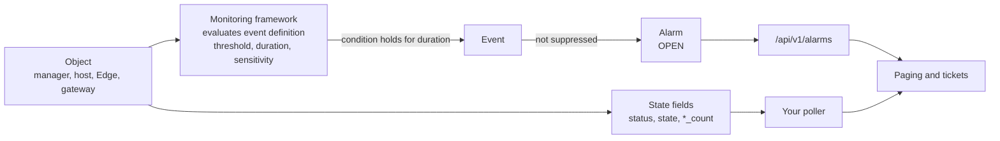

# NSX availability metrics and events

Availability metrics tell you whether an object is **reachable and in a working state**. NSX signals this in two ways:

1. **State fields** you poll: `status`, `state`, connection statuses, and counts of objects up, down or degraded.
2. **Events** the monitoring framework raises when a condition holds for a set time. Examples: a manager node unreachable, an Edge datapath thread deadlocked. Events become alarms, which you can page on.

Use the events for paging. Use the state fields to see the picture behind an alarm, and to measure availability over time.

- Companion guides: [Formulas](NSX-Metrics-Formulas.md) · [Contention](NSX-Contention-Metrics.md) · [Consumption](NSX-Consumption-Metrics.md) · [Capacity](NSX-Capacity-Metrics.md)
- Lab: `nsxman1`, NSX 9.1.1.0, healthy at the time of the crawl. Crawl 2026-10-19.
- Evidence tags: **[Lab]**, **[Doc]**, **[Derived]**, **[Open]**.

---

## 1. How availability is signalled

Two properties of events matter when you design alerts:

- **Duration.** Many availability events fire only after a condition has held for a set time (for example 3, 5 or 15 minutes). A short outage can be real and still raise no alarm. This is by design: it avoids flapping.
- **Pairs.** Several conditions have two events for the same problem. A **MEDIUM** event fires after a short window. A **CRITICAL** event fires after a long window for the same condition. The five pairs in the lab are listed in section 4.

---

## 2. Open alarms in the lab (2026-10-19)

| Feature | Event type | Severity | Status | Node | Meaning |
|---|---|---|---|---|---|
| logging | `remote_logging_not_configured` | MEDIUM | OPEN | nsxman1 | No remote syslog server is configured. Two records of the same event. |
| ipam | `ip_pool_usage_very_high` | MEDIUM | OPEN | nsxman1 | An IP pool is nearly used up. See [Capacity, 2.4](NSX-Capacity-Metrics.md#24-capacity-gap-ip-pool-usage). |
| capacity | `minimum_capacity_threshold` | MEDIUM | OPEN | nsxman1 | A minimum capacity threshold was breached. The object is not named in the record. |

**What this tells you.** The lab has **no availability alarm open**. All four alarms are configuration or capacity. Every node reports up. This is a useful baseline: when an availability alarm appears, it is new.

---

## 3. State values the lab returns

These are the enumerations the lab actually returns, with counts across all responses ([Lab]). The Broadcom schemas list fewer values for some fields. Those gaps are in the [doubts log](NSX-Open-Questions.md).

| Field | Values in lab | Count | Meaning |
|---|---|---:|---|
| `tunnel_status.status`, `pnic_status.status`, `agent_status.status`, `control_connection_status.status` | `UP` | 24 each | Host component healthy |
| `mgmt_connection_status` | `UP` | 54 | Management channel up |
| `lcp_connectivity_status`, `mpa_connectivity_status` | `UP` | 30 each | Control plane and management-plane agent connected |
| `mpa_connectivity_status_details` | "Client is responding to heartbeats" | 30 | Heartbeat seen |
| `host_node_deployment_status` | `INSTALL_SUCCESSFUL` | 30 | Host prepared |
| `hyperbus_status` | `HEALTHY` | 3 | Container network channel healthy |
| `group_status` | `STABLE` | 11 | Manager service group stable |
| `mgmt_cluster_status`, `control_cluster_status` | `CONNECTED` | 1 each | Manager cluster connected |
| `overall_status` (cluster) | `STABLE`, `GREEN`, `NOT_DEPLOYED`, `NOT_STARTED`, `not_configured` | varies | Mixed vocabulary. Read with the object. |
| `maintenance_mode_state` | `DISABLED` | 6 | Hosts in service |
| `power_state` (VMs) | `VM_RUNNING`, `VM_POWER_STATE_TYPE_VM_RUNNING` | 67 and 5 | VMs running (two spellings of the same state) |
| `registration_status` | `REGISTERED` | 1 | Compute manager registered |
| `overall_backup_status` | `SUCCESS` | 4 | Backups succeeded |
| `state` | `REALIZED`, `SUCCESS`, `ENABLED_AND_LICENSED`, `ACTIVE`, `RUNNING`, `NORMAL`, `NOT_STARTED` | varies | Realization and service state |
| `publish_status` | `UNINITIALIZED` | 2 | Not in Broadcom's 4.2 list (D2) |
| `severity` (alarm) | `CRITICAL`, `HIGH`, `MEDIUM`, `LOW` | — | Alarm severity |
| `severity` (health) | `GREEN`, `ORANGE`, `RED`, `SUSPICIOUS`, `INFO`, `WARNING` | — | Health and capacity colours. **Not the same scale as alarm severity.** |

**Two vocabularies.** Do not compare `severity: RED` with `severity: CRITICAL`. They come from different objects with different rules.

---

## 4. Event semantics

| Pattern | Example | Threshold (lab) | Severity | Reading |
|---|---|---|---|---|
| Manager node unreachable from a transport node, short window | `control_channel_to_manager_node_down` | 180 s (3 min) | MEDIUM | Control channel to a manager node down for 3 min |
| Same, long window | `control_channel_to_manager_node_down_too_long` | 900 s (15 min) | CRITICAL | Same condition, 15 min |
| Management channel to manager, short window | `management_channel_to_manager_node_down` | 300 s (5 min) | MEDIUM | Management channel down for 5 min |
| Same, long window | `management_channel_to_manager_node_down_long` | 900 s (15 min) | CRITICAL | Same condition, 15 min |
| Management channel to transport node, short then long | `management_channel_to_transport_node_down` / `_long` | 300 s / 900 s | MEDIUM / CRITICAL | Management channel on a manager to a transport node, 5 min and 15 min |
| Controller to transport node, short then long | `control_channel_to_transport_node_down` / `_long` | 100 / 100 | MEDIUM / CRITICAL | Unit not stated in the definition ([Open]) |
| Controller to Antrea cluster, short then long | `control_channel_to_antrea_cluster_down` / `_long` | 100 / 100 | MEDIUM / CRITICAL | Same pattern |

**Units.** The duration-based events use seconds. The threshold for each matches the duration in the description: 180 for "3 minutes", 300 for "5 minutes", 900 for "15 minutes" ([Derived] from the lab metadata). The `100` values do not match a duration in their description, so their unit is unknown ([Open]).

**Suppression.** Some events are recorded without raising an alarm. For example `tep_ha_activated` has `suppress_alarm` set, so it appears in the event list but not in `/alarms` ([Lab] metadata).

**Fixed and tunable thresholds.** The definitions carry `is_threshold_fixed`. A fixed threshold is set by NSX. A tunable one may be changed in the event definition ([Derived] from the field name). The event tables in sections 8 and "Resource-threshold events" below show which is which.

---

## 5. Requested examples, mapped to NSX

You asked for two examples: "NSX controller out of sync" and "NSX Edge process hang". Neither name exists as an event in the lab's catalogue of 284 event definitions. This table gives the nearest events and how confident I am in each.

| Requested | Nearest NSX event(s) | Confidence | Notes |
|---|---|---|---|
| **NSX controller out of sync** | `cluster_degraded` (one manager service-group member down, MEDIUM); `cluster_unavailable` (all members down, HIGH) | Medium | Degradation of a manager service group. "Sync" is not in the name. |
| | `control_channel_to_transport_node_down` (controller to a host or Edge, MEDIUM, then CRITICAL) | Medium | The controller cannot reach a transport node. This is the closest to "out of sync" with a host. |
| | `gm_to_lm_synchronization_error` (HIGH) and `lm_to_lm_synchronization_error` (HIGH, after 15 min) | Medium for federated sites | Data sync between sites failed. Applies to Federation only. |
| | State fields: `consolidated_status`, `publish_status`, host `node_status.inventory_sync_paused`, `last_sync_time` | Medium | Poll these for a realization or sync view without an alarm |
| **NSX Edge process hang** | `datapath_thread_deadlocked` (CRITICAL): "Edge node datapath thread is deadlocked." | **High** for a hang in the Edge datapath | This is the closest match to a hang |
| | `edge_agent_down` (MEDIUM): "Edge Agent liveness is down" | **High** for the Edge agent process | Liveness failure |
| | `service_status_unknown` (CRITICAL): "Service's status is abnormal." | Medium | Generic service status |
| | `edge_ha_member_status_down` (CRITICAL): Edge node down in an active/active set | High for an Edge outage | Traffic moves to peers |

If your ticket or NSX UI shows an exact alarm name for either example, send it and I will check the mapping against the catalogue (D12).

---

## 6. Availability by object type

| Object | State fields to poll | Key availability events | Lab status |
|---|---|---|---|
| **NSX Manager cluster** | `/cluster/status` (`overall_status`, `mgmt_cluster_status`, `control_cluster_status`, group status) | `cluster_degraded`, `cluster_unavailable`, `manager_control_channel_down`, `management_channel_to_transport_node_down` | ✓ Observed, all `STABLE`, `CONNECTED` |
| **NSX Manager node** | `/node/status`, `/node/services/*/status` (`runtime_state`, `monitor_runtime_state`, `pids`) | `manager_control_channel_down`, `service_status_down`, `monitoring_framework_unhealthy` | ✓ Observed |
| **ESXi host transport node** | `status`, `tunnel_status`, `pnic_status`, `agent_status`, `control_connection_status`, `mgmt_connection_status` | `control_channel_to_manager_node_down`, `management_channel_to_manager_node_down`, `faulty_tep`, `node_agents_down`, `transport_node_uplink_down`, `lag_member_down`, `hyperbus_manager_connection_down` | ✓ Observed (3 hosts, all UP) |
| **Transport zone** | `up_count`, `down_count`, `degraded_count`, `unknown_count` per zone | Node-level events above | ✓ Observed |
| **Edge node** | Edge status and state endpoints (`edge-transport-nodes/…/status`) | `datapath_thread_deadlocked`, `edge_agent_down`, `edge_ha_member_status_down`, `edge_tunnels_down`, `gre_tunnel_down` | Spec only (no Edge) |
| **Tier-0 and Tier-1 gateway** | Gateway `state`, service-router state, BGP neighbour status, BFD peer status | `bgp_down`, `bfd_down_on_external_interface`, `ospf_neighbor_went_down`, `routing_down`, `tier0_gateway_failover`, `tier1_gateway_failover` | Spec only |
| **Federation (sites)** | `/sites/status`, `/sites/switchover-status` | `gm_to_lm_synchronization_error`, `lm_to_lm_synchronization_error`, `rtep_connectivity_lost`, `gm_to_gm_split_brain` | ✓ Endpoints observed. No events in the lab. |
| **Load balancer** | `detailed-status` (service, pool, virtual server), `lb-service-usage-summary` | `lb_status_down`, `pool_status_down`, `virtual_server_status_down` | Spec only |
| **VPN** | IPsec and L2VPN session status | `ipsec_service_down`, `ipsec_policy_based_tunnel_down`, `l2vpn_session_down` | Spec only |
| **Security services** | IDPS engine, NAPP, malware prevention, SCRX status | `nsx_idps_engine_down`, `security_services_health_degraded`, `service_status_down`, `analyst_api_service_unreachable` | Spec only |
| **Compute manager (vCenter)** | `/fabric/compute-managers/{id}/status` (`connection_status`, `registration_status`, `last_sync_time`) | `compute_manager_lost_connectivity`, `eam_status_down` | ✓ Observed (`REGISTERED`) |
| **Virtual machine** | `power_state` in the inventory | Not an NSX event | ✓ Observed (72 `VM_RUNNING`) |

---

## 7. Availability fields (generated)

Fields in category **Availability** from [`data/nsx-metric-fields.csv`](data/nsx-metric-fields.csv), by object type. Column meanings are in the [contention guide, section 6](NSX-Contention-Metrics.md#6-full-lists-by-object-type).

<!-- BEGIN GENERATED: availability-fields -->

<b>Edge transport node and edge cluster</b> — 215 fields, 27 endpoints

| Field | Type | Endpoints | Lab | Formula | Description |
|---|---|---:|:-:|---|---|
| `member_status[].status` | string | 5 | – | Enumerated state value | Edge node IBGP status |
| `active_sessions` | integer | 3 | – | Enumerated state value | Provides the current number of active traffic sessions matching the NAT rules. |
| `member_status[].established_bgp_sessions` | integer | 3 | – | Enumerated state value | Total number of current established inter-site IBGP sessions. |
| `member_status[].neighbor_status[].connection_state` | string | 3 | – | Enumerated state value | Current state of the BGP session. |
| `overall_status` | string | 3 | – | Enumerated state value | Overall status of all edge nodes IBGP status in the edge cluster. |
| `results[].address_families[].enabled` | boolean | 3 | – | Enumerated state value | Enable this address family |
| `results[].bfd_config.declare_dead_multiple` | integer | 3 | – | Enumerated state value | Number of times a packet is missed before BFD declares the neighbor down. |
| `results[].enable_bfd` | boolean | 3 | – | Enumerated state value | Flag to enable BFD for this BGP Neighbor. Enable this if the neighbor supports BFD as this will lead to faster convergence. |
| `results[].enabled` | boolean | 3 | – | Enumerated state value | Flag to enable this BGP Neighbor |
| `results[].keep_alive_timer` | integer | 3 | – | Timestamp of last change | Frequency (seconds) with which keep alive messages are sent to peers |
| `stats_per_site[].stats_per_tunnel[].tunnel_destination_address` | string | 3 | – | Enumerated state value | Ip address of remote tunnel destination. |
| `stats_per_site[].stats_per_tunnel[].tunnel_source_address` | string | 3 | – | Enumerated state value | Ip address of remote tunnel source. |
| `edge_cluster_status` | string | 2 | – | Enumerated state value | Edge node status |
| `edge_nodes[].neighbor_status[].connection_state` | string | 2 | – | Enumerated state value | Current state of the BGP session. |
| `edge_nodes[].neighbor_status[].established_connection_count` | integer | 2 | – | Count of objects in this state; roll-up status is NSX-computed | Count of connections established |
| `edge_nodes[].neighbor_status[].messages_received` | integer | 2 | – | Enumerated state value | Count of messages received from the neighbor |
| `edge_nodes[].neighbor_status[].messages_sent` | integer | 2 | – | Enumerated state value | Count of messages sent to the neighbor |
| `edge_nodes[].neighbor_status[].time_since_established` | integer | 2 | – | Timestamp of last change | Time(in seconds) since connection was established. |
| `member_status[].neighbor_status[].established_connection_count` | integer | 2 | – | Count of objects in this state; roll-up status is NSX-computed | Count of connections established |
| `member_status[].neighbor_status[].messages_received` | integer | 2 | – | Enumerated state value | Count of messages received from the neighbor |
| `member_status[].neighbor_status[].messages_sent` | integer | 2 | – | Enumerated state value | Count of messages sent to the neighbor |
| `member_status[].neighbor_status[].time_since_established` | integer | 2 | – | Timestamp of last change | Time(in seconds) since connection was established. |
| `member_status[].peer_node_status[].status` | string | 2 | – | Enumerated state value | If member is not realized yet, status value will be set as "NOT_AVAILABLE". |
| `member_status[].storage_state` | string | 2 | – | Enumerated state value | Storage state of an edge node. |
| `member_status[].vtep_state` | string | 2 | – | Enumerated state value | VTEP state of an edge node. |
| `members[].allocated_services[].high_availability_status` | string | 2 | – | Enumerated state value | Represents the active or the standby state of the service. |
| `members[].allocation_pools[].active_service_count` | integer | 2 | – | Count of objects in this state; roll-up status is NSX-computed | Represents the number of acitve services running on the edge node. |
| `neighbor_status[].connection_state` | string | 2 | – | Enumerated state value | Current state of the BGP session. |
| `neighbor_status[].established_connection_count` | integer | 2 | – | Count of objects in this state; roll-up status is NSX-computed | Count of connections established |
| `neighbor_status[].messages_received` | integer | 2 | – | Enumerated state value | Count of messages received from the neighbor |
| `neighbor_status[].messages_sent` | integer | 2 | – | Enumerated state value | Count of messages sent to the neighbor |
| `neighbor_status[].time_since_established` | integer | 2 | – | Timestamp of last change | Time(in seconds) since connection was established. |
| `agent_status.agents[].components[].status` | string | 1 | – | Enumerated state value | Agent subcomponent status |
| `agent_status.agents[].components[].status_description` | string | 1 | – | Enumerated state value | Describe what makes the status not UP |
| `agent_status.agents[].status` | string | 1 | – | Enumerated state value | Agent status |
| `agent_status.agents[].status_description` | string | 1 | – | Enumerated state value | Describe what makes the status not UP |
| `agent_status.degraded_count` | integer | 1 | – | Count of objects in this state; roll-up status is NSX-computed | Degraded count |
| `agent_status.down_count` | integer | 1 | – | Count of objects in this state; roll-up status is NSX-computed | Down count |
| `agent_status.smartnic_agents[].statuses[].status` | string | 1 | – | Enumerated state value | Agent status |
| `agent_status.smartnic_agents[].statuses[].status_description` | string | 1 | – | Enumerated state value | Describe what makes the status not UP |
| `agent_status.status` | string | 1 | – | Enumerated state value | Roll-up agent status |
| `agent_status.up_count` | integer | 1 | – | Count of objects in this state; roll-up status is NSX-computed | Up count |
| `consolidated_status` | string | 1 | – | Enumerated state value | Current Realization Status of Cluster |
| `control_connection_status.degraded_count` | integer | 1 | – | Count of objects in this state; roll-up status is NSX-computed | Degraded count |
| `control_connection_status.down_count` | integer | 1 | – | Count of objects in this state; roll-up status is NSX-computed | Down count |
| `control_connection_status.down_pnics[].bond_pnics[].status` | string | 1 | – | Enumerated state value | Status of pNIC/bond |
| `control_connection_status.down_pnics[].status` | string | 1 | – | Enumerated state value | Status of pNIC/bond |
| `control_connection_status.status` | string | 1 | – | Enumerated state value | Roll-up status |
| `control_connection_status.status_description` | string | 1 | – | Enumerated state value | Describe what makes the status not UP |
| `control_connection_status.up_count` | integer | 1 | – | Count of objects in this state; roll-up status is NSX-computed | Up count |
| `details[].configuration_state.consolidated_status` | string | 1 | – | Enumerated state value | Current Realization Status of Member |
| `details[].configuration_state.failure_details[].state` | string | 1 | – | Enumerated state value | State of configuration on this sub system |
| `details[].configuration_state.progress_state.progress` | integer | 1 | – | Enumerated state value | Percentage of deployment completed |
| `details[].state` | string | 1 | – | Enumerated state value | This field indicates the publish state of the node. The state could be unknown if the member has not yet been realized. |
| `edge_tn_state.consolidated_status` | string | 1 | – | Enumerated state value | Overall state of edge tn state |
| `edge_tn_state.deployment_state.details[].state` | string | 1 | – | Enumerated state value | State of configuration on this sub system |
| `edge_tn_state.deployment_state.state` | string | 1 | – | Enumerated state value | Gives details of state of desired configuration. Additional enums with more details on progress/success/error states are sent for edge node… |
| `edge_tn_state.details[].state` | string | 1 | – | Enumerated state value | State of configuration on this sub system |
| `edge_tn_state.progress_state.progress` | integer | 1 | – | Enumerated state value | Percentage of deployment completed |
| `edge_tn_state.state` | string | 1 | – | Enumerated state value | Gives details of state of desired configuration. Additional enums with more details on progress/success/error states are sent for edge node… |
| `edge_tn_state.transport_node_state.details[].state` | string | 1 | – | Enumerated state value | State of configuration on this sub system |
| `edge_tn_state.transport_node_state.state` | string | 1 | – | Enumerated state value | Gives details of state of desired configuration. Additional enums with more details on progress/success/error states are sent for edge node… |
| `evpn_tunnel_status.bfd_diagnostic.administratively_down_count` | integer | 1 | – | Count of objects in this state; roll-up status is NSX-computed | Number of tunnels with administratively down diagnostic message |
| `evpn_tunnel_status.bfd_diagnostic.concatenated_path_down_count` | integer | 1 | – | Count of objects in this state; roll-up status is NSX-computed | Number of tunnels with concatenated path down diagnostic message |
| `evpn_tunnel_status.bfd_diagnostic.control_detection_time_expired_count` | integer | 1 | – | Count of objects in this state; roll-up status is NSX-computed | Number of tunnels with control detection time expired diagnostic message |
| `evpn_tunnel_status.bfd_diagnostic.forwarding_plane_reset_count` | integer | 1 | – | Count of objects in this state; roll-up status is NSX-computed | Number of tunnels with forwarding plane reset diagnostic message |
| `evpn_tunnel_status.bfd_diagnostic.neighbor_signaled_session_down_count` | integer | 1 | – | Count of objects in this state; roll-up status is NSX-computed | Number of tunnels neighbor signaled session down |
| `evpn_tunnel_status.bfd_diagnostic.no_diagnostic_count` | integer | 1 | – | Count of objects in this state; roll-up status is NSX-computed | Number of tunnels with no diagnostic |
| `evpn_tunnel_status.bfd_diagnostic.path_down_count` | integer | 1 | – | Count of objects in this state; roll-up status is NSX-computed | Number of tunnels with path down diagnostic message |
| `evpn_tunnel_status.bfd_diagnostic.reverse_concatenated_path_down_count` | integer | 1 | – | Count of objects in this state; roll-up status is NSX-computed | Number of tunnels with reverse concatenated path down diagnostic message |
| `evpn_tunnel_status.bfd_status.bfd_admin_down_count` | integer | 1 | – | Count of objects in this state; roll-up status is NSX-computed | Number of tunnels in BFD admin down state |
| `evpn_tunnel_status.bfd_status.bfd_down_count` | integer | 1 | – | Count of objects in this state; roll-up status is NSX-computed | Number of tunnels in BFD down state |
| `evpn_tunnel_status.bfd_status.bfd_init_count` | integer | 1 | – | Count of objects in this state; roll-up status is NSX-computed | Number of tunnels in BFD init state |
| `evpn_tunnel_status.bfd_status.bfd_up_count` | integer | 1 | – | Count of objects in this state; roll-up status is NSX-computed | Number of tunnels in BFD up state |
| `evpn_tunnel_status.degraded_count` | integer | 1 | – | Count of objects in this state; roll-up status is NSX-computed | Degraded count |
| `evpn_tunnel_status.down_count` | integer | 1 | – | Count of objects in this state; roll-up status is NSX-computed | Down count |
| `evpn_tunnel_status.down_pnics[].bond_pnics[].status` | string | 1 | – | Enumerated state value | Status of pNIC/bond |
| `evpn_tunnel_status.down_pnics[].status` | string | 1 | – | Enumerated state value | Status of pNIC/bond |
| `evpn_tunnel_status.status` | string | 1 | – | Enumerated state value | Roll-up status |
| `evpn_tunnel_status.status_description` | string | 1 | – | Enumerated state value | Describe what makes the status not UP |
| `evpn_tunnel_status.up_count` | integer | 1 | – | Count of objects in this state; roll-up status is NSX-computed | Up count |
| `high_availability_status` | string | 1 | – | Enumerated state value | High Availability status of the edge node. |
| `inter_site_forwarder_status[].high_availability_status` | string | 1 | – | Enumerated state value | High Availability status of a service router on the edge node. |
| `last_aggsvc_heartbeat` | integer | 1 | – | Enumerated state value | Timestamp of the last agg-service heartbeat, in epoch milliseconds. |
| `maintenance_mode_state` | string | 1 | – | Enumerated state value | Realized Maintenance Mode State |
| `mgmt_connection_status` | string | 1 | – | Enumerated state value | Management connection status |
| `node_status.host_node_deployment_status` | string | 1 | – | Enumerated state value | This enum specifies the current nsx install state for host node or current deployment and ready state for edge node. The ready status 'NODE… |
| `node_status.inventory_sync_paused` | boolean | 1 | – | Enumerated state value | Is true if inventory sync is paused else false |
| `node_status.lcp_connectivity_status` | string | 1 | – | Enumerated state value | Indicates the fabric node's LCP&lt;-&gt;CCP channel connectivity status, UP, DOWN, DEGRADED, UNKNOWN. |
| `node_status.lcp_connectivity_status_details[].failure_status` | string | 1 | – | Enumerated state value | Failure status of the control Node for e.g CONNECTION_REFUSED,INCOMPLETE_HOST_CERT. |
| `node_status.lcp_connectivity_status_details[].status` | string | 1 | – | Enumerated state value | Status of the control Node for e.g  UP, DOWN. |
| `node_status.mpa_connectivity_status` | string | 1 | – | Enumerated state value | Indicates the fabric node's MP&lt;-&gt;MPA channel connectivity status, UP, DOWN, UNKNOWN. |
| `node_status.mpa_connectivity_status_details` | string | 1 | – | Enumerated state value | Details, if any, about the current MP&lt;-&gt;MPA channel connectivity status of the fabric node. |
| `node_status.system_status.dfw_heap_memory_usage[].peak_ever` | number | 1 | – | Enumerated state value | Number of times peak threshold reached for specific heap. |
| `pnic_status.degraded_count` | integer | 1 | – | Count of objects in this state; roll-up status is NSX-computed | Degraded count |
| `pnic_status.down_count` | integer | 1 | – | Count of objects in this state; roll-up status is NSX-computed | Down count |
| `pnic_status.down_pnics[].bond_pnics[].status` | string | 1 | – | Enumerated state value | Status of pNIC/bond |
| `pnic_status.down_pnics[].status` | string | 1 | – | Enumerated state value | Status of pNIC/bond |
| `pnic_status.status` | string | 1 | – | Enumerated state value | Roll-up status |
| `pnic_status.status_description` | string | 1 | – | Enumerated state value | Describe what makes the status not UP |
| `pnic_status.up_count` | integer | 1 | – | Count of objects in this state; roll-up status is NSX-computed | Up count |
| `results[].agent_status.agents[].status` | string | 1 | – | Enumerated state value | Agent status |
| `results[].agent_status.agents[].status_description` | string | 1 | – | Enumerated state value | Describe what makes the status not UP |
| `results[].agent_status.degraded_count` | integer | 1 | – | Count of objects in this state; roll-up status is NSX-computed | Degraded count |
| `results[].agent_status.down_count` | integer | 1 | – | Count of objects in this state; roll-up status is NSX-computed | Down count |
| `results[].agent_status.status` | string | 1 | – | Enumerated state value | Roll-up agent status |
| `results[].agent_status.up_count` | integer | 1 | – | Count of objects in this state; roll-up status is NSX-computed | Up count |
| `results[].control_connection_status.degraded_count` | integer | 1 | – | Count of objects in this state; roll-up status is NSX-computed | Degraded count |
| `results[].control_connection_status.down_count` | integer | 1 | – | Count of objects in this state; roll-up status is NSX-computed | Down count |
| `results[].control_connection_status.down_pnics[].status` | string | 1 | – | Enumerated state value | Status of pNIC/bond |
| `results[].control_connection_status.status` | string | 1 | – | Enumerated state value | Roll-up status |
| `results[].control_connection_status.status_description` | string | 1 | – | Enumerated state value | Describe what makes the status not UP |
| `results[].control_connection_status.up_count` | integer | 1 | – | Count of objects in this state; roll-up status is NSX-computed | Up count |
| `results[].edge_tn_state.consolidated_status` | string | 1 | – | Enumerated state value | Overall state of edge tn state |
| `results[].edge_tn_state.deployment_state.state` | string | 1 | – | Enumerated state value | Gives details of state of desired configuration. Additional enums with more details on progress/success/error states are sent for edge node… |
| `results[].edge_tn_state.details[].state` | string | 1 | – | Enumerated state value | State of configuration on this sub system |
| `results[].edge_tn_state.progress_state.progress` | integer | 1 | – | Enumerated state value | Percentage of deployment completed |
| `results[].edge_tn_state.state` | string | 1 | – | Enumerated state value | Gives details of state of desired configuration. Additional enums with more details on progress/success/error states are sent for edge node… |
| `results[].edge_tn_state.transport_node_state.state` | string | 1 | – | Enumerated state value | Gives details of state of desired configuration. Additional enums with more details on progress/success/error states are sent for edge node… |
| `results[].evpn_tunnel_status.bfd_diagnostic.administratively_down_count` | integer | 1 | – | Count of objects in this state; roll-up status is NSX-computed | Number of tunnels with administratively down diagnostic message |
| `results[].evpn_tunnel_status.bfd_diagnostic.concatenated_path_down_count` | integer | 1 | – | Count of objects in this state; roll-up status is NSX-computed | Number of tunnels with concatenated path down diagnostic message |
| `results[].evpn_tunnel_status.bfd_diagnostic.control_detection_time_expired_count` | integer | 1 | – | Count of objects in this state; roll-up status is NSX-computed | Number of tunnels with control detection time expired diagnostic message |
| `results[].evpn_tunnel_status.bfd_diagnostic.forwarding_plane_reset_count` | integer | 1 | – | Count of objects in this state; roll-up status is NSX-computed | Number of tunnels with forwarding plane reset diagnostic message |
| `results[].evpn_tunnel_status.bfd_diagnostic.neighbor_signaled_session_down_count` | integer | 1 | – | Count of objects in this state; roll-up status is NSX-computed | Number of tunnels neighbor signaled session down |
| `results[].evpn_tunnel_status.bfd_diagnostic.no_diagnostic_count` | integer | 1 | – | Count of objects in this state; roll-up status is NSX-computed | Number of tunnels with no diagnostic |
| `results[].evpn_tunnel_status.bfd_diagnostic.path_down_count` | integer | 1 | – | Count of objects in this state; roll-up status is NSX-computed | Number of tunnels with path down diagnostic message |
| `results[].evpn_tunnel_status.bfd_diagnostic.reverse_concatenated_path_down_count` | integer | 1 | – | Count of objects in this state; roll-up status is NSX-computed | Number of tunnels with reverse concatenated path down diagnostic message |
| `results[].evpn_tunnel_status.bfd_status.bfd_admin_down_count` | integer | 1 | – | Count of objects in this state; roll-up status is NSX-computed | Number of tunnels in BFD admin down state |
| `results[].evpn_tunnel_status.bfd_status.bfd_down_count` | integer | 1 | – | Count of objects in this state; roll-up status is NSX-computed | Number of tunnels in BFD down state |
| `results[].evpn_tunnel_status.bfd_status.bfd_init_count` | integer | 1 | – | Count of objects in this state; roll-up status is NSX-computed | Number of tunnels in BFD init state |
| `results[].evpn_tunnel_status.bfd_status.bfd_up_count` | integer | 1 | – | Count of objects in this state; roll-up status is NSX-computed | Number of tunnels in BFD up state |
| `results[].evpn_tunnel_status.degraded_count` | integer | 1 | – | Count of objects in this state; roll-up status is NSX-computed | Degraded count |
| `results[].evpn_tunnel_status.down_count` | integer | 1 | – | Count of objects in this state; roll-up status is NSX-computed | Down count |
| `results[].evpn_tunnel_status.down_pnics[].status` | string | 1 | – | Enumerated state value | Status of pNIC/bond |
| `results[].evpn_tunnel_status.status` | string | 1 | – | Enumerated state value | Roll-up status |
| `results[].evpn_tunnel_status.status_description` | string | 1 | – | Enumerated state value | Describe what makes the status not UP |
| `results[].evpn_tunnel_status.up_count` | integer | 1 | – | Count of objects in this state; roll-up status is NSX-computed | Up count |
| `results[].high_availability_status` | string | 1 | – | Enumerated state value | High Availability status of the edge node. |
| `results[].last_aggsvc_heartbeat` | integer | 1 | – | Enumerated state value | Timestamp of the last agg-service heartbeat, in epoch milliseconds. |
| `results[].maintenance_mode_state` | string | 1 | – | Enumerated state value | Realized Maintenance Mode State |
| `results[].mgmt_connection_status` | string | 1 | – | Enumerated state value | Management connection status |
| `results[].neighbors[].link_aggregation_status` | boolean | 1 | – | Enumerated state value | True if currently in aggregation |
| `results[].node_status.host_node_deployment_status` | string | 1 | – | Enumerated state value | This enum specifies the current nsx install state for host node or current deployment and ready state for edge node. The ready status 'NODE… |
| `results[].node_status.inventory_sync_paused` | boolean | 1 | – | Enumerated state value | Is true if inventory sync is paused else false |
| `results[].node_status.lcp_connectivity_status` | string | 1 | – | Enumerated state value | Indicates the fabric node's LCP&lt;-&gt;CCP channel connectivity status, UP, DOWN, DEGRADED, UNKNOWN. |
| `results[].node_status.lcp_connectivity_status_details[].failure_status` | string | 1 | – | Enumerated state value | Failure status of the control Node for e.g CONNECTION_REFUSED,INCOMPLETE_HOST_CERT. |
| `results[].node_status.lcp_connectivity_status_details[].status` | string | 1 | – | Enumerated state value | Status of the control Node for e.g  UP, DOWN. |
| `results[].node_status.mpa_connectivity_status` | string | 1 | – | Enumerated state value | Indicates the fabric node's MP&lt;-&gt;MPA channel connectivity status, UP, DOWN, UNKNOWN. |
| `results[].node_status.mpa_connectivity_status_details` | string | 1 | – | Enumerated state value | Details, if any, about the current MP&lt;-&gt;MPA channel connectivity status of the fabric node. |
| `results[].pnic_status.degraded_count` | integer | 1 | – | Count of objects in this state; roll-up status is NSX-computed | Degraded count |
| `results[].pnic_status.down_count` | integer | 1 | – | Count of objects in this state; roll-up status is NSX-computed | Down count |
| `results[].pnic_status.down_pnics[].status` | string | 1 | – | Enumerated state value | Status of pNIC/bond |
| `results[].pnic_status.status` | string | 1 | – | Enumerated state value | Roll-up status |
| `results[].pnic_status.status_description` | string | 1 | – | Enumerated state value | Describe what makes the status not UP |
| `results[].pnic_status.up_count` | integer | 1 | – | Count of objects in this state; roll-up status is NSX-computed | Up count |
| `results[].status` | string | 1 | – | Enumerated state value | Roll-up status of pNIC, management connection, control connection, tunnel status, agent status |
| `results[].status_description` | string | 1 | – | Enumerated state value | Describe what makes the status not UP |
| `results[].storage_state` | string | 1 | – | Enumerated state value | Edge node storage state. |
| `results[].threat_status.status` | string | 1 | – | Enumerated state value | Transport node threat status |
| `results[].tier_0s[].bgp_neighbors_down_count` | integer | 1 | – | Count of objects in this state; roll-up status is NSX-computed | The DOWN count of BGP neighbors. |
| `results[].tier_0s[].bgp_neighbors_up_count` | integer | 1 | – | Count of objects in this state; roll-up status is NSX-computed | The UP count of BGP neighbors. |
| `results[].tier_0s[].high_availability_status` | string | 1 | – | Enumerated state value | High Availability status of a service router on the edge node. |
| `results[].tier_0s[].ospf_neighbors_down_count` | integer | 1 | – | Count of objects in this state; roll-up status is NSX-computed | The DOWN count of OSPF neighbors. |
| `results[].tier_0s[].ospf_neighbors_up_count` | integer | 1 | – | Count of objects in this state; roll-up status is NSX-computed | The UP count of OSPF neighbors. |
| `results[].tier_0s[].routing_status` | string | 1 | – | Enumerated state value | Routing status of tier0. |
| `results[].tunnel_status.bfd_diagnostic.administratively_down_count` | integer | 1 | – | Count of objects in this state; roll-up status is NSX-computed | Number of tunnels with administratively down diagnostic message |
| `results[].tunnel_status.bfd_diagnostic.concatenated_path_down_count` | integer | 1 | – | Count of objects in this state; roll-up status is NSX-computed | Number of tunnels with concatenated path down diagnostic message |
| `results[].tunnel_status.bfd_diagnostic.control_detection_time_expired_count` | integer | 1 | – | Count of objects in this state; roll-up status is NSX-computed | Number of tunnels with control detection time expired diagnostic message |
| `results[].tunnel_status.bfd_diagnostic.forwarding_plane_reset_count` | integer | 1 | – | Count of objects in this state; roll-up status is NSX-computed | Number of tunnels with forwarding plane reset diagnostic message |
| `results[].tunnel_status.bfd_diagnostic.neighbor_signaled_session_down_count` | integer | 1 | – | Count of objects in this state; roll-up status is NSX-computed | Number of tunnels neighbor signaled session down |
| `results[].tunnel_status.bfd_diagnostic.no_diagnostic_count` | integer | 1 | – | Count of objects in this state; roll-up status is NSX-computed | Number of tunnels with no diagnostic |
| `results[].tunnel_status.bfd_diagnostic.path_down_count` | integer | 1 | – | Count of objects in this state; roll-up status is NSX-computed | Number of tunnels with path down diagnostic message |
| `results[].tunnel_status.bfd_diagnostic.reverse_concatenated_path_down_count` | integer | 1 | – | Count of objects in this state; roll-up status is NSX-computed | Number of tunnels with reverse concatenated path down diagnostic message |
| `results[].tunnel_status.bfd_status.bfd_admin_down_count` | integer | 1 | – | Count of objects in this state; roll-up status is NSX-computed | Number of tunnels in BFD admin down state |
| `results[].tunnel_status.bfd_status.bfd_down_count` | integer | 1 | – | Count of objects in this state; roll-up status is NSX-computed | Number of tunnels in BFD down state |
| `results[].tunnel_status.bfd_status.bfd_init_count` | integer | 1 | – | Count of objects in this state; roll-up status is NSX-computed | Number of tunnels in BFD init state |
| `results[].tunnel_status.bfd_status.bfd_up_count` | integer | 1 | – | Count of objects in this state; roll-up status is NSX-computed | Number of tunnels in BFD up state |
| `results[].tunnel_status.degraded_count` | integer | 1 | – | Count of objects in this state; roll-up status is NSX-computed | Degraded count |
| `results[].tunnel_status.down_count` | integer | 1 | – | Count of objects in this state; roll-up status is NSX-computed | Down count |
| `results[].tunnel_status.down_pnics[].status` | string | 1 | – | Enumerated state value | Status of pNIC/bond |
| `results[].tunnel_status.status` | string | 1 | – | Enumerated state value | Roll-up status |
| `results[].tunnel_status.status_description` | string | 1 | – | Enumerated state value | Describe what makes the status not UP |
| `results[].tunnel_status.up_count` | integer | 1 | – | Count of objects in this state; roll-up status is NSX-computed | Up count |
| `results[].vtep_state` | string | 1 | – | Enumerated state value | Edge node VTEP state. |
| `state` | string | 1 | – | Enumerated state value | Gives details of state of publish state configuration. "in_sync" state indicates that the edge config has been published. |
| `status` | string | 1 | – | Enumerated state value | Roll-up status of pNIC, management connection, control connection, tunnel status, agent status |
| `status_description` | string | 1 | – | Enumerated state value | Describe what makes the status not UP |
| `storage_state` | string | 1 | – | Enumerated state value | Edge node storage state. |
| `threat_status.status` | string | 1 | – | Enumerated state value | Transport node threat status |
| `tier_0s[].bgp_neighbors_down_count` | integer | 1 | – | Count of objects in this state; roll-up status is NSX-computed | The DOWN count of BGP neighbors. |
| `tier_0s[].bgp_neighbors_up_count` | integer | 1 | – | Count of objects in this state; roll-up status is NSX-computed | The UP count of BGP neighbors. |
| `tier_0s[].high_availability_status` | string | 1 | – | Enumerated state value | High Availability status of a service router on the edge node. |
| `tier_0s[].ospf_neighbors_down_count` | integer | 1 | – | Count of objects in this state; roll-up status is NSX-computed | The DOWN count of OSPF neighbors. |
| `tier_0s[].ospf_neighbors_up_count` | integer | 1 | – | Count of objects in this state; roll-up status is NSX-computed | The UP count of OSPF neighbors. |
| `tier_0s[].routing_status` | string | 1 | – | Enumerated state value | Routing status of tier0. |
| `tunnel_status.bfd_diagnostic.administratively_down_count` | integer | 1 | – | Count of objects in this state; roll-up status is NSX-computed | Number of tunnels with administratively down diagnostic message |
| `tunnel_status.bfd_diagnostic.concatenated_path_down_count` | integer | 1 | – | Count of objects in this state; roll-up status is NSX-computed | Number of tunnels with concatenated path down diagnostic message |
| `tunnel_status.bfd_diagnostic.control_detection_time_expired_count` | integer | 1 | – | Count of objects in this state; roll-up status is NSX-computed | Number of tunnels with control detection time expired diagnostic message |
| `tunnel_status.bfd_diagnostic.forwarding_plane_reset_count` | integer | 1 | – | Count of objects in this state; roll-up status is NSX-computed | Number of tunnels with forwarding plane reset diagnostic message |
| `tunnel_status.bfd_diagnostic.neighbor_signaled_session_down_count` | integer | 1 | – | Count of objects in this state; roll-up status is NSX-computed | Number of tunnels neighbor signaled session down |
| `tunnel_status.bfd_diagnostic.no_diagnostic_count` | integer | 1 | – | Count of objects in this state; roll-up status is NSX-computed | Number of tunnels with no diagnostic |
| `tunnel_status.bfd_diagnostic.path_down_count` | integer | 1 | – | Count of objects in this state; roll-up status is NSX-computed | Number of tunnels with path down diagnostic message |
| `tunnel_status.bfd_diagnostic.reverse_concatenated_path_down_count` | integer | 1 | – | Count of objects in this state; roll-up status is NSX-computed | Number of tunnels with reverse concatenated path down diagnostic message |
| `tunnel_status.bfd_status.bfd_admin_down_count` | integer | 1 | – | Count of objects in this state; roll-up status is NSX-computed | Number of tunnels in BFD admin down state |
| `tunnel_status.bfd_status.bfd_down_count` | integer | 1 | – | Count of objects in this state; roll-up status is NSX-computed | Number of tunnels in BFD down state |
| `tunnel_status.bfd_status.bfd_init_count` | integer | 1 | – | Count of objects in this state; roll-up status is NSX-computed | Number of tunnels in BFD init state |
| `tunnel_status.bfd_status.bfd_up_count` | integer | 1 | – | Count of objects in this state; roll-up status is NSX-computed | Number of tunnels in BFD up state |
| `tunnel_status.degraded_count` | integer | 1 | – | Count of objects in this state; roll-up status is NSX-computed | Degraded count |
| `tunnel_status.down_count` | integer | 1 | – | Count of objects in this state; roll-up status is NSX-computed | Down count |
| `tunnel_status.down_pnics[].bond_pnics[].status` | string | 1 | – | Enumerated state value | Status of pNIC/bond |
| `tunnel_status.down_pnics[].status` | string | 1 | – | Enumerated state value | Status of pNIC/bond |
| `tunnel_status.status` | string | 1 | – | Enumerated state value | Roll-up status |
| `tunnel_status.status_description` | string | 1 | – | Enumerated state value | Describe what makes the status not UP |
| `tunnel_status.up_count` | integer | 1 | – | Count of objects in this state; roll-up status is NSX-computed | Up count |
| `vtep_state` | string | 1 | – | Enumerated state value | Edge node VTEP state. |

<b>Transport node (ESXi host or Edge)</b> — 197 fields, 44 endpoints

| Field | Type | Endpoints | Lab | Formula | Description |
|---|---|---:|:-:|---|---|
| `health` | string | 21 | – | Enumerated state value | Service health in addition to runtime_state |
| `monitor_runtime_state` | string | 21 | – | Timestamp of last change | Service monitor runtime state |
| `runtime_state` | string | 21 | – | Timestamp of last change | Service runtime state |
| `results[].status` | string | 6 | ✓ | Enumerated state value | Status of pNIC/bond |
| `results[].agent_status.agents[].status` | string | 3 | ✓ | Enumerated state value | Agent status |
| `results[].agent_status.agents[].status_description` | string | 3 | – | Enumerated state value | Describe what makes the status not UP |
| `results[].agent_status.degraded_count` | integer | 3 | ✓ | Count of objects in this state; roll-up status is NSX-computed | Degraded count |
| `results[].agent_status.down_count` | integer | 3 | ✓ | Count of objects in this state; roll-up status is NSX-computed | Down count |
| `results[].agent_status.status` | string | 3 | ✓ | Enumerated state value | Roll-up agent status |
| `results[].agent_status.up_count` | integer | 3 | ✓ | Count of objects in this state; roll-up status is NSX-computed | Up count |
| `results[].control_connection_status.degraded_count` | integer | 3 | ✓ | Count of objects in this state; roll-up status is NSX-computed | Degraded count |
| `results[].control_connection_status.down_count` | integer | 3 | ✓ | Count of objects in this state; roll-up status is NSX-computed | Down count |
| `results[].control_connection_status.down_pnics[].status` | string | 3 | – | Enumerated state value | Status of pNIC/bond |
| `results[].control_connection_status.status` | string | 3 | ✓ | Enumerated state value | Roll-up status |
| `results[].control_connection_status.status_description` | string | 3 | – | Enumerated state value | Describe what makes the status not UP |
| `results[].control_connection_status.up_count` | integer | 3 | ✓ | Count of objects in this state; roll-up status is NSX-computed | Up count |
| `results[].evpn_tunnel_status.bfd_diagnostic.administratively_down_count` | integer | 3 | ✓ | Count of objects in this state; roll-up status is NSX-computed | Number of tunnels with administratively down diagnostic message |
| `results[].evpn_tunnel_status.bfd_diagnostic.concatenated_path_down_count` | integer | 3 | ✓ | Count of objects in this state; roll-up status is NSX-computed | Number of tunnels with concatenated path down diagnostic message |
| `results[].evpn_tunnel_status.bfd_diagnostic.control_detection_time_expired_count` | integer | 3 | ✓ | Count of objects in this state; roll-up status is NSX-computed | Number of tunnels with control detection time expired diagnostic message |
| `results[].evpn_tunnel_status.bfd_diagnostic.forwarding_plane_reset_count` | integer | 3 | ✓ | Count of objects in this state; roll-up status is NSX-computed | Number of tunnels with forwarding plane reset diagnostic message |
| `results[].evpn_tunnel_status.bfd_diagnostic.neighbor_signaled_session_down_count` | integer | 3 | ✓ | Count of objects in this state; roll-up status is NSX-computed | Number of tunnels neighbor signaled session down |
| `results[].evpn_tunnel_status.bfd_diagnostic.no_diagnostic_count` | integer | 3 | ✓ | Count of objects in this state; roll-up status is NSX-computed | Number of tunnels with no diagnostic |
| `results[].evpn_tunnel_status.bfd_diagnostic.path_down_count` | integer | 3 | ✓ | Count of objects in this state; roll-up status is NSX-computed | Number of tunnels with path down diagnostic message |
| `results[].evpn_tunnel_status.bfd_diagnostic.reverse_concatenated_path_down_count` | integer | 3 | ✓ | Count of objects in this state; roll-up status is NSX-computed | Number of tunnels with reverse concatenated path down diagnostic message |
| `results[].evpn_tunnel_status.bfd_status.bfd_admin_down_count` | integer | 3 | ✓ | Count of objects in this state; roll-up status is NSX-computed | Number of tunnels in BFD admin down state |
| `results[].evpn_tunnel_status.bfd_status.bfd_down_count` | integer | 3 | ✓ | Count of objects in this state; roll-up status is NSX-computed | Number of tunnels in BFD down state |
| `results[].evpn_tunnel_status.bfd_status.bfd_init_count` | integer | 3 | ✓ | Count of objects in this state; roll-up status is NSX-computed | Number of tunnels in BFD init state |
| `results[].evpn_tunnel_status.bfd_status.bfd_up_count` | integer | 3 | ✓ | Count of objects in this state; roll-up status is NSX-computed | Number of tunnels in BFD up state |
| `results[].evpn_tunnel_status.degraded_count` | integer | 3 | – | Count of objects in this state; roll-up status is NSX-computed | Degraded count |
| `results[].evpn_tunnel_status.down_count` | integer | 3 | ✓ | Count of objects in this state; roll-up status is NSX-computed | Down count |
| `results[].evpn_tunnel_status.down_pnics[].status` | string | 3 | – | Enumerated state value | Status of pNIC/bond |
| `results[].evpn_tunnel_status.status` | string | 3 | ✓ | Enumerated state value | Roll-up status |
| `results[].evpn_tunnel_status.status_description` | string | 3 | – | Enumerated state value | Describe what makes the status not UP |
| `results[].evpn_tunnel_status.up_count` | integer | 3 | ✓ | Count of objects in this state; roll-up status is NSX-computed | Up count |
| `results[].high_availability_status` | string | 3 | – | Enumerated state value | High Availability status of the edge node. |
| `results[].last_aggsvc_heartbeat` | integer | 3 | ✓ | Enumerated state value | Timestamp of the last agg-service heartbeat, in epoch milliseconds. |
| `results[].mgmt_connection_status` | string | 3 | ✓ | Enumerated state value | Management connection status |
| `results[].node_status.host_node_deployment_status` | string | 3 | ✓ | Enumerated state value | This enum specifies the current nsx install state for host node or current deployment and ready state for edge node. The ready status 'NODE… |
| `results[].node_status.inventory_sync_paused` | boolean | 3 | ✓ | Enumerated state value | Is true if inventory sync is paused else false |
| `results[].node_status.lcp_connectivity_status` | string | 3 | ✓ | Enumerated state value | Indicates the fabric node's LCP&lt;-&gt;CCP channel connectivity status, UP, DOWN, DEGRADED, UNKNOWN. |
| `results[].node_status.lcp_connectivity_status_details[].failure_status` | string | 3 | – | Enumerated state value | Failure status of the control Node for e.g CONNECTION_REFUSED,INCOMPLETE_HOST_CERT. |
| `results[].node_status.lcp_connectivity_status_details[].status` | string | 3 | ✓ | Enumerated state value | Status of the control Node for e.g  UP, DOWN. |
| `results[].node_status.mpa_connectivity_status` | string | 3 | ✓ | Enumerated state value | Indicates the fabric node's MP&lt;-&gt;MPA channel connectivity status, UP, DOWN, UNKNOWN. |
| `results[].node_status.mpa_connectivity_status_details` | string | 3 | ✓ | Enumerated state value | Details, if any, about the current MP&lt;-&gt;MPA channel connectivity status of the fabric node. |
| `results[].pnic_status.degraded_count` | integer | 3 | ✓ | Count of objects in this state; roll-up status is NSX-computed | Degraded count |
| `results[].pnic_status.down_count` | integer | 3 | ✓ | Count of objects in this state; roll-up status is NSX-computed | Down count |
| `results[].pnic_status.down_pnics[].status` | string | 3 | – | Enumerated state value | Status of pNIC/bond |
| `results[].pnic_status.status` | string | 3 | ✓ | Enumerated state value | Roll-up status |
| `results[].pnic_status.status_description` | string | 3 | – | Enumerated state value | Describe what makes the status not UP |
| `results[].pnic_status.up_count` | integer | 3 | ✓ | Count of objects in this state; roll-up status is NSX-computed | Up count |
| `results[].status_description` | string | 3 | – | Enumerated state value | Describe what makes the status not UP |
| `results[].storage_state` | string | 3 | – | Enumerated state value | Edge node storage state. |
| `results[].threat_status.status` | string | 3 | – | Enumerated state value | Transport node threat status |
| `results[].tier_0s[].bgp_neighbors_down_count` | integer | 3 | – | Count of objects in this state; roll-up status is NSX-computed | The DOWN count of BGP neighbors. |
| `results[].tier_0s[].bgp_neighbors_up_count` | integer | 3 | – | Count of objects in this state; roll-up status is NSX-computed | The UP count of BGP neighbors. |
| `results[].tier_0s[].high_availability_status` | string | 3 | – | Enumerated state value | High Availability status of a service router on the edge node. |
| `results[].tier_0s[].ospf_neighbors_down_count` | integer | 3 | – | Count of objects in this state; roll-up status is NSX-computed | The DOWN count of OSPF neighbors. |
| `results[].tier_0s[].ospf_neighbors_up_count` | integer | 3 | – | Count of objects in this state; roll-up status is NSX-computed | The UP count of OSPF neighbors. |
| `results[].tier_0s[].routing_status` | string | 3 | – | Enumerated state value | Routing status of tier0. |
| `results[].tunnel_status.bfd_diagnostic.administratively_down_count` | integer | 3 | ✓ | Count of objects in this state; roll-up status is NSX-computed | Number of tunnels with administratively down diagnostic message |
| `results[].tunnel_status.bfd_diagnostic.concatenated_path_down_count` | integer | 3 | ✓ | Count of objects in this state; roll-up status is NSX-computed | Number of tunnels with concatenated path down diagnostic message |
| `results[].tunnel_status.bfd_diagnostic.control_detection_time_expired_count` | integer | 3 | ✓ | Count of objects in this state; roll-up status is NSX-computed | Number of tunnels with control detection time expired diagnostic message |
| `results[].tunnel_status.bfd_diagnostic.forwarding_plane_reset_count` | integer | 3 | ✓ | Count of objects in this state; roll-up status is NSX-computed | Number of tunnels with forwarding plane reset diagnostic message |
| `results[].tunnel_status.bfd_diagnostic.neighbor_signaled_session_down_count` | integer | 3 | ✓ | Count of objects in this state; roll-up status is NSX-computed | Number of tunnels neighbor signaled session down |
| `results[].tunnel_status.bfd_diagnostic.no_diagnostic_count` | integer | 3 | ✓ | Count of objects in this state; roll-up status is NSX-computed | Number of tunnels with no diagnostic |
| `results[].tunnel_status.bfd_diagnostic.path_down_count` | integer | 3 | ✓ | Count of objects in this state; roll-up status is NSX-computed | Number of tunnels with path down diagnostic message |
| `results[].tunnel_status.bfd_diagnostic.reverse_concatenated_path_down_count` | integer | 3 | ✓ | Count of objects in this state; roll-up status is NSX-computed | Number of tunnels with reverse concatenated path down diagnostic message |
| `results[].tunnel_status.bfd_status.bfd_admin_down_count` | integer | 3 | ✓ | Count of objects in this state; roll-up status is NSX-computed | Number of tunnels in BFD admin down state |
| `results[].tunnel_status.bfd_status.bfd_down_count` | integer | 3 | ✓ | Count of objects in this state; roll-up status is NSX-computed | Number of tunnels in BFD down state |
| `results[].tunnel_status.bfd_status.bfd_init_count` | integer | 3 | ✓ | Count of objects in this state; roll-up status is NSX-computed | Number of tunnels in BFD init state |
| `results[].tunnel_status.bfd_status.bfd_up_count` | integer | 3 | ✓ | Count of objects in this state; roll-up status is NSX-computed | Number of tunnels in BFD up state |
| `results[].tunnel_status.degraded_count` | integer | 3 | – | Count of objects in this state; roll-up status is NSX-computed | Degraded count |
| `results[].tunnel_status.down_count` | integer | 3 | ✓ | Count of objects in this state; roll-up status is NSX-computed | Down count |
| `results[].tunnel_status.down_pnics[].status` | string | 3 | – | Enumerated state value | Status of pNIC/bond |
| `results[].tunnel_status.status` | string | 3 | ✓ | Enumerated state value | Roll-up status |
| `results[].tunnel_status.status_description` | string | 3 | – | Enumerated state value | Describe what makes the status not UP |
| `results[].tunnel_status.up_count` | integer | 3 | ✓ | Count of objects in this state; roll-up status is NSX-computed | Up count |
| `results[].vtep_state` | string | 3 | – | Enumerated state value | Edge node VTEP state. |
| `agent_status.agents[].components[].status` | string | 2 | ✓ | Enumerated state value | Agent subcomponent status |
| `agent_status.agents[].components[].status_description` | string | 2 | – | Enumerated state value | Describe what makes the status not UP |
| `agent_status.agents[].status` | string | 2 | ✓ | Enumerated state value | Agent status |
| `agent_status.agents[].status_description` | string | 2 | – | Enumerated state value | Describe what makes the status not UP |
| `agent_status.degraded_count` | integer | 2 | ✓ | Count of objects in this state; roll-up status is NSX-computed | Degraded count |
| `agent_status.down_count` | integer | 2 | ✓ | Count of objects in this state; roll-up status is NSX-computed | Down count |
| `agent_status.smartnic_agents[].statuses[].status` | string | 2 | – | Enumerated state value | Agent status |
| `agent_status.smartnic_agents[].statuses[].status_description` | string | 2 | – | Enumerated state value | Describe what makes the status not UP |
| `agent_status.status` | string | 2 | ✓ | Enumerated state value | Roll-up agent status |
| `agent_status.up_count` | integer | 2 | ✓ | Count of objects in this state; roll-up status is NSX-computed | Up count |
| `control_connection_status.degraded_count` | integer | 2 | ✓ | Count of objects in this state; roll-up status is NSX-computed | Degraded count |
| `control_connection_status.down_count` | integer | 2 | ✓ | Count of objects in this state; roll-up status is NSX-computed | Down count |
| `control_connection_status.down_pnics[].bond_pnics[].status` | string | 2 | – | Enumerated state value | Status of pNIC/bond |
| `control_connection_status.down_pnics[].status` | string | 2 | – | Enumerated state value | Status of pNIC/bond |
| `control_connection_status.status` | string | 2 | ✓ | Enumerated state value | Roll-up status |
| `control_connection_status.status_description` | string | 2 | – | Enumerated state value | Describe what makes the status not UP |
| `control_connection_status.up_count` | integer | 2 | ✓ | Count of objects in this state; roll-up status is NSX-computed | Up count |
| `degraded_count` | integer | 2 | ✓ | Count of objects in this state; roll-up status is NSX-computed | Number of transport nodes that are degraded |
| `down_count` | integer | 2 | ✓ | Count of objects in this state; roll-up status is NSX-computed | Number of transport nodes that are down |
| `evpn_tunnel_status.bfd_diagnostic.administratively_down_count` | integer | 2 | ✓ | Count of objects in this state; roll-up status is NSX-computed | Number of tunnels with administratively down diagnostic message |
| `evpn_tunnel_status.bfd_diagnostic.concatenated_path_down_count` | integer | 2 | ✓ | Count of objects in this state; roll-up status is NSX-computed | Number of tunnels with concatenated path down diagnostic message |
| `evpn_tunnel_status.bfd_diagnostic.control_detection_time_expired_count` | integer | 2 | ✓ | Count of objects in this state; roll-up status is NSX-computed | Number of tunnels with control detection time expired diagnostic message |
| `evpn_tunnel_status.bfd_diagnostic.forwarding_plane_reset_count` | integer | 2 | ✓ | Count of objects in this state; roll-up status is NSX-computed | Number of tunnels with forwarding plane reset diagnostic message |
| `evpn_tunnel_status.bfd_diagnostic.neighbor_signaled_session_down_count` | integer | 2 | ✓ | Count of objects in this state; roll-up status is NSX-computed | Number of tunnels neighbor signaled session down |
| `evpn_tunnel_status.bfd_diagnostic.no_diagnostic_count` | integer | 2 | ✓ | Count of objects in this state; roll-up status is NSX-computed | Number of tunnels with no diagnostic |
| `evpn_tunnel_status.bfd_diagnostic.path_down_count` | integer | 2 | ✓ | Count of objects in this state; roll-up status is NSX-computed | Number of tunnels with path down diagnostic message |
| `evpn_tunnel_status.bfd_diagnostic.reverse_concatenated_path_down_count` | integer | 2 | ✓ | Count of objects in this state; roll-up status is NSX-computed | Number of tunnels with reverse concatenated path down diagnostic message |
| `evpn_tunnel_status.bfd_status.bfd_admin_down_count` | integer | 2 | ✓ | Count of objects in this state; roll-up status is NSX-computed | Number of tunnels in BFD admin down state |
| `evpn_tunnel_status.bfd_status.bfd_down_count` | integer | 2 | ✓ | Count of objects in this state; roll-up status is NSX-computed | Number of tunnels in BFD down state |
| `evpn_tunnel_status.bfd_status.bfd_init_count` | integer | 2 | ✓ | Count of objects in this state; roll-up status is NSX-computed | Number of tunnels in BFD init state |
| `evpn_tunnel_status.bfd_status.bfd_up_count` | integer | 2 | ✓ | Count of objects in this state; roll-up status is NSX-computed | Number of tunnels in BFD up state |
| `evpn_tunnel_status.degraded_count` | integer | 2 | – | Count of objects in this state; roll-up status is NSX-computed | Degraded count |
| `evpn_tunnel_status.down_count` | integer | 2 | ✓ | Count of objects in this state; roll-up status is NSX-computed | Down count |
| `evpn_tunnel_status.down_pnics[].bond_pnics[].status` | string | 2 | – | Enumerated state value | Status of pNIC/bond |
| `evpn_tunnel_status.down_pnics[].status` | string | 2 | – | Enumerated state value | Status of pNIC/bond |
| `evpn_tunnel_status.status` | string | 2 | ✓ | Enumerated state value | Roll-up status |
| `evpn_tunnel_status.status_description` | string | 2 | – | Enumerated state value | Describe what makes the status not UP |
| `evpn_tunnel_status.up_count` | integer | 2 | ✓ | Count of objects in this state; roll-up status is NSX-computed | Up count |
| `ha_info.ha_state` | string | 2 | – | Enumerated state value | Logical router HA state DOWN - Logical router is not in good health SYNC -  Logical router is synchronizing data from peer logical router S… |
| `ha_info.state-history.state` | string | 2 | – | Enumerated state value | Logical router HA state DOWN - Logical router is not in good health SYNC -  Logical router is synchronizing data from peer logical router S… |
| `high_availability_status` | string | 2 | – | Enumerated state value | High Availability status of the edge node. |
| `last_aggsvc_heartbeat` | integer | 2 | ✓ | Enumerated state value | Timestamp of the last agg-service heartbeat, in epoch milliseconds. |
| `mgmt_connection_status` | string | 2 | ✓ | Enumerated state value | Management connection status |
| `node_status.host_node_deployment_status` | string | 2 | ✓ | Enumerated state value | This enum specifies the current nsx install state for host node or current deployment and ready state for edge node. The ready status 'NODE… |
| `node_status.inventory_sync_paused` | boolean | 2 | ✓ | Enumerated state value | Is true if inventory sync is paused else false |
| `node_status.lcp_connectivity_status` | string | 2 | ✓ | Enumerated state value | Indicates the fabric node's LCP&lt;-&gt;CCP channel connectivity status, UP, DOWN, DEGRADED, UNKNOWN. |
| `node_status.lcp_connectivity_status_details[].failure_status` | string | 2 | – | Enumerated state value | Failure status of the control Node for e.g CONNECTION_REFUSED,INCOMPLETE_HOST_CERT. |
| `node_status.lcp_connectivity_status_details[].status` | string | 2 | ✓ | Enumerated state value | Status of the control Node for e.g  UP, DOWN. |
| `node_status.mpa_connectivity_status` | string | 2 | ✓ | Enumerated state value | Indicates the fabric node's MP&lt;-&gt;MPA channel connectivity status, UP, DOWN, UNKNOWN. |
| `node_status.mpa_connectivity_status_details` | string | 2 | ✓ | Enumerated state value | Details, if any, about the current MP&lt;-&gt;MPA channel connectivity status of the fabric node. |
| `node_status.system_status.dfw_heap_memory_usage[].peak_ever` | number | 2 | ✓ | Enumerated state value | Number of times peak threshold reached for specific heap. |
| `pnic_status.degraded_count` | integer | 2 | ✓ | Count of objects in this state; roll-up status is NSX-computed | Degraded count |
| `pnic_status.down_count` | integer | 2 | ✓ | Count of objects in this state; roll-up status is NSX-computed | Down count |
| `pnic_status.down_pnics[].bond_pnics[].status` | string | 2 | – | Enumerated state value | Status of pNIC/bond |
| `pnic_status.down_pnics[].status` | string | 2 | – | Enumerated state value | Status of pNIC/bond |
| `pnic_status.status` | string | 2 | ✓ | Enumerated state value | Roll-up status |
| `pnic_status.status_description` | string | 2 | – | Enumerated state value | Describe what makes the status not UP |
| `pnic_status.up_count` | integer | 2 | ✓ | Count of objects in this state; roll-up status is NSX-computed | Up count |
| `results[].bond_pnics[].status` | string | 2 | ✓ | Enumerated state value | Status of pNIC/bond |
| `scrx_stats.host_scrx.scrx_status` | string | 2 | – | Enumerated state value | scrx status. It can be DISABLED, RUNNING, ERROR |
| `status` | string | 2 | ✓ | Enumerated state value | Roll-up status of pNIC, management connection, control connection, tunnel status, agent status |
| `status_description` | string | 2 | – | Enumerated state value | Describe what makes the status not UP |
| `storage_state` | string | 2 | – | Enumerated state value | Edge node storage state. |
| `threat_status.status` | string | 2 | – | Enumerated state value | Transport node threat status |
| `tier_0s[].bgp_neighbors_down_count` | integer | 2 | – | Count of objects in this state; roll-up status is NSX-computed | The DOWN count of BGP neighbors. |
| `tier_0s[].bgp_neighbors_up_count` | integer | 2 | – | Count of objects in this state; roll-up status is NSX-computed | The UP count of BGP neighbors. |
| `tier_0s[].high_availability_status` | string | 2 | – | Enumerated state value | High Availability status of a service router on the edge node. |
| `tier_0s[].ospf_neighbors_down_count` | integer | 2 | – | Count of objects in this state; roll-up status is NSX-computed | The DOWN count of OSPF neighbors. |
| `tier_0s[].ospf_neighbors_up_count` | integer | 2 | – | Count of objects in this state; roll-up status is NSX-computed | The UP count of OSPF neighbors. |
| `tier_0s[].routing_status` | string | 2 | – | Enumerated state value | Routing status of tier0. |
| `tunnel_status.bfd_diagnostic.administratively_down_count` | integer | 2 | ✓ | Count of objects in this state; roll-up status is NSX-computed | Number of tunnels with administratively down diagnostic message |
| `tunnel_status.bfd_diagnostic.concatenated_path_down_count` | integer | 2 | ✓ | Count of objects in this state; roll-up status is NSX-computed | Number of tunnels with concatenated path down diagnostic message |
| `tunnel_status.bfd_diagnostic.control_detection_time_expired_count` | integer | 2 | ✓ | Count of objects in this state; roll-up status is NSX-computed | Number of tunnels with control detection time expired diagnostic message |
| `tunnel_status.bfd_diagnostic.forwarding_plane_reset_count` | integer | 2 | ✓ | Count of objects in this state; roll-up status is NSX-computed | Number of tunnels with forwarding plane reset diagnostic message |
| `tunnel_status.bfd_diagnostic.neighbor_signaled_session_down_count` | integer | 2 | ✓ | Count of objects in this state; roll-up status is NSX-computed | Number of tunnels neighbor signaled session down |
| `tunnel_status.bfd_diagnostic.no_diagnostic_count` | integer | 2 | ✓ | Count of objects in this state; roll-up status is NSX-computed | Number of tunnels with no diagnostic |
| `tunnel_status.bfd_diagnostic.path_down_count` | integer | 2 | ✓ | Count of objects in this state; roll-up status is NSX-computed | Number of tunnels with path down diagnostic message |
| `tunnel_status.bfd_diagnostic.reverse_concatenated_path_down_count` | integer | 2 | ✓ | Count of objects in this state; roll-up status is NSX-computed | Number of tunnels with reverse concatenated path down diagnostic message |
| `tunnel_status.bfd_status.bfd_admin_down_count` | integer | 2 | ✓ | Count of objects in this state; roll-up status is NSX-computed | Number of tunnels in BFD admin down state |
| `tunnel_status.bfd_status.bfd_down_count` | integer | 2 | ✓ | Count of objects in this state; roll-up status is NSX-computed | Number of tunnels in BFD down state |
| `tunnel_status.bfd_status.bfd_init_count` | integer | 2 | ✓ | Count of objects in this state; roll-up status is NSX-computed | Number of tunnels in BFD init state |
| `tunnel_status.bfd_status.bfd_up_count` | integer | 2 | ✓ | Count of objects in this state; roll-up status is NSX-computed | Number of tunnels in BFD up state |
| `tunnel_status.degraded_count` | integer | 2 | – | Count of objects in this state; roll-up status is NSX-computed | Degraded count |
| `tunnel_status.down_count` | integer | 2 | ✓ | Count of objects in this state; roll-up status is NSX-computed | Down count |
| `tunnel_status.down_pnics[].bond_pnics[].status` | string | 2 | – | Enumerated state value | Status of pNIC/bond |
| `tunnel_status.down_pnics[].status` | string | 2 | – | Enumerated state value | Status of pNIC/bond |
| `tunnel_status.status` | string | 2 | ✓ | Enumerated state value | Roll-up status |
| `tunnel_status.status_description` | string | 2 | – | Enumerated state value | Describe what makes the status not UP |
| `tunnel_status.up_count` | integer | 2 | ✓ | Count of objects in this state; roll-up status is NSX-computed | Up count |
| `unknown_count` | integer | 2 | ✓ | Count of objects in this state; roll-up status is NSX-computed | Number of transport nodes with unknown status |
| `up_count` | integer | 2 | ✓ | Count of objects in this state; roll-up status is NSX-computed | Number of transport nodes that are up |
| `vtep_state` | string | 2 | – | Enumerated state value | Edge node VTEP state. |
| `admin_status` | boolean | 1 | – | Enumerated state value | QAT device enabled |
| `config.failed.nsxa-state` | string | 1 | – | Enumerated state value | NSXA State |
| `config.warning.nsxa-state` | string | 1 | – | Enumerated state value | NSXA State |
| `deployment_progress_state.progress` | integer | 1 | ✓ | Enumerated state value | Percentage of deployment completed |
| `details[].state` | string | 1 | ✓ | Enumerated state value | State of configuration on this sub system |
| `deterministic_esp_rss_driver_status` | string | 1 | – | Enumerated state value | Shows driver status of deterministic esp rss feature. |
| `deterministic_esp_rss_enabled` | boolean | 1 | – | Enumerated state value | Shows configured value of deterministic esp rss feature. |
| `deterministic_esp_rss_status` | string | 1 | – | Enumerated state value | Shows runtime status of deterministic esp rss feature. |
| `ha-state` | string | 1 | – | Enumerated state value | HA State |
| `hyperbus_status` | string | 1 | ✓ | Enumerated state value | Display the hyperbus status |
| `maintenance_mode_state` | string | 1 | ✓ | Enumerated state value | the present realized maintenance mode state |
| `node_deployment_state.details[].state` | string | 1 | – | Enumerated state value | State of configuration on this sub system |
| `node_deployment_state.state` | string | 1 | ✓ | Enumerated state value | Gives details of state of desired configuration. Additional enums with more details on progress/success/error states are sent for edge node… |
| `operational_status` | boolean | 1 | – | Enumerated state value | QAT device currently running |
| `results[].agent_status.agents[].components[].status` † | string | 1 | ✓ | Enumerated state value | – |
| `results[].connection-count` | string | 1 | – | Enumerated state value | Connection count |
| `results[].deployment_progress_state.progress` | integer | 1 | – | Enumerated state value | Percentage of deployment completed |
| `results[].details[].state` | string | 1 | – | Enumerated state value | State of configuration on this sub system |
| `results[].hyperbus_connection_status` | string | 1 | – | Enumerated state value | Show the Node Agent connected VM vif status. |
| `results[].maintenance_mode_state` | string | 1 | ✓ | Enumerated state value | the present realized maintenance mode state |
| `results[].neighbors[].link_aggregation_status` | boolean | 1 | – | Enumerated state value | True if currently in aggregation |
| `results[].node_deployment_state.details[].state` | string | 1 | – | Enumerated state value | State of configuration on this sub system |
| `results[].node_deployment_state.state` | string | 1 | ✓ | Enumerated state value | Gives details of state of desired configuration. Additional enums with more details on progress/success/error states are sent for edge node… |
| `results[].state` | string | 1 | ✓ | Enumerated state value | Gives details of state of desired configuration. Additional enums with more details on progress/success/error states are sent for edge node… |
| `results[].status_message` | string | 1 | – | Enumerated state value | Action status message |
| `results[].status_type` | string | 1 | – | Enumerated state value | Type of action status |
| `state` | string | 1 | ✓ | Enumerated state value | Gives details of state of desired configuration. Additional enums with more details on progress/success/error states are sent for edge node… |

<b>Transport zone</b> — 88 fields, 10 endpoints

| Field | Type | Endpoints | Lab | Formula | Description |
|---|---|---:|:-:|---|---|
| `results[].mgmt_connection_status` | string | 6 | ✓ | Enumerated state value | Management connection status |
| `degraded_count` | integer | 4 | ✓ | Count of objects in this state; roll-up status is NSX-computed | Number of transport zones that are degraded. |
| `down_count` | integer | 4 | ✓ | Count of objects in this state; roll-up status is NSX-computed | Number of transport zones that are down. |
| `unknown_count` | integer | 4 | ✓ | Count of objects in this state; roll-up status is NSX-computed | Number of transport zones with unknown status. |
| `up_count` | integer | 4 | ✓ | Count of objects in this state; roll-up status is NSX-computed | Number of transport zones that are up. |
| `results[].agent_status` | string | 3 | ✓ | Enumerated state value | Agent status |
| `results[].agent_status.agents[].components[].status` † | string | 3 | ✓ | Enumerated state value | – |
| `results[].agent_status.agents[].status` | string | 3 | ✓ | Enumerated state value | Agent status |
| `results[].agent_status.agents[].status_description` | string | 3 | – | Enumerated state value | Describe what makes the status not UP |
| `results[].agent_status.degraded_count` | integer | 3 | ✓ | Count of objects in this state; roll-up status is NSX-computed | Degraded count |
| `results[].agent_status.down_count` | integer | 3 | ✓ | Count of objects in this state; roll-up status is NSX-computed | Down count |
| `results[].agent_status.status` | string | 3 | ✓ | Enumerated state value | Roll-up agent status |
| `results[].agent_status.up_count` | integer | 3 | ✓ | Count of objects in this state; roll-up status is NSX-computed | Up count |
| `results[].control_connection_status` | string | 3 | ✓ | Enumerated state value | Ccp connection status |
| `results[].control_connection_status.degraded_count` | integer | 3 | ✓ | Count of objects in this state; roll-up status is NSX-computed | Degraded count |
| `results[].control_connection_status.down_count` | integer | 3 | ✓ | Count of objects in this state; roll-up status is NSX-computed | Down count |
| `results[].control_connection_status.down_pnics[].status` | string | 3 | – | Enumerated state value | Status of pNIC/bond |
| `results[].control_connection_status.status` | string | 3 | ✓ | Enumerated state value | Roll-up status |
| `results[].control_connection_status.status_description` | string | 3 | – | Enumerated state value | Describe what makes the status not UP |
| `results[].control_connection_status.up_count` | integer | 3 | ✓ | Count of objects in this state; roll-up status is NSX-computed | Up count |
| `results[].down_agent_count` | integer | 3 | ✓ | Count of objects in this state; roll-up status is NSX-computed | Agent down count |
| `results[].down_tunnel_count` | integer | 3 | ✓ | Count of objects in this state; roll-up status is NSX-computed | Tunnel down count |
| `results[].evpn_tunnel_status.bfd_diagnostic.administratively_down_count` | integer | 3 | ✓ | Count of objects in this state; roll-up status is NSX-computed | Number of tunnels with administratively down diagnostic message |
| `results[].evpn_tunnel_status.bfd_diagnostic.concatenated_path_down_count` | integer | 3 | ✓ | Count of objects in this state; roll-up status is NSX-computed | Number of tunnels with concatenated path down diagnostic message |
| `results[].evpn_tunnel_status.bfd_diagnostic.control_detection_time_expired_count` | integer | 3 | ✓ | Count of objects in this state; roll-up status is NSX-computed | Number of tunnels with control detection time expired diagnostic message |
| `results[].evpn_tunnel_status.bfd_diagnostic.forwarding_plane_reset_count` | integer | 3 | ✓ | Count of objects in this state; roll-up status is NSX-computed | Number of tunnels with forwarding plane reset diagnostic message |
| `results[].evpn_tunnel_status.bfd_diagnostic.neighbor_signaled_session_down_count` | integer | 3 | ✓ | Count of objects in this state; roll-up status is NSX-computed | Number of tunnels neighbor signaled session down |
| `results[].evpn_tunnel_status.bfd_diagnostic.no_diagnostic_count` | integer | 3 | ✓ | Count of objects in this state; roll-up status is NSX-computed | Number of tunnels with no diagnostic |
| `results[].evpn_tunnel_status.bfd_diagnostic.path_down_count` | integer | 3 | ✓ | Count of objects in this state; roll-up status is NSX-computed | Number of tunnels with path down diagnostic message |
| `results[].evpn_tunnel_status.bfd_diagnostic.reverse_concatenated_path_down_count` | integer | 3 | ✓ | Count of objects in this state; roll-up status is NSX-computed | Number of tunnels with reverse concatenated path down diagnostic message |
| `results[].evpn_tunnel_status.bfd_status.bfd_admin_down_count` | integer | 3 | ✓ | Count of objects in this state; roll-up status is NSX-computed | Number of tunnels in BFD admin down state |
| `results[].evpn_tunnel_status.bfd_status.bfd_down_count` | integer | 3 | ✓ | Count of objects in this state; roll-up status is NSX-computed | Number of tunnels in BFD down state |
| `results[].evpn_tunnel_status.bfd_status.bfd_init_count` | integer | 3 | ✓ | Count of objects in this state; roll-up status is NSX-computed | Number of tunnels in BFD init state |
| `results[].evpn_tunnel_status.bfd_status.bfd_up_count` | integer | 3 | ✓ | Count of objects in this state; roll-up status is NSX-computed | Number of tunnels in BFD up state |
| `results[].evpn_tunnel_status.degraded_count` | integer | 3 | – | Count of objects in this state; roll-up status is NSX-computed | Degraded count |
| `results[].evpn_tunnel_status.down_count` | integer | 3 | ✓ | Count of objects in this state; roll-up status is NSX-computed | Down count |
| `results[].evpn_tunnel_status.down_pnics[].status` | string | 3 | – | Enumerated state value | Status of pNIC/bond |
| `results[].evpn_tunnel_status.status` | string | 3 | ✓ | Enumerated state value | Roll-up status |
| `results[].evpn_tunnel_status.status_description` | string | 3 | – | Enumerated state value | Describe what makes the status not UP |
| `results[].evpn_tunnel_status.up_count` | integer | 3 | ✓ | Count of objects in this state; roll-up status is NSX-computed | Up count |
| `results[].high_availability_status` | string | 3 | – | Enumerated state value | High Availability status of the edge node. |
| `results[].last_aggsvc_heartbeat` | integer | 3 | ✓ | Enumerated state value | Timestamp of the last agg-service heartbeat, in epoch milliseconds. |
| `results[].node_status.host_node_deployment_status` | string | 3 | ✓ | Enumerated state value | This enum specifies the current nsx install state for host node or current deployment and ready state for edge node. The ready status 'NODE… |
| `results[].node_status.inventory_sync_paused` | boolean | 3 | ✓ | Enumerated state value | Is true if inventory sync is paused else false |
| `results[].node_status.lcp_connectivity_status` | string | 3 | ✓ | Enumerated state value | Indicates the fabric node's LCP&lt;-&gt;CCP channel connectivity status, UP, DOWN, DEGRADED, UNKNOWN. |
| `results[].node_status.lcp_connectivity_status_details[].failure_status` | string | 3 | – | Enumerated state value | Failure status of the control Node for e.g CONNECTION_REFUSED,INCOMPLETE_HOST_CERT. |
| `results[].node_status.lcp_connectivity_status_details[].status` | string | 3 | ✓ | Enumerated state value | Status of the control Node for e.g  UP, DOWN. |
| `results[].node_status.mpa_connectivity_status` | string | 3 | ✓ | Enumerated state value | Indicates the fabric node's MP&lt;-&gt;MPA channel connectivity status, UP, DOWN, UNKNOWN. |
| `results[].node_status.mpa_connectivity_status_details` | string | 3 | ✓ | Enumerated state value | Details, if any, about the current MP&lt;-&gt;MPA channel connectivity status of the fabric node. |
| `results[].pnic_status` | string | 3 | ✓ | Enumerated state value | Pnic status |
| `results[].pnic_status.degraded_count` | integer | 3 | ✓ | Count of objects in this state; roll-up status is NSX-computed | Degraded count |
| `results[].pnic_status.down_count` | integer | 3 | ✓ | Count of objects in this state; roll-up status is NSX-computed | Down count |
| `results[].pnic_status.down_pnics[].status` | string | 3 | – | Enumerated state value | Status of pNIC/bond |
| `results[].pnic_status.status` | string | 3 | ✓ | Enumerated state value | Roll-up status |
| `results[].pnic_status.status_description` | string | 3 | – | Enumerated state value | Describe what makes the status not UP |
| `results[].pnic_status.up_count` | integer | 3 | ✓ | Count of objects in this state; roll-up status is NSX-computed | Up count |
| `results[].status` | string | 3 | ✓ | Enumerated state value | Roll-up status of pNIC, management connection, control connection, tunnel status, agent status |
| `results[].status_description` | string | 3 | – | Enumerated state value | Describe what makes the status not UP |
| `results[].storage_state` | string | 3 | – | Enumerated state value | Edge node storage state. |
| `results[].threat_status` | string | 3 | – | Enumerated state value | Transport node threat status |
| `results[].threat_status.status` | string | 3 | – | Enumerated state value | Transport node threat status |
| `results[].tier_0s[].bgp_neighbors_down_count` | integer | 3 | – | Count of objects in this state; roll-up status is NSX-computed | The DOWN count of BGP neighbors. |
| `results[].tier_0s[].bgp_neighbors_up_count` | integer | 3 | – | Count of objects in this state; roll-up status is NSX-computed | The UP count of BGP neighbors. |
| `results[].tier_0s[].high_availability_status` | string | 3 | – | Enumerated state value | High Availability status of a service router on the edge node. |
| `results[].tier_0s[].ospf_neighbors_down_count` | integer | 3 | – | Count of objects in this state; roll-up status is NSX-computed | The DOWN count of OSPF neighbors. |
| `results[].tier_0s[].ospf_neighbors_up_count` | integer | 3 | – | Count of objects in this state; roll-up status is NSX-computed | The UP count of OSPF neighbors. |
| `results[].tier_0s[].routing_status` | string | 3 | – | Enumerated state value | Routing status of tier0. |
| `results[].tunnel_status` | string | 3 | ✓ | Enumerated state value | Tunnel status |
| `results[].tunnel_status.bfd_diagnostic.administratively_down_count` | integer | 3 | ✓ | Count of objects in this state; roll-up status is NSX-computed | Number of tunnels with administratively down diagnostic message |
| `results[].tunnel_status.bfd_diagnostic.concatenated_path_down_count` | integer | 3 | ✓ | Count of objects in this state; roll-up status is NSX-computed | Number of tunnels with concatenated path down diagnostic message |
| `results[].tunnel_status.bfd_diagnostic.control_detection_time_expired_count` | integer | 3 | ✓ | Count of objects in this state; roll-up status is NSX-computed | Number of tunnels with control detection time expired diagnostic message |
| `results[].tunnel_status.bfd_diagnostic.forwarding_plane_reset_count` | integer | 3 | ✓ | Count of objects in this state; roll-up status is NSX-computed | Number of tunnels with forwarding plane reset diagnostic message |
| `results[].tunnel_status.bfd_diagnostic.neighbor_signaled_session_down_count` | integer | 3 | ✓ | Count of objects in this state; roll-up status is NSX-computed | Number of tunnels neighbor signaled session down |
| `results[].tunnel_status.bfd_diagnostic.no_diagnostic_count` | integer | 3 | ✓ | Count of objects in this state; roll-up status is NSX-computed | Number of tunnels with no diagnostic |
| `results[].tunnel_status.bfd_diagnostic.path_down_count` | integer | 3 | ✓ | Count of objects in this state; roll-up status is NSX-computed | Number of tunnels with path down diagnostic message |
| `results[].tunnel_status.bfd_diagnostic.reverse_concatenated_path_down_count` | integer | 3 | ✓ | Count of objects in this state; roll-up status is NSX-computed | Number of tunnels with reverse concatenated path down diagnostic message |
| `results[].tunnel_status.bfd_status.bfd_admin_down_count` | integer | 3 | ✓ | Count of objects in this state; roll-up status is NSX-computed | Number of tunnels in BFD admin down state |
| `results[].tunnel_status.bfd_status.bfd_down_count` | integer | 3 | ✓ | Count of objects in this state; roll-up status is NSX-computed | Number of tunnels in BFD down state |
| `results[].tunnel_status.bfd_status.bfd_init_count` | integer | 3 | ✓ | Count of objects in this state; roll-up status is NSX-computed | Number of tunnels in BFD init state |
| `results[].tunnel_status.bfd_status.bfd_up_count` | integer | 3 | ✓ | Count of objects in this state; roll-up status is NSX-computed | Number of tunnels in BFD up state |
| `results[].tunnel_status.degraded_count` | integer | 3 | – | Count of objects in this state; roll-up status is NSX-computed | Degraded count |
| `results[].tunnel_status.down_count` | integer | 3 | ✓ | Count of objects in this state; roll-up status is NSX-computed | Down count |
| `results[].tunnel_status.down_pnics[].status` | string | 3 | – | Enumerated state value | Status of pNIC/bond |
| `results[].tunnel_status.status` | string | 3 | ✓ | Enumerated state value | Roll-up status |
| `results[].tunnel_status.status_description` | string | 3 | – | Enumerated state value | Describe what makes the status not UP |
| `results[].tunnel_status.up_count` | integer | 3 | ✓ | Count of objects in this state; roll-up status is NSX-computed | Up count |
| `results[].up_tunnel_count` | integer | 3 | ✓ | Count of objects in this state; roll-up status is NSX-computed | Tunnel up count |
| `results[].vtep_state` | string | 3 | – | Enumerated state value | Edge node VTEP state. |

<b>Realization and platform status</b> — 54 fields, 28 endpoints

| Field | Type | Endpoints | Lab | Formula | Description |
|---|---|---:|:-:|---|---|
| `status` | string | 7 | ✓ | Enumerated state value | Indicates the reconciliation status. |
| `publish_status` | string | 4 | – | Enumerated state value | Aggregated Realization state of this object |
| `state` | string | 4 | – | Enumerated state value | Gives details of state of desired configuration. Additional enums with more details on progress/success/error states are sent for edge node… |
| `consolidated_status.consolidated_status` | string | 3 | – | Enumerated state value | Consolidated Realized Status of an intent object. |
| `consolidated_status_per_enforcement_point[].consolidated_status.consolidated_status` | string | 3 | – | Enumerated state value | Consolidated Realized Status of an intent object. |
| `details[].state` | string | 3 | – | Enumerated state value | State of configuration on this sub system |
| `operation_state` | string | 3 | – | Enumerated state value | The operation state of Livetrace. IN_PROGRESS - collecting the session results. FINISHED - session results collection completes. PARTIAL_FI… |
| `request_status` | string | 3 | – | Enumerated state value | The status of a Livetrace request. SUCCESS_DELIVERED - The request is delivered successfully. LCP_FAILURE - LCP agent fails to realize the… |
| `results[].alarms[].severity` | string | 3 | – | Enumerated state value | This defines severity level of the alarm. |
| `results[].operational_status` | string | 3 | – | Enumerated state value | Runtime operational status of this realized resource as observed on the enforcement point. Common values include UP (resource is operationa… |
| `results[].operational_status_error` | string | 3 | – | Enumerated state value | It defines the root cause for operational status error. |
| `results[].publish_status` | string | 3 | – | Enumerated state value | Publish (intent-to-datapath push) status of this realized resource. Common values include UP (successfully published), DOWN (publish failed… |
| `results[].publish_status_error` | string | 3 | – | Enumerated state value | It defines the root cause for publish status error. |
| `results[].publish_status_error_details[].state` | string | 3 | – | Enumerated state value | State of configuration on this sub system |
| `results[].runtime_error` | string | 3 | – | Timestamp of last change | It define the root cause for runtime error. |
| `results[].runtime_status` | string | 3 | – | Timestamp of last change | Possible values could be UP, DOWN, UNKNOWN, DEGRADED This list is not exhaustive. |
| `results[].state` | string | 3 | – | Enumerated state value | Realization state of this object |
| `service_status` | string | 3 | – | Enumerated state value | UP means the dhcp service is working fine on both active transport-node and stand-by transport-node (if have), hence fail-over can work at… |
| `apply_to[].resource_tag_status[].tag_status` | string | 2 | – | Enumerated state value | Status of tag apply or remove operation |
| `proxy_status` | string | 2 | – | Enumerated state value | UP means the metadata proxy is working fine on both transport-nodes(if configured); DOWN means the metadata proxy is is down on both transp… |
| `remove_from[].resource_tag_status[].tag_status` | string | 2 | – | Enumerated state value | Status of tag apply or remove operation |
| `agent_info.degraded_agent_num` | integer | 1 | – | Enumerated state value | The number of degraded agents |
| `agent_info.healthy_agent_num` | integer | 1 | – | Enumerated state value | The number of healthy agents |
| `alarms[].severity` | string | 1 | – | Enumerated state value | This defines severity level of the alarm. |
| `ccp_adapter_status.conditions[].status` | string | 1 | – | Enumerated state value | Indicate healthy or unhealthy. |
| `ccp_adapter_status.status` | string | 1 | – | Enumerated state value | Indicate overall healthy status. |
| `consolidated_status` | string | 1 | – | Enumerated state value | Current Realization Status of Cluster |
| `controller_status.conditions[].status` | string | 1 | – | Enumerated state value | Indicate healthy or unhealthy. |
| `controller_status.connected_agent_num` | integer | 1 | – | Enumerated state value | If status is UNKNOWN, this number is meaningless. |
| `controller_status.status` | string | 1 | – | Enumerated state value | Indicate overall healthy status. |
| `deployment_progress_state.progress` | integer | 1 | – | Enumerated state value | Overall progress percentage of deployment completed. |
| `member_status[].peer_node_status[].status` | string | 1 | – | Enumerated state value | If member is not realized yet, status value will be set as "NOT_AVAILABLE". |
| `member_status[].status` | string | 1 | – | Enumerated state value | Status Of Virtual Network Appliance |
| `member_status[].storage_state` | string | 1 | – | Enumerated state value | Storage state of virtual network appliance. |
| `member_status[].vtep_state` | string | 1 | – | Enumerated state value | VTEP state of virtual network appliance. |
| `members[].allocated_services[].high_availability_status` | string | 1 | – | Enumerated state value | Represents the active or the standby state of the service. |
| `members[].allocation_pools[].active_service_count` | integer | 1 | – | Count of objects in this state; roll-up status is NSX-computed | Represents the number of acitve services running on the edge node. |
| `members_state[].configuration_state.consolidated_status` | string | 1 | – | Enumerated state value | Overall Status Of Virtual Network Appliance Configuration |
| `members_state[].configuration_state.details[].state` | string | 1 | – | Enumerated state value | State of configuration |
| `members_state[].configuration_state.progress_state.progress` | integer | 1 | – | Enumerated state value | Percentage of deployment completed |
| `mp_adapter_status.conditions[].status` | string | 1 | – | Enumerated state value | Indicate healthy or unhealthy. |
| `mp_adapter_status.status` | string | 1 | – | Enumerated state value | Indicate overall healthy status. |
| `operational_status` | string | 1 | – | Enumerated state value | Runtime operational status of this realized resource as observed on the enforcement point. Common values include UP (resource is operationa… |
| `operational_status_error` | string | 1 | – | Enumerated state value | It defines the root cause for operational status error. |
| `publish_state.details[].state` | string | 1 | – | Enumerated state value | This field indicates the publish state of the node. The state could be unknown if the member has not yet been realized. |
| `publish_state.state` | string | 1 | – | Enumerated state value | "IN_SYNC" state indicates that the desired configuration has been  published. |
| `publish_status_error` | string | 1 | – | Enumerated state value | It defines the root cause for publish status error. |
| `publish_status_error_details[].state` | string | 1 | – | Enumerated state value | State of configuration on this sub system |
| `runtime_error` | string | 1 | – | Timestamp of last change | It define the root cause for runtime error. |
| `runtime_status` | string | 1 | – | Timestamp of last change | Possible values could be UP, DOWN, UNKNOWN, DEGRADED This list is not exhaustive. |
| `virtual_network_appliance_state.configuration_state.consolidated_status` | string | 1 | – | Enumerated state value | Overall Status Of Virtual Network Appliance Configuration |
| `virtual_network_appliance_state.configuration_state.details[].state` | string | 1 | – | Enumerated state value | State of configuration |
| `virtual_network_appliance_state.configuration_state.progress_state.progress` | integer | 1 | – | Enumerated state value | Percentage of deployment completed |
| `virtual_network_appliance_state.maintenance_mode_state` | string | 1 | – | Enumerated state value | Realized Maintenance Mode State |

<b>VPC and subnet</b> — 37 fields, 11 endpoints

| Field | Type | Endpoints | Lab | Formula | Description |
|---|---|---:|:-:|---|---|
| `status` | string | 4 | – | Enumerated state value | Status of this object |
| `apply_to[].resource_tag_status[].tag_status` | string | 1 | – | Enumerated state value | Status of tag apply or remove operation |
| `attachment.state` | string | 1 | – | Enumerated state value | A segment port must be in one of following states. FREE - If there are no active attachers. The port may or may not have an attachment ID c… |
| `details[].state` | string | 1 | – | Enumerated state value | State of configuration on this sub system |
| `per_node_status[].high_availability_status` | string | 1 | – | Enumerated state value | A service router's HA status on an edge node. |
| `ports[].status` | string | 1 | – | Enumerated state value | Status of this object |
| `real_time_eth_config_state` | string | 1 | – | Timestamp of last change | Real time ethernet config state on the port. The state is set as VALID if the corresponding Transport node's host switch has vSwitch-RT con… |
| `realization_entities[].status` | string | 1 | – | Enumerated state value | Status of this object |
| `remove_from[].resource_tag_status[].tag_status` | string | 1 | – | Enumerated state value | Status of tag apply or remove operation |
| `results[].per_node_statistics[].active_sessions` | integer | 1 | – | Enumerated state value | Provides the current number of active traffic sessions matching the NAT rules. |
| `results[].rule_statistics[].active_sessions` | integer | 1 | – | Enumerated state value | Provides the current number of active traffic sessions matching the NAT rules. |
| `results[].statistics.active_sessions` | integer | 1 | – | Enumerated state value | Provides the current number of active traffic sessions matching the NAT rules. |
| `results[].status` | string | 1 | – | Enumerated state value | Routing table fetch status from Transport node. |
| `results[].vlan_extension.vpc_gateway_connection_enable` | boolean | 1 | – | Enumerated state value | Indicates whether the VPC gateway connection is enabled for this subnet. This value is configured on the associated Distributed VLAN Connec… |
| `service_status` | string | 1 | – | Enumerated state value | UP means the dhcp service is working fine on both active transport-node and stand-by transport-node (if have), hence fail-over can work at… |
| `state` | string | 1 | – | Enumerated state value | Gives details of state of desired configuration. Additional enums with more details on progress/success/error states are sent for edge node… |
| `vpc.gateway_policies.realization_entities[].status` | string | 1 | – | Enumerated state value | Status of this object |
| `vpc.gateway_policies.rules.realization_entities[].status` | string | 1 | – | Enumerated state value | Status of this object |
| `vpc.gateway_policies.rules.status` | string | 1 | – | Enumerated state value | Status of this object |
| `vpc.gateway_policies.status` | string | 1 | – | Enumerated state value | Status of this object |
| `vpc.groups.realization_entities[].status` | string | 1 | – | Enumerated state value | Status of this object |
| `vpc.groups.status` | string | 1 | – | Enumerated state value | Status of this object |
| `vpc.nat.realization_entities[].status` | string | 1 | – | Enumerated state value | Status of this object |
| `vpc.nat.rules.realization_entities[].status` | string | 1 | – | Enumerated state value | Status of this object |
| `vpc.nat.rules.status` | string | 1 | – | Enumerated state value | Status of this object |
| `vpc.nat.status` | string | 1 | – | Enumerated state value | Status of this object |
| `vpc.realization_entities[].status` | string | 1 | – | Enumerated state value | Status of this object |
| `vpc.security_policies.realization_entities[].status` | string | 1 | – | Enumerated state value | Status of this object |
| `vpc.security_policies.rules.realization_entities[].status` | string | 1 | – | Enumerated state value | Status of this object |
| `vpc.security_policies.rules.status` | string | 1 | – | Enumerated state value | Status of this object |
| `vpc.security_policies.status` | string | 1 | – | Enumerated state value | Status of this object |
| `vpc.static_routes.realization_entities[].status` | string | 1 | – | Enumerated state value | Status of this object |
| `vpc.static_routes.status` | string | 1 | – | Enumerated state value | Status of this object |
| `vpc.status` | string | 1 | – | Enumerated state value | Status of this object |
| `vpc.subnets.ports[].status` | string | 1 | – | Enumerated state value | Status of this object |
| `vpc.subnets.realization_entities[].status` | string | 1 | – | Enumerated state value | Status of this object |
| `vpc.subnets.status` | string | 1 | – | Enumerated state value | Status of this object |

<b>Tier-0 and Tier-1 gateway, routing</b> — 34 fields, 45 endpoints

| Field | Type | Endpoints | Lab | Formula | Description |
|---|---|---:|:-:|---|---|
| `results[].status` | string | 9 | – | Enumerated state value | Routing table fetch status from Transport node. |
| `dad_statuses[].status` | string | 5 | – | Enumerated state value | DAD status for IP address on the port. |
| `ipv6_status[].connected_segment_path` | string | 5 | – | Enumerated state value | Path of the segment attached to the interface. |
| `ipv6_status[].dad_statuses[].status` | string | 5 | – | Enumerated state value | DAD status for IP address on the port. |
| `results[].enabled` | boolean | 5 | – | Enumerated state value | Flag to enable/disable BGP peering. Disabling will stop the BGP peering. True - indicates enable BGP peering, False - indicates disable BGP… |
| `results[].per_node_statistics[].active_sessions` | integer | 5 | – | Enumerated state value | Provides the current number of active traffic sessions matching the NAT rules. |
| `results[].rule_statistics[].active_sessions` | integer | 5 | – | Enumerated state value | Provides the current number of active traffic sessions matching the NAT rules. |
| `results[].statistics.active_sessions` | integer | 5 | – | Enumerated state value | Provides the current number of active traffic sessions matching the NAT rules. |
| `enabled` | boolean | 4 | – | Enumerated state value | Flag to enable BGP configuration. Disabling will stop feature and BGP peering. |
| `results[].bfd.enabled` | boolean | 3 | – | Enumerated state value | Flag to enable BFD cofiguration. |
| `results[].bfd.multiple` | integer | 3 | – | Enumerated state value | Declare dead multiple. Number of times heartbeat packet is missed before BFD declares the neighbor is down. |
| `results[].connection_state` | string | 3 | – | Enumerated state value | Current state of the BGP session. |
| `results[].established_connection_count` | integer | 3 | – | Count of objects in this state; roll-up status is NSX-computed | Count of connections established |
| `results[].route_filtering[].enabled` | boolean | 3 | – | Enumerated state value | Flag to enable address family. |
| `results[].time_since_established` | integer | 3 | – | Timestamp of last change | Time(in seconds) since connection was established. |
| `tier1_state.details[].state` | string | 3 | – | Enumerated state value | State of configuration on this sub system |
| `tier1_state.state` | string | 3 | – | Enumerated state value | Gives details of state of desired configuration. Additional enums with more details on progress/success/error states are sent for edge node… |
| `tier1_status.per_node_status[].high_availability_status` | string | 3 | – | Enumerated state value | A service router's HA status on an edge node |
| `tier1_status.per_node_status[].service_group_ha_status` | string | 3 | – | Enumerated state value | Service High availability status of service group linked with sub cluster. |
| `bfd_profile_path` | string | 2 | – | Enumerated state value | Bfd Profile is not supported for IPv6 networks. |
| `instance_runtime_statistics[].interface_statistics[].rx_bytes.multicast_broadcast` | integer | 2 | – | Enumerated state value | The multicast and broadcast packets or bytes |
| `instance_runtime_statistics[].interface_statistics[].rx_packets.multicast_broadcast` | integer | 2 | – | Enumerated state value | The multicast and broadcast packets or bytes |
| `instance_runtime_statistics[].interface_statistics[].tx_bytes.multicast_broadcast` | integer | 2 | – | Enumerated state value | The multicast and broadcast packets or bytes |
| `instance_runtime_statistics[].interface_statistics[].tx_packets.multicast_broadcast` | integer | 2 | – | Enumerated state value | The multicast and broadcast packets or bytes |
| `instance_runtime_statistics[].primary_runtime_stats` | boolean | 2 | – | Timestamp of last change | Specifies whether statistics are for primary runtime. |
| `instance_runtime_statistics[].runtime_id` | string | 2 | – | Timestamp of last change | Id of the instance runtime |
| `instance_runtime_statistics[].runtime_name` | string | 2 | – | Timestamp of last change | Name of the instance runtime |
| `results[].bfd_profile_path` | string | 2 | – | Enumerated state value | Bfd Profile is not supported for IPv6 networks. |
| `tier0_state.details[].state` | string | 2 | – | Enumerated state value | State of configuration on this sub system |
| `tier0_state.state` | string | 2 | – | Enumerated state value | Gives details of state of desired configuration. Additional enums with more details on progress/success/error states are sent for edge node… |
| `tier0_status.per_node_status[].high_availability_status` | string | 2 | – | Enumerated state value | A service router's HA status on an edge node |
| `tier0_status.per_node_status[].service_group_ha_status` | string | 2 | – | Enumerated state value | Service High availability status of service group linked with sub cluster. |
| `active_sessions` | integer | 1 | ✓ | Enumerated state value | Provides the current number of active traffic sessions matching the NAT rules. |
| `per_node_status[].high_availability_status` | string | 1 | – | Enumerated state value | High availability status on virtual network appliance node. |

<b>Other platform status</b> — 32 fields, 13 endpoints

| Field | Type | Endpoints | Lab | Formula | Description |
|---|---|---:|:-:|---|---|
| `results[].status` | string | 3 | – | Enumerated state value | Display the container cluster status. |
| `status` | string | 3 | – | Enumerated state value | Current status of bundle upload. |
| `current_state` | string | 2 | – | Enumerated state value | Current running state of the directory domain in synchronization life cycle. It could be one of the following five states. SELECTIVE_FULL_S… |
| `num_delta_sync` | integer | 2 | – | Enumerated state value | number of successful historical delta sync initiated either by system or by API request. |
| `prev_sync_status` | string | 2 | – | Enumerated state value | Directory domain previous sync status. It could be one of the following two states. |
| `detailed_status` | string | 1 | – | Enumerated state value | Detailed status of bundle upload. |
| `enabled` | boolean | 1 | ✓ | Enumerated state value | Status of automatic health check |
| `overall_status` | string | 1 | – | Enumerated state value | SUCCESS if all the TN's stack status are SUCCESS, FAILED if some of the TN's stack status are FAILED. |
| `results[].agent_info.degraded_agent_num` | integer | 1 | – | Enumerated state value | The number of degraded agents |
| `results[].agent_info.healthy_agent_num` | integer | 1 | – | Enumerated state value | The number of healthy agents |
| `results[].agent_status` | string | 1 | ✓ | Enumerated state value | Agent status |
| `results[].ccp_adapter_status.conditions[].status` | string | 1 | – | Enumerated state value | Indicate healthy or unhealthy. |
| `results[].ccp_adapter_status.status` | string | 1 | – | Enumerated state value | Indicate overall healthy status. |
| `results[].control_connection_status` | string | 1 | ✓ | Enumerated state value | Ccp connection status |
| `results[].controller_status.conditions[].status` | string | 1 | – | Enumerated state value | Indicate healthy or unhealthy. |
| `results[].controller_status.connected_agent_num` | integer | 1 | – | Enumerated state value | If status is UNKNOWN, this number is meaningless. |
| `results[].controller_status.status` | string | 1 | – | Enumerated state value | Indicate overall healthy status. |
| `results[].dedicated_stack_status` | string | 1 | – | Enumerated state value | Show the dedicated mirror stack health status, if the TN node has the mirror stack, it will show SUCCESS or it will show FAILED. |
| `results[].down_agent_count` | integer | 1 | ✓ | Count of objects in this state; roll-up status is NSX-computed | Agent down count |
| `results[].down_tunnel_count` | integer | 1 | ✓ | Count of objects in this state; roll-up status is NSX-computed | Tunnel down count |
| `results[].mgmt_connection_status` | string | 1 | ✓ | Enumerated state value | Management connection status |
| `results[].mp_adapter_status.conditions[].status` | string | 1 | – | Enumerated state value | Indicate healthy or unhealthy. |
| `results[].mp_adapter_status.status` | string | 1 | – | Enumerated state value | Indicate overall healthy status. |
| `results[].operation_state` | string | 1 | – | Enumerated state value | The operation state of Livetrace. IN_PROGRESS - collecting the session results. FINISHED - session results collection completes. PARTIAL_FI… |
| `results[].pnic_status` | string | 1 | ✓ | Enumerated state value | Pnic status |
| `results[].request_status` | string | 1 | – | Enumerated state value | The status of a Livetrace request. SUCCESS_DELIVERED - The request is delivered successfully. LCP_FAILURE - LCP agent fails to realize the… |
| `results[].result.transport_node_results[].result_status` | string | 1 | – | Enumerated state value | The result status for the VLAN MTU health checks of this transport node. FINISHED - The VLAN MTU health check result for this transport nod… |
| `results[].result.vlan_mtu_status` | string | 1 | – | Enumerated state value | Overall status of VLAN-MTU health check result. |
| `results[].threat_status` | string | 1 | – | Enumerated state value | Transport node threat status |
| `results[].tunnel_status` | string | 1 | ✓ | Enumerated state value | Tunnel status |
| `results[].up_tunnel_count` | integer | 1 | ✓ | Count of objects in this state; roll-up status is NSX-computed | Tunnel up count |
| `results[].vmknic_status` | string | 1 | – | Enumerated state value | Show the vmknic health status, if the vmknic has been bouned to mirror stack, it will show SUCCESS or it will show FAILED. |

<b>Security platform services (NAPP, MPS, SCRX, service insertion)</b> — 23 fields, 14 endpoints

| Field | Type | Endpoints | Lab | Formula | Description |
|---|---|---:|:-:|---|---|
| `overall_status` | string | 3 | ✓ | Enumerated state value | Field to indicate if resize was successful at a cluster level. |
| `details[].state` | string | 2 | – | Enumerated state value | State of configuration on this sub system |
| `results[].status` | string | 2 | – | Enumerated state value | Status pre/post check. SUCCESS - Successfully completed pre/post check. FAILED - Failed pre/post check. WARNING - Warning in pre/post check… |
| `state` | string | 2 | – | Enumerated state value | Gives details of state of desired configuration. Additional enums with more details on progress/success/error states are sent for edge node… |
| `compute_collection_deployment_status` | string | 1 | – | Enumerated state value | Deployment status of MPS SVM on a compute collection. It shows the latest status during the process of deployment, redeploy, upgrade, and u… |
| `deployment_status` | string | 1 | – | Enumerated state value | Deployment status of NXGI Partner Service-VM on a compute collection. It shows the latest status during the process of deployment, redeploy… |
| `east_west_enabled` | boolean | 1 | ✓ | Enumerated state value | If set to true, service insertion for east-west traffic is enabled. |
| `host_status[].resize_status` | string | 1 | – | Enumerated state value | Status to indicate whether the SCRX resize operation was successful or not. |
| `host_status[].scrx_status` | string | 1 | – | Enumerated state value | Status to indicate whether the SCRX container is running or not. |
| `instance_deployment_status.deployment_status` | string | 1 | – | Enumerated state value | Deployment status of NXGI Partner Service-VM on a compute collection. It shows the latest status during the process of deployment, redeploy… |
| `instance_health_status.connect_timestamp` | string | 1 | – | Timestamp of last change | Latest timestamp when mux was connected to SVA. |
| `instance_health_status.mux_connected_status` | string | 1 | – | Enumerated state value | Status of multiplexer which forwards the events from guest virtual machines to the partner appliance. |
| `instance_health_status.solution_status` | string | 1 | – | Enumerated state value | Status of third party partner solution application. |
| `north_south_enabled` | boolean | 1 | ✓ | Enumerated state value | If set to true, service insertion for north-south traffic is enabled. |
| `results[].deployment_status` | string | 1 | – | Enumerated state value | Service-Instance Runtime deployment status of the Service-VM. It shows the latest status during the process of deployment, redeploy, upgrad… |
| `results[].runtime_health_status_by_partner` | string | 1 | – | Timestamp of last change | Service-Instance runtime health status set by partner to indicate whether the service is running properly or not. |
| `results[].runtime_status` | string | 1 | – | Timestamp of last change | Service-Instance Runtime status of the deployed Service-VM. |
| `results[].unhealthy_reason` | string | 1 | – | Enumerated state value | Reason provided by partner for the service being unhealthy. This could be due to various reasons such as connectivity lost as an example. |
| `status` | string | 1 | – | Enumerated state value | The Operational status of the interface |
| `tn_component_health_status_list[].service_status` | string | 1 | – | Enumerated state value | Status of MPS Component running status. |
| `tn_deployment_status` | string | 1 | – | Enumerated state value | Deployment status of MPS SVM on Transport Node. It shows the latest status during the process of deployment, redeploy, upgrade, and un-depl… |
| `transport_node_status_list[].tn_component_health_status_list[].service_status` | string | 1 | – | Enumerated state value | Status of MPS Component running status. |
| `transport_node_status_list[].tn_deployment_status` | string | 1 | – | Enumerated state value | Deployment status of MPS SVM on Transport Node. It shows the latest status during the process of deployment, redeploy, upgrade, and un-depl… |

<b>NSX Manager cluster</b> — 17 fields, 33 endpoints

| Field | Type | Endpoints | Lab | Formula | Description |
|---|---|---:|:-:|---|---|
| `health` | string | 29 | – | Enumerated state value | Service health in addition to runtime_state |
| `monitor_runtime_state` | string | 29 | – | Timestamp of last change | Service monitor runtime state |
| `runtime_state` | string | 29 | – | Timestamp of last change | Service runtime state |
| `status` | string | 2 | ✓ | Enumerated state value | Status of the addition or deletion of an auto-deployed cluster node VM. |
| `control_cluster_status.control_cluster_status` | string | 1 | ✓ | Enumerated state value | Status of this node's connection to the control cluster |
| `control_cluster_status.mgmt_connection_status.connectivity_status` | string | 1 | ✓ | Enumerated state value | Indicates the controller node's MP channel connectivity status |
| `control_cluster_status.status` | string | 1 | ✓ | Enumerated state value | The current status of the controller cluster |
| `deployment_progress_state.progress` | integer | 1 | – | Enumerated state value | Overall progress percentage of deployment completed |
| `detailed_cluster_status.groups[].group_status` | string | 1 | ✓ | Enumerated state value | Group status |
| `detailed_cluster_status.groups[].members[].member_status` | string | 1 | ✓ | Enumerated state value | Status of the group member |
| `detailed_cluster_status.overall_status` | string | 1 | ✓ | Enumerated state value | Overall status of the cluster |
| `mgmt_cluster_status.mgmt_cluster_status` | string | 1 | ✓ | Enumerated state value | Status of this node's connection to the management cluster |
| `mgmt_cluster_status.status` | string | 1 | ✓ | Enumerated state value | The current status of the management cluster |
| `node_services_status.services[].nodes[].status` | string | 1 | ✓ | Enumerated state value | Status of the service on the node |
| `overall_status` | string | 1 | ✓ | Enumerated state value | Aggregated status of node services and clustered services |
| `status_message` | string | 1 | – | Enumerated state value | Describes the steps which repo sync operation is performing currently. |
| `system_status.dfw_heap_memory_usage[].peak_ever` | number | 1 | – | Enumerated state value | Number of times peak threshold reached for specific heap. |

<b>Compute manager (vCenter)</b> — 15 fields, 8 endpoints

| Field | Type | Endpoints | Lab | Formula | Description |
|---|---|---:|:-:|---|---|
| `overall_status` | string | 2 | ✓ | Enumerated state value | Overall Status of VC Folder on vCenter |
| `vds_folders_state[].state` | string | 2 | – | Enumerated state value | vCenter Folder State |
| `compute_collection_status[].status` | string | 1 | – | Enumerated state value | IDFW enabled Compute collection status. |
| `compute_collection_status[].status_detail` | string | 1 | – | Enumerated state value | Status of the Compute collection. |
| `connection_status` | string | 1 | ✓ | Enumerated state value | Status of connection with the compute manager |
| `connection_status_details` | string | 1 | – | Enumerated state value | Details about connection status |
| `details[].state` | string | 1 | – | Enumerated state value | State of configuration on this sub system |
| `registration_status` | string | 1 | ✓ | Enumerated state value | Registration status of compute manager |
| `results[].compute_collection_status[].status` | string | 1 | – | Enumerated state value | IDFW enabled Compute collection status. |
| `results[].compute_collection_status[].status_detail` | string | 1 | – | Enumerated state value | Status of the Compute collection. |
| `results[].config_status` | string | 1 | – | Enumerated state value | Gives details of state of desired configuration. This property is available only if Tranport Node exists for the host. Following are the su… |
| `results[].deployment_status` | string | 1 | – | Enumerated state value | This specifies the current nsx install status for host node. Following are the supported values INSTALL_IN_PROGRESS - NSX installation is i… |
| `results[].transport_node_status[].status` | string | 1 | – | Enumerated state value | Transport node status for IDFW compute collection. |
| `results[].transport_node_status[].status_detail` | string | 1 | – | Enumerated state value | IDFW Compute collection's transport node condition. |
| `state` | string | 1 | ✓ | Enumerated state value | Gives details of state of desired configuration. Additional enums with more details on progress/success/error states are sent for edge node… |

<b>Upgrade coordinator</b> — 14 fields, 8 endpoints

| Field | Type | Endpoints | Lab | Formula | Description |
|---|---|---:|:-:|---|---|
| `status` | string | 3 | ✓ | Enumerated state value | State of Upgrade Bundle |
| `results[].status` | string | 2 | ✓ | Enumerated state value | Upgrade status of upgrade unit group |
| `state` | string | 2 | ✓ | Enumerated state value | function state of the upgrade coordinator |
| `ccp_status.pre_upgrade_status.status` | string | 1 | – | Enumerated state value | Status of execution of pre/post-upgrade checks |
| `ccp_status.status` | string | 1 | – | Enumerated state value | Upgrade status of component |
| `component_status[].pre_upgrade_status.status` | string | 1 | ✓ | Enumerated state value | Status of execution of pre/post-upgrade checks |
| `component_status[].status` | string | 1 | ✓ | Enumerated state value | Upgrade status of component |
| `detailed_status` | string | 1 | – | Enumerated state value | Detailed status of upgrade bundle upload |
| `edge_status.pre_upgrade_status.status` | string | 1 | – | Enumerated state value | Status of execution of pre/post-upgrade checks |
| `edge_status.status` | string | 1 | – | Enumerated state value | Upgrade status of component |
| `host_status.pre_upgrade_status.status` | string | 1 | – | Enumerated state value | Status of execution of pre/post-upgrade checks |
| `host_status.status` | string | 1 | – | Enumerated state value | Upgrade status of component |
| `overall_upgrade_status` | string | 1 | ✓ | Enumerated state value | Status of upgrade |
| `upgrade_status` | string | 1 | ✓ | Enumerated state value | Status of upgrade |

<b>Manager appliance process and latency (SHA)</b> — 12 fields, 7 endpoints

| Field | Type | Endpoints | Lab | Formula | Description |
|---|---|---:|:-:|---|---|
| `latency_data[].status` | string | 2 | – | Enumerated state value | Display the connection status between source node and destination node. |
| `results[].latency_data[].status` | string | 2 | – | Enumerated state value | Display the connection status between source node and destination node. |
| `install_state[].status` | string | 1 | – | Enumerated state value | Runbook installation state.   NONE - Runbook package is not installed yet.   REQUESTING - Runbook package request is being made.   REQUESTE… |
| `management_state` | string | 1 | – | Enumerated state value | Management state of a Dynamic Online Diagnostic System Runbook.   NONE - No runbook is installed.   INSTALLING - Runbook is being installed… |
| `results[].status_details.overall_status` | string | 1 | – | Enumerated state value | The overall status is calculated based on the status of the sub-monitors if there are. UNKNOWN - UNKNOWN status. NORMAL - This monitor or a… |
| `results[].status_details.status_description` | string | 1 | – | Enumerated state value | Description of this monitor status |
| `results[].status_details.status_detail_per_sub_monitor[].status` | string | 1 | – | Enumerated state value | Status of this sub-monitor |
| `results[].status_details.status_detail_per_sub_monitor[].status_description` | string | 1 | – | Enumerated state value | Description of this sub-monitor status |
| `status_details.overall_status` | string | 1 | – | Enumerated state value | The overall status is calculated based on the status of the sub-monitors if there are. UNKNOWN - UNKNOWN status. NORMAL - This monitor or a… |
| `status_details.status_description` | string | 1 | – | Enumerated state value | Description of this monitor status |
| `status_details.status_detail_per_sub_monitor[].status` | string | 1 | – | Enumerated state value | Status of this sub-monitor |
| `status_details.status_detail_per_sub_monitor[].status_description` | string | 1 | – | Enumerated state value | Description of this sub-monitor status |

<b>Segment and port</b> — 11 fields, 40 endpoints

| Field | Type | Endpoints | Lab | Formula | Description |
|---|---|---:|:-:|---|---|
| `details[].state` | string | 12 | – | Enumerated state value | State of configuration on this sub system |
| `state` | string | 12 | – | Enumerated state value | Gives details of state of desired configuration. Additional enums with more details on progress/success/error states are sent for edge node… |
| `attachment.state` | string | 6 | – | Enumerated state value | A segment port must be in one of following states. FREE - If there are no active attachers. The port may or may not have an attachment ID c… |
| `dad_statuses[].status` | string | 6 | – | Enumerated state value | DAD status for IP address on the port. |
| `real_time_eth_config_state` | string | 6 | – | Timestamp of last change | Real time ethernet config state on the port. The state is set as VALID if the corresponding Transport node's host switch has vSwitch-RT con… |
| `results[].details[].state` | string | 6 | – | Enumerated state value | State of configuration on this sub system |
| `results[].state` | string | 6 | – | Enumerated state value | Gives details of state of desired configuration. Additional enums with more details on progress/success/error states are sent for edge node… |
| `status` | string | 6 | – | Enumerated state value | The Operational status of the logical port |
| `overall_status` | string | 4 | – | Enumerated state value | SUCCESS if all the TN's stack status are SUCCESS, FAILED if some of the TN's stack status are FAILED. |
| `results[].dedicated_stack_status` | string | 4 | – | Enumerated state value | Show the dedicated mirror stack health status, if the TN node has the mirror stack, it will show SUCCESS or it will show FAILED. |
| `results[].vmknic_status` | string | 4 | – | Enumerated state value | Show the vmknic health status, if the vmknic has been bouned to mirror stack, it will show SUCCESS or it will show FAILED. |

<b>Transit gateway (VPC)</b> — 8 fields, 6 endpoints

| Field | Type | Endpoints | Lab | Formula | Description |
|---|---|---:|:-:|---|---|
| `results[].status` | string | 2 | – | Enumerated state value | Routing table fetch status from Transport node. |
| `attachments[].status` | string | 1 | – | Enumerated state value | Status of this object |
| `per_node_status[].high_availability_status` | string | 1 | – | Enumerated state value | A service router's HA status on an edge node. |
| `realization_entities[].status` | string | 1 | ✓ | Enumerated state value | Status of this object |
| `results[].per_node_statistics[].active_sessions` | integer | 1 | – | Enumerated state value | Provides the current number of active traffic sessions matching the NAT rules. |
| `results[].rule_statistics[].active_sessions` | integer | 1 | – | Enumerated state value | Provides the current number of active traffic sessions matching the NAT rules. |
| `results[].statistics.active_sessions` | integer | 1 | ✓ | Enumerated state value | Provides the current number of active traffic sessions matching the NAT rules. |
| `status` | string | 1 | ✓ | Enumerated state value | Realization state of this object |

<b>Load balancer</b> — 7 fields, 2 endpoints

| Field | Type | Endpoints | Lab | Formula | Description |
|---|---|---:|:-:|---|---|
| `pool_member_severity` | string | 1 | ✓ | Enumerated state value | The severity calculation is based on the overall usage percentage of pool members for all load balancer services. |
| `pool_severity` | string | 1 | ✓ | Enumerated state value | The severity calculation is based on the overall usage percentage of pools for all load balancer services. |
| `results[].node_counts[].severity` | string | 1 | – | Enumerated state value | The severity calculation is based on current credit usage percentage of load balancer for one node. |
| `results[].severity` | string | 1 | – | Enumerated state value | The severity calculation is based on overall credit usage percentage of load balancer for all nodes. |
| `service_counts[].severity` | string | 1 | ✓ | Enumerated state value | The severity calculation is based on current usage percentage for one load balancer service. |
| `service_usages[].severity` | string | 1 | – | Enumerated state value | The severity calculation is based on the largest usage percentage from virtual servers, pools and pool members for one load balancer servic… |
| `virtual_server_severity` | string | 1 | ✓ | Enumerated state value | The severity calculation is based on the overall usage percentage of virtual servers for all load balancer services. |

<b>Federation (sites)</b> — 6 fields, 2 endpoints

| Field | Type | Endpoints | Lab | Formula | Description |
|---|---|---:|:-:|---|---|
| `active_standby_sync_statuses[].full_sync_status.status` | string | 1 | – | Enumerated state value | Status of full sync. |
| `active_standby_sync_statuses[].remaining_entries_to_send` | integer | 1 | – | Enumerated state value | Number of entries pending synchronization. This value is only returned when queried on an active Global Manager node. |
| `active_standby_sync_statuses[].status` | string | 1 | – | Enumerated state value | Status of synchronization between active and standby Global Manager nodes. |
| `current_step.parts[].status` | string | 1 | ✓ | Enumerated state value | Status of this process. |
| `overall_status` | string | 1 | ✓ | Enumerated state value | Status of the operation. |
| `remote_connections[].stubs[].connection_up` | boolean | 1 | – | Enumerated state value | Whether or not stub is up. |

<b>NSX Manager node</b> — 5 fields, 30 endpoints

| Field | Type | Endpoints | Lab | Formula | Description |
|---|---|---:|:-:|---|---|
| `health` | string | 29 | – | Enumerated state value | Service health in addition to runtime_state |
| `monitor_runtime_state` | string | 29 | ✓ | Timestamp of last change | Service monitor runtime state |
| `runtime_state` | string | 29 | ✓ | Timestamp of last change | Service runtime state |
| `components_health` | string | 1 | ✓ | Enumerated state value | Comoponents health details |
| `healthy` | boolean | 1 | ✓ | Enumerated state value | Flag indicating that node is healthy or not |

<b>Security services (IDFW, IDS/IPS)</b> — 4 fields, 2 endpoints

| Field | Type | Endpoints | Lab | Formula | Description |
|---|---|---:|:-:|---|---|
| `download_status` | string | 1 | – | Enumerated state value | READY means signatures were downloaded and parsed successfully. PENDING means that signatures download is in progress. ERROR means error oc… |
| `results[].vm_status[].status` | string | 1 | – | Enumerated state value | VM IDFW Status. |
| `results[].vm_status[].status_detail` | string | 1 | – | Enumerated state value | IDFW compute collection's VM condition. |
| `signature_status` | string | 1 | – | Enumerated state value | AVAILABLE means the signatures are available for the version. UNAVAILABLE means there are no available signatures for the version. |

<b>Alarms and events</b> — 3 fields, 2 endpoints

| Field | Type | Endpoints | Lab | Formula | Description |
|---|---|---:|:-:|---|---|
| `results[].severity` | string | 2 | ✓ | Enumerated state value | Severity of the Alarm.Can be one of - CRITICAL, HIGH, MEDIUM, LOW. |
| `results[].runtime_data` | string | 1 | – | Timestamp of last change | Runtime data for Alarm. When an alarming condition occurs, there may be additional data of interest when triaging the underlying issue, for… |
| `results[].status` | string | 1 | ✓ | Enumerated state value | Indicate the status which the Alarm is in. |

<b>Transport node collection</b> — 2 fields, 2 endpoints

| Field | Type | Endpoints | Lab | Formula | Description |
|---|---|---:|:-:|---|---|
| `state` | string | 2 | ✓ | Enumerated state value | If the host preparation or transport node creation is going on for any host then state will be "IN_PROGRESS".  If setting desired state of… |
| `state_detail` | string | 2 | ✓ | Enumerated state value | Detailed information about the current state of the installation |

<b>VPN (IPsec, L2VPN)</b> — 2 fields, 5 endpoints

| Field | Type | Endpoints | Lab | Formula | Description |
|---|---|---:|:-:|---|---|
| `session_summary.degraded_sessions` | integer | 5 | – | Enumerated state value | The number of degraded IPSec VPN sessions. |
| `session_summary.established_sessions` | integer | 5 | – | Enumerated state value | The number of established IPSec VPN sessions. |

<b>Licensing</b> — 1 fields, 2 endpoints

| Field | Type | Endpoints | Lab | Formula | Description |
|---|---|---:|:-:|---|---|
| `status` | string | 2 | – | Enumerated state value | Operation status. RUNNING means the operation is running. SUCCESS means the entitlement query from all license sources succeeded. PARTIAL_S… |

<b>Capacity dashboard and limits</b> — 1 fields, 1 endpoints

| Field | Type | Endpoints | Lab | Formula | Description |
|---|---|---:|:-:|---|---|
| `capacity_usage[].severity` | string | 1 | ✓ | Enumerated state value | Severity calculated from percentage usage |

<b>IP address management (IP blocks)</b> — 1 fields, 1 endpoints

| Field | Type | Endpoints | Lab | Formula | Description |
|---|---|---:|:-:|---|---|
| `connection_status` | string | 1 | – | Enumerated state value | Status of connection. |

<!-- END GENERATED: availability-fields -->

---

## 8. Availability events (generated)

Event definitions from the lab's catalogue, selected by keyword as availability-related (connectivity, down, unreachable, sync, deadlock, heartbeat, and similar). The selection is a heuristic. The 40 remaining events are configuration, certificate and compliance events, and are not listed here. Each block is grouped by the node type the event applies to. An event that applies to several node types appears in each group.

<!-- BEGIN GENERATED: availability-events -->

<b>NSX Manager</b> — 56 event types

| Feature | Event type | Severity | Threshold | Fixed | Trigger (from the event definition) |
|---|---|---|---:|:-:|---|
| alarm_management | `alarm_service_overloaded` | CRITICAL | – | – | Due to heavy volume of alarms reported, the alarm service is temporarily overloaded. The NSX UI and GET /api/v1/alarms NSX API have stopped reporting new alarms; however… |
| alarm_management | `heavy_volume_of_alarms` | CRITICAL | – | – | Due to heavy volume of alarms having alarm definition id as {event_id}, the alarm service has temporarily stopped reporting alarms of this type. The NSX UI and GET /api/… |
| audit_log_health | `audit_log_file_update_error` | CRITICAL | – | – | At least one of the monitored log files has read-only permissions or has incorrect user/group ownership on Manager, Global Manager, Edge, Public Cloud Gateway, KVM or Li… |
| audit_log_health | `remote_logging_server_error` | CRITICAL | – | – | Log messages to logging server {hostname_or_ip_address_with_port} ({entity_id}) cannot be delivered possibly due to an unresolvable FQDN, an invalid TLS certificate or m… |
| clustering | `cluster_degraded` | MEDIUM | – | – | Group member {manager_node_id} of service {group_type} is down. |
| clustering | `cluster_unavailable` | HIGH | – | – | All group members {manager_node_ids} of service {group_type} are down. |
| communication | `control_channel_to_antrea_cluster_down` | MEDIUM | 100 | ✓ | Controller service on Manager node {appliance_address} ({central_control_plane_id}) to Antrea cluster {antrea_cluster_node_name} ({entity_id}) down for at least three mi… |
| communication | `control_channel_to_antrea_cluster_down_long` | CRITICAL | 100 | ✓ | Controller service on Manager node {appliance_address} ({central_control_plane_id}) to Antrea cluster {antrea_cluster_node_name} ({entity_id}) down for at least 15 minut… |
| communication | `control_channel_to_transport_node_down` | MEDIUM | 100 | ✓ | Controller service on Manager node {appliance_address} ({central_control_plane_id}) to Transport node {transport_node_name} ({entity_id}) down for at least 3 minutes fro… |
| communication | `control_channel_to_transport_node_down_long` | CRITICAL | 100 | ✓ | Controller service on Manager node {appliance_address} ({central_control_plane_id}) to Transport node {transport_node_name} ({entity_id}) down for at least 15 minutes fr… |
| communication | `management_channel_to_transport_node_down` | MEDIUM | 300 | ✓ | Management channel on {manager_node_name} to Transport Node {transport_node_name} ({transport_node_address}) is down for 5 minutes. |
| communication | `management_channel_to_transport_node_down_long` | CRITICAL | 900 | ✓ | Management channel on {manager_node_name} to Transport Node {transport_node_name} ({transport_node_address}) is down for 15 minutes. |
| communication | `manager_control_channel_down` | CRITICAL | – | – | The communication between the management function and the control function has failed on Manager node {manager_node_name} ({appliance_address}). |
| communication | `manager_fqdn_lookup_failure` | CRITICAL | – | – | DNS lookup failed for Manager node {entity_id} with FQDN {appliance_fqdn} and the publish_fqdns flag was set. |
| communication | `manager_fqdn_reverse_lookup_failure` | CRITICAL | – | – | Reverse DNS lookup failed for Manager node {entity_id} with IP address {appliance_address} and the publish_fqdns flag was set. |
| edge | `edge_node_settings_and_vsphere_settings_are_changed` | CRITICAL | – | – | The Edge node {entity_id} settings and vSphere configuration are changed and does not match the policy intent configuration. The Edge node configuration visible to user… |
| edge | `edge_node_settings_mismatch` | CRITICAL | – | – | The Edge node {entity_id} settings configuration does not match the policy intent configuration. The Edge node configuration visible to user on UI or API is not same as… |
| edge | `edge_vm_vsphere_settings_mismatch` | CRITICAL | – | – | The Edge node {entity_id} configuration on vSphere does not match the policy intent configuration. The Edge node configuration visible to user on UI or API is not same a… |
| edge | `edge_vsphere_location_mismatch` | HIGH | – | – | The Edge node {entity_id} has been moved using vMotion. The Edge node {entity_id}, the configuration on vSphere does not match the policy intent configuration. The Edge… |
| edge_cluster | `edge_cluster_member_relocate_failure` | CRITICAL | – | – | The operation on Edge/VNA cluster {edge_cluster_id} to relocate/evacuate all service contexts failed for Edge/VNA cluster member {transport_node_id} |
| endpoint_protection | `eam_status_down` | CRITICAL | – | – | ESX Agent Manager (EAM) service on compute manager {entity_id} is down. |
| federation | `gm_to_lm_synchronization_error` | HIGH | – | – | Data synchronization between sites {site_name}({site_id}) and {remote_site_name}({remote_site_id}) failed for the {flow_identifier} for an extended period. |
| federation | `gm_to_lm_synchronization_warning` | MEDIUM | – | – | Data synchronization between sites {site_name}({site_id}) and {remote_site_name}({remote_site_id}) failed for the {flow_identifier}. |
| federation | `lm_to_lm_synchronization_error` | HIGH | 100 | ✓ | The synchronization between {site_name}({site_id}) and {remote_site_name}({remote_site_id}) failed for more than 15 minutes. |
| federation | `lm_to_lm_synchronization_warning` | MEDIUM | 100 | ✓ | The synchronization between {site_name}({site_id}) and {remote_site_name}({remote_site_id}) failed for more than 3 minutes. |
| federation | `rtep_connectivity_lost` | HIGH | – | – | Edge node {transport_node_name} lost RTEP (Remote Tunnel Endpoint) connectivity with remote location {remote_site_name}. |
| geoip | `bundle_sync_error` | HIGH | – | – | The NSX manager is not able to sync the latest GeoIP bundle from NTICS. The GeoIP bundle is used to determine the country that an IP belongs to. Outdated GeoIP bundle mi… |
| ids_ips | `idps_signature_bundle_download_failure` | MEDIUM | – | – | Unable to download IDPS signature bundle from NTICS. |
| ids_ips | `pcap_export_purge_failure` | MEDIUM | – | – | Cleanup of tar gz files containing PCAPs in the /image/pcap location on NSX Manager {manager_node_id} encountered a failure. |
| infrastructure_service | `compute_manager_lost_connectivity` | CRITICAL | – | – | Connection status of Compute Manager {cm_name} having id {cm_id} is DOWN. |
| infrastructure_service | `metrics_delivery_failure` | CRITICAL | – | – | Failed to deliver metrics to target {metrics_target_alias}({metrics_target_address}:{metrics_target_port}). Status code: {metrics_delivery_failure_code}. |
| infrastructure_service | `service_status_unknown` | CRITICAL | – | – | The service {service_name} has been unresponsive for {heartbeat_threshold} seconds. |
| ipam | `third_party_provider_dns_record_update_failure` | MEDIUM | – | – | Third party provider DNS record update failed. Host records will not be in sync on Infoblox if the alarm is not resolved. |
| ipam | `third_party_provider_tls_handshake_failure` | CRITICAL | – | – | Third party provider TLS handshake failed. This could be due to certificate expiry, rotation, or other certificate-related issues. Communication with third-party IPAM pr… |
| licenses | `security_license_refresh_failed` | MEDIUM | 60 | tunable | Licenses could not be fetched from License Hub. |
| load_balancer | `dlb_status_down` | CRITICAL | – | – | The distributed load balancer service {entity_id} is down. |
| load_balancer | `lb_status_degraded` | MEDIUM | – | – | The load balancer service {entity_id} is degraded. |
| logging | `remote_logging_not_configured` | MEDIUM | – | – | One or more {node_type_name} nodes are not currently configured to forward log messages to a remote logging server. |
| malware_prevention_health | `analyst_api_service_unreachable` | HIGH | – | – | Service {mps_service_name} is degraded on NSX Application Platform. It is unable to communicate with analyst_api service. Inspected file verdicts may not be up to date. |
| malware_prevention_health | `database_unreachable` | HIGH | – | – | Service {mps_service_name} is degraded on NSX Application Platform. It is unable to communicate with Malware Prevention database. |
| malware_prevention_health | `file_extraction_service_unreachable` | HIGH | – | – | Service {mps_service_name} is degraded on {transport_node_name}. Unable to communicate with file extraction functionality. All file extraction abilities on the {transpor… |
| malware_prevention_health | `ntics_reputation_service_unreachable` | HIGH | – | – | Service {mps_service_name} is degraded on NSX Application Platform. It is unable to communicate with NTICS reputation service. Inspected file reputations may not be up t… |
| malware_prevention_health | `service_status_down` | HIGH | – | – | Service {mps_service_name} is not running on {transport_node_name}. |
| manager_health | `missing_dns_entry_for_manager_fqdn` | CRITICAL | – | – | The DNS configuration for Manager node {manager_node_name} ({entity_id}) is incorrect. The Manager node is dual-stack and/or CA-signed API certificate is used, but the I… |
| manager_health | `missing_dns_entry_for_vip_fqdn` | CRITICAL | 100 | ✓ | In case of dual stack or CA-signed API certificate for a NSX Manager, virtual IPv4 address {ipv4_address} and virtual IPv6 address {ipv6_address} for Manager node {entit… |
| mtu_check | `mtu_mismatch_within_transport_zone` | HIGH | – | – | MTU configuration mismatch between Transport Nodes (ESXi, KVM and Edge) attached to the same Transport Zone. MTU values on all switches attached to the same Transport Zo… |
| ncp_health | `ncp_plugin_down` | CRITICAL | – | – | Detect and report when the NCP plugin is down. |
| port_mirror | `fail_to_upgrade_mp_mirror_to_policy_mirror` | HIGH | – | – | Some or all MP mirror sessions cannot be upgraded to Policy mirror sessions after upgrade. If alarm condition is not solved, old MP mirror sessions cannot be modified or… |
| routing | `proxy_arp_not_configured_for_service_ip` | CRITICAL | – | – | Proxy ARP for Service IP {service_ip} and Service entity {entity_id} is not configured as the number of ARP proxy entries generated due to overlap of the Service IP with… |
| security_services_config_agent | `config_agent_unhealthy` | CRITICAL | – | – | Security Services Platform Config Agent on Manager Node {manager_node_name} status is unhealthy. This prevents inventory and config updates from NSX manager being sent t… |
| security_services_platform_comms | `manager_disconnected` | HIGH | – | – | The Security Services Platform cluster {ssp_cluster_id} is disconnected from the NSX management cluster. This impacts Infrastructure and Inventory sync, causing them to… |
| service_insertion | `service_deployment_failed` | CRITICAL | – | – | The service deployment {entity_id} for service {service_name} on cluster {vcenter_cluster_id} has failed. Reason : |
| service_insertion | `service_undeployment_failed` | CRITICAL | – | – | The deletion of service deployment {entity_id} for service {service_name} on cluster {vcenter_cluster_id} has failed. Reason : |
| service_insertion | `svm_health_status_down` | HIGH | – | – | The health check for SVM {entity_id} for service {service_name} is not working correctly on {hostname_or_ip_address_with_port}. Reason : {failure_reason}. |
| service_insertion | `svm_health_status_up` | LOW | – | – | The health check for SVM {entity_id} for service {service_name} is working correctly on {hostname_or_ip_address_with_port}. |
| user_account_management | `node_user_account_http_status_locked` | MEDIUM | – | – | Node local user account with username {username} is temporarily locked for VCF Networking web access, due to {api_max_auth_failures} failed authentication attempts were… |

<b>NSX Global Manager</b> — 22 event types

| Feature | Event type | Severity | Threshold | Fixed | Trigger (from the event definition) |
|---|---|---|---:|:-:|---|
| alarm_management | `alarm_service_overloaded` | CRITICAL | – | – | Due to heavy volume of alarms reported, the alarm service is temporarily overloaded. The NSX UI and GET /api/v1/alarms NSX API have stopped reporting new alarms; however… |
| alarm_management | `heavy_volume_of_alarms` | CRITICAL | – | – | Due to heavy volume of alarms having alarm definition id as {event_id}, the alarm service has temporarily stopped reporting alarms of this type. The NSX UI and GET /api/… |
| audit_log_health | `audit_log_file_update_error` | CRITICAL | – | – | At least one of the monitored log files has read-only permissions or has incorrect user/group ownership on Manager, Global Manager, Edge, Public Cloud Gateway, KVM or Li… |
| audit_log_health | `remote_logging_server_error` | CRITICAL | – | – | Log messages to logging server {hostname_or_ip_address_with_port} ({entity_id}) cannot be delivered possibly due to an unresolvable FQDN, an invalid TLS certificate or m… |
| clustering | `cluster_degraded` | MEDIUM | – | – | Group member {manager_node_id} of service {group_type} is down. |
| clustering | `cluster_unavailable` | HIGH | – | – | All group members {manager_node_ids} of service {group_type} are down. |
| communication | `manager_fqdn_lookup_failure` | CRITICAL | – | – | DNS lookup failed for Manager node {entity_id} with FQDN {appliance_fqdn} and the publish_fqdns flag was set. |
| communication | `manager_fqdn_reverse_lookup_failure` | CRITICAL | – | – | Reverse DNS lookup failed for Manager node {entity_id} with IP address {appliance_address} and the publish_fqdns flag was set. |
| federation | `connectivity_to_ldap_server_lost` | CRITICAL | – | – | The connectivity to LDAP server {ldap_server} is lost. Unless corrected, the AD groups won't be synced from AD server. |
| federation | `error_in_delta_sync` | CRITICAL | – | – | Errors occurred while performing delta sync with {directory_domain}. Unless corrected the AD groups won't be synced from AD server. |
| federation | `gm_to_gm_split_brain` | CRITICAL | – | – | Multiple Global Manager nodes are active: {active_global_managers}. Only one Global Manager node must be active at any time. |
| federation | `gm_to_gm_synchronization_error` | HIGH | 100 | ✓ | Active Global Manager {from_gm_path} to Standby Global Manager {to_gm_path} cannot  synchronize for more than 5 minutes. |
| federation | `gm_to_gm_synchronization_warning` | MEDIUM | 100 | ✓ | Active Global Manager {from_gm_path} to Standby Global Manager {to_gm_path} can not synchronize. |
| federation | `gm_to_lm_synchronization_error` | HIGH | – | – | Data synchronization between sites {site_name}({site_id}) and {remote_site_name}({remote_site_id}) failed for the {flow_identifier} for an extended period. |
| federation | `gm_to_lm_synchronization_warning` | MEDIUM | – | – | Data synchronization between sites {site_name}({site_id}) and {remote_site_name}({remote_site_id}) failed for the {flow_identifier}. |
| ids_ips | `idps_bundle_upload_from_gm_to_lm_auto_update_failure` | MEDIUM | – | – | Unable to upload the IDPS Signature Bundle on airgapped Local Manager {site_name} ({site_id}). Unless corrected, Local Manager will continue to use earlier active IDPS S… |
| ids_ips | `idps_signature_bundle_download_failure_on_gm` | MEDIUM | – | – | Unable to download IDPS signature bundle from NTICS. Unless corrected, Auto-Update and On-Demand download functionality of IDPS signature bundle will not work. |
| infrastructure_service | `compute_manager_lost_connectivity` | CRITICAL | – | – | Connection status of Compute Manager {cm_name} having id {cm_id} is DOWN. |
| infrastructure_service | `metrics_delivery_failure` | CRITICAL | – | – | Failed to deliver metrics to target {metrics_target_alias}({metrics_target_address}:{metrics_target_port}). Status code: {metrics_delivery_failure_code}. |
| infrastructure_service | `service_status_unknown` | CRITICAL | – | – | The service {service_name} has been unresponsive for {heartbeat_threshold} seconds. |
| logging | `remote_logging_not_configured` | MEDIUM | – | – | One or more {node_type_name} nodes are not currently configured to forward log messages to a remote logging server. |
| manager_health | `missing_dns_entry_for_manager_fqdn` | CRITICAL | – | – | The DNS configuration for Manager node {manager_node_name} ({entity_id}) is incorrect. The Manager node is dual-stack and/or CA-signed API certificate is used, but the I… |

<b>NSX Edge and VNA (incl. public cloud gateway)</b> — 42 event types

| Feature | Event type | Severity | Threshold | Fixed | Trigger (from the event definition) |
|---|---|---|---:|:-:|---|
| audit_log_health | `audit_log_file_update_error` | CRITICAL | – | – | At least one of the monitored log files has read-only permissions or has incorrect user/group ownership on Manager, Global Manager, Edge, Public Cloud Gateway, KVM or Li… |
| audit_log_health | `remote_logging_server_error` | CRITICAL | – | – | Log messages to logging server {hostname_or_ip_address_with_port} ({entity_id}) cannot be delivered possibly due to an unresolvable FQDN, an invalid TLS certificate or m… |
| communication | `control_channel_to_manager_node_down` | MEDIUM | 180 | tunable | The Transport node {entity_id} control plane connection to Manager node {appliance_address} is down for at least {timeout_in_minutes} minutes from the Transport node's p… |
| communication | `control_channel_to_manager_node_down_too_long` | CRITICAL | 900 | tunable | The Transport node {entity_id} control plane connection to Manager node {appliance_address} is down for at least {timeout_in_minutes} minutes from the Transport node's p… |
| communication | `fail_to_stream_metrics_to_vcf_ops_data_platform` | HIGH | – | – | {node_type_name} failed to stream metrics to VODAP (VCF Ops Data Platform) metrics collector - {metrics_target_address}:{metrics_target_port}. Unless the alarm is resolv… |
| communication | `management_channel_to_manager_node_down` | MEDIUM | 300 | ✓ | Management channel to Manager Node {manager_node_id} ({appliance_address}) is down for 5 minutes. |
| communication | `management_channel_to_manager_node_down_long` | CRITICAL | 900 | ✓ | Management channel to Manager Node {manager_node_id} ({appliance_address}) is down for 15 minutes. |
| communication | `manager_fqdn_lookup_failure` | CRITICAL | – | – | DNS lookup failed for Manager node {entity_id} with FQDN {appliance_fqdn} and the publish_fqdns flag was set. |
| dns | `forwarder_down` | HIGH | – | – | DNS forwarder {entity_id} is not running. This is impacting the identified DNS Forwarder that is currently activated. |
| dns | `forwarder_upstream_server_timeout` | HIGH | – | – | DNS forwarder {intent_path}({dns_id}) did not receive a timely response from upstream server {dns_upstream_ip}. Compute instance connectivity to timed out FQDNs may be i… |
| edge | `edge_failed_to_send_metrics_to_aria_operation_networks` | CRITICAL | – | – | Edge failed to send metrics to the Aria Operation Networks collector ({metrics_target_address}:{metrics_target_port}) due to configuration error in the collector or netw… |
| edge_health | `core_profile_mismatch` | MEDIUM | – | – | Edge/VNA transport node {transport_node_name} has a mismatch between configured core profile {configured_core_profile} and applied core profile {applied_core_profile} du… |
| edge_health | `datapath_thread_deadlocked` | CRITICAL | – | – | Edge node datapath thread {edge_thread_name} is deadlocked. |
| edge_health | `edge_agent_down` | MEDIUM | – | – | Edge Agent liveness is down on Edge/VNA Transport Node {transport_node_name}. |
| edge_health | `edge_datapath_configuration_failure` | HIGH | 100 | ✓ | Failed to enable the datapath on the Edge node after three attempts. |
| edge_health | `edge_datapath_cryptodrv_down` | CRITICAL | – | – | Edge node crypto driver {edge_crypto_drv_name} is down. |
| edge_health | `edge_ha_member_status_down` | CRITICAL | – | – | Edge/VNA node {transport_node_id} is down, In an Active/Active configuration, the SRs will continue to be running on the other healthy edge/VNA nodes. In an Active/Stand… |
| federation | `rtep_bgp_down` | HIGH | – | – | RTEP (Remote Tunnel Endpoint) BGP session from source IP {bgp_source_ip} to remote location {remote_site_name} neighbor IP {bgp_neighbor_ip} is down. |
| high_availability | `tier0_gateway_failover` | HIGH | – | – | The tier0 gateway {entity_id} failover from {previous_gateway_state} to {current_gateway_state}, service-router {service_router_id}. |
| high_availability | `tier0_service_group_failover` | HIGH | – | – | Service-group cluster {entity_id} currently does not have an active instance. It is in state {ha_state} (where 0 is down, 1 is standby and 2 is active) on Edge/VNA node… |
| high_availability | `tier0_service_group_reduced_redundancy` | MEDIUM | – | – | Service-group cluster {entity_id} attached to Tier0 service-router {service_router_id} on Edge/VNA node {transport_node_id} has failed. As a result, the service-group cl… |
| high_availability | `tier1_gateway_failover` | HIGH | – | – | The tier1 gateway {entity_id} failover from {previous_gateway_state} to {current_gateway_state}, service-router {service_router_id}. |
| high_availability | `tier1_service_group_failover` | HIGH | – | – | Service-group cluster {entity_id} currently does not have an active instance. It is in state {ha_state} (where 0 is down, 1 is standby and 2 is active) on Edge/VNA node… |
| high_availability | `tier1_service_group_reduced_redundancy` | MEDIUM | – | – | Service-group cluster {entity_id} attached to Tier1 service-router {service_router_id} on Edge/VNA node {transport_node_id} has failed. As a result, the service-group cl… |
| ids_ips | `message_transmission_failed` | MEDIUM | – | – | Transmission of data from transport node {transport_node_name} to messaging broker {messaging_broker_ip} failed. |
| infrastructure_communication | `edge_tunnels_down` | CRITICAL | – | – | The overall tunnel status of Edge/VNA node {entity_id} is down. |
| infrastructure_communication | `gre_tunnel_down` | CRITICAL | – | – | GRE tunnel on Edge/VNA Transport Node {transport_node_name} with tunnel UUID {tunnel_uuid} is down. The traffic that is to be sent through the tunnel will be impacted. |
| infrastructure_service | `edge_service_status_changed` | MEDIUM | – | – | The service {edge_service_name} changed from {previous_service_state} to {current_service_state}. |
| infrastructure_service | `metrics_delivery_failure` | CRITICAL | – | – | Failed to deliver metrics to target {metrics_target_alias}({metrics_target_address}:{metrics_target_port}). Status code: {metrics_delivery_failure_code}. |
| infrastructure_service | `service_status_unknown` | CRITICAL | – | – | The service {service_name} has been unresponsive for {heartbeat_threshold} seconds. |
| load_balancer | `l7_open_connections_overload` | MEDIUM | 95 | tunable | The number of HTTP/HTTPS open connections on the load balancer {entity_id} in Edge/VNA node {transport_node_id} is very high. At the time this alarm was raised the obser… |
| load_balancer | `lb_status_down` | CRITICAL | – | – | The centralized load balancer service {entity_id} is down. |
| load_balancer | `virtual_server_status_down` | MEDIUM | – | – | The load balancer virtual server {entity_id} is down. |
| routing | `bfd_down_on_external_interface` | HIGH | – | – | In router {lr_id}, BFD session for peer {peer_address} is down. |
| routing | `bgp_down` | HIGH | – | – | In Router {lr_id}, BGP neighbor {entity_id} (ip: {bgp_neighbor_ip}, description: '{bgp_neighbor_description}') is down. |
| routing | `dynamic_bgp_down` | MEDIUM | – | – | In router {lr_id}, BGP neighbor (ip: {bgp_neighbor_ip}, description: '{bgp_neighbor_description}') in bgp neighbor range {listen_ip_range} ({configured_entity_id}) is do… |
| routing | `ospf_neighbor_went_down` | HIGH | – | – | OSPF neighbor {peer_address} moved from full to another state. |
| routing | `routing_down` | HIGH | – | – | No northbound connectivity from the edge. |
| vpn | `ipsec_policy_based_session_down` | MEDIUM | – | – | The policy based IPsec VPN session {entity_id} is down. |
| vpn | `ipsec_policy_based_tunnel_down` | MEDIUM | – | – | One or more policy based IPsec VPN tunnels in session {entity_id} are down. |
| vpn | `ipsec_service_down` | MEDIUM | – | – | The IPsec service {entity_id} is down. |
| vpn | `l2vpn_session_down` | MEDIUM | – | – | The L2VPN session {entity_id} is down. |

<b>ESXi and KVM host transport nodes</b> — 23 event types

| Feature | Event type | Severity | Threshold | Fixed | Trigger (from the event definition) |
|---|---|---|---:|:-:|---|
| audit_log_health | `audit_log_file_update_error` | CRITICAL | – | – | At least one of the monitored log files has read-only permissions or has incorrect user/group ownership on Manager, Global Manager, Edge, Public Cloud Gateway, KVM or Li… |
| cni_health | `hyperbus_manager_connection_down` | MEDIUM | – | – | Detect and report when the container network infrastructure channel is unhealthy. |
| communication | `control_channel_to_manager_node_down` | MEDIUM | 180 | tunable | The Transport node {entity_id} control plane connection to Manager node {appliance_address} is down for at least {timeout_in_minutes} minutes from the Transport node's p… |
| communication | `control_channel_to_manager_node_down_too_long` | CRITICAL | 900 | tunable | The Transport node {entity_id} control plane connection to Manager node {appliance_address} is down for at least {timeout_in_minutes} minutes from the Transport node's p… |
| communication | `fail_to_stream_metrics_to_vcf_ops_data_platform` | HIGH | – | – | {node_type_name} failed to stream metrics to VODAP (VCF Ops Data Platform) metrics collector - {metrics_target_address}:{metrics_target_port}. Unless the alarm is resolv… |
| communication | `management_channel_to_manager_node_down` | MEDIUM | 300 | ✓ | Management channel to Manager Node {manager_node_id} ({appliance_address}) is down for 5 minutes. |
| communication | `management_channel_to_manager_node_down_long` | CRITICAL | 900 | ✓ | Management channel to Manager Node {manager_node_id} ({appliance_address}) is down for 15 minutes. |
| communication | `manager_fqdn_lookup_failure` | CRITICAL | – | – | DNS lookup failed for Manager node {entity_id} with FQDN {appliance_fqdn} and the publish_fqdns flag was set. |
| distributed_firewall | `dfw_vmotion_failure` | CRITICAL | 1 | ✓ | The DFW vMotion for DFW LSP {entity_id} on destination host {transport_node_name} has failed and the port for the entity has been disconnected. |
| distributed_ids_ips | `nsx_idps_engine_down` | CRITICAL | 1 | ✓ | NSX IDPS is activated via NSX policy and IDPS rules are configured, but NSX-IDPS engine is down. |
| endpoint_protection | `partner_channel_down` | CRITICAL | – | – | The connection between host module and Partner SVM {entity_id} is down. |
| ids_ips | `message_transmission_failed` | MEDIUM | – | – | Transmission of data from transport node {transport_node_name} to messaging broker {messaging_broker_ip} failed. |
| infrastructure_service | `metrics_delivery_failure` | CRITICAL | – | – | Failed to deliver metrics to target {metrics_target_alias}({metrics_target_address}:{metrics_target_port}). Status code: {metrics_delivery_failure_code}. |
| infrastructure_service | `service_status_unknown` | CRITICAL | – | – | The service {service_name} has been unresponsive for {heartbeat_threshold} seconds. |
| node_agents_health | `node_agents_down` | HIGH | – | – | Detect and report when the connection between nsx-node-agent and hyperbus is down. |
| nsx_application_platform_communication | `tn_flow_exp_disconnected` | HIGH | – | – | The flow exporter on Transport node {entity_id} is disconnected from its messaging broker {messaging_broker_info}. Data collection is affected. |
| scrx | `security_services_health_degraded` | CRITICAL | 1 | ✓ | The security services on host node {host_uuid} is down. Traffic will not be subject to IDPS, and malicious traffic could go undetected. For L7 traffic, App ID or FQDN ba… |
| service_insertion | `service_insertion_infra_status_down` | CRITICAL | – | – | SPF not enabled at port level on host {transport_node_id} and the status is down. Reason : {failure_reason}. |
| tep_health | `faulty_tep` | MEDIUM | 1 | ✓ | TEP:{vtep_name} of VDS:{dvs_name} at Transport node:{transport_node_id}. Overlay workloads using this TEP will face network outage. |
| tep_health | `tep_autorecover_failure` | MEDIUM | 1 | ✓ | Auto Recover for TEP:{vtep_name} of VDS:{dvs_name} at Transport node:{transport_node_id} failed. Overlay workloads using this TEP will failover to other healthy TEPs. If… |
| tgw_distributed_vlan_connection | `dtgw_vlan_uplink_arp_fail` | MEDIUM | – | – | The rate of DTGW External VLAN gateway resolution failure is high. North-South traffic for the VMs in the VPC with DTGW will not work if the gateway is not resolved. The… |
| transport_node_health | `lag_member_down` | MEDIUM | – | – | LACP reporting member down. |
| transport_node_health | `transport_node_uplink_down` | MEDIUM | – | – | Uplink is going down. |

<b>DPU transport nodes</b> — 10 event types

| Feature | Event type | Severity | Threshold | Fixed | Trigger (from the event definition) |
|---|---|---|---:|:-:|---|
| cni_health | `hyperbus_manager_connection_down_on_dpu` | MEDIUM | – | – | Detect and report when the container network infrastructure channel is unhealthy on DPU {dpu_id}. |
| communication | `unreachable_collector_on_dpu` | CRITICAL | – | – | The {vertical_name} collector {collector_ip} can not be reached via existing vmknic(s)(stack {stack_alias}) on any DVS on DPU {dpu_id}. |
| distributed_ids_ips | `nsx_idps_engine_down_on_dpu` | CRITICAL | 1 | ✓ | NSX IDPS is activated via NSX policy and IDPS rules are configured, but NSX-IDPS engine is down on DPU {dpu_id}. |
| infrastructure_service | `service_status_unknown_on_dpu` | CRITICAL | – | – | The service {service_name} on DPU {dpu_id} has been unresponsive for 10 seconds. |
| node_agents_health | `node_agents_down_on_dpu` | HIGH | – | – | Detect and report when the connection between nsx-node-agent and hyperbus is down on DPU {dpu_id}. |
| nsx_application_platform_communication | `tn_flow_exp_disconnected_on_dpu` | HIGH | – | – | The flow exporter on Transport node {entity_id} DPU {dpu_id} is disconnected from its messaging broker {messaging_broker_info}. Data collection is affected. |
| tep_health | `faulty_tep_on_dpu` | MEDIUM | 1 | ✓ | TEP:{vtep_name} of VDS:{dvs_name} at Transport node:{transport_node_id} on DPU {dpu_id}. Overlay workloads using this TEP will face network outage. |
| tep_health | `tep_autorecover_failure_on_dpu` | MEDIUM | 1 | ✓ | Auto Recover for TEP:{vtep_name} of VDS:{dvs_name} at Transport node:{transport_node_id} on DPU {dpu_id} failed. Overlay workloads using this TEP will failover to other… |
| transport_node_health | `lag_member_down_on_dpu` | MEDIUM | – | – | LACP on DPU {dpu_id} reporting member down. |
| transport_node_health | `transport_node_uplink_down_on_dpu` | MEDIUM | – | – | Uplink on DPU {dpu_id} is going down. |

<b>Bare-metal transport nodes</b> — 11 event types

| Feature | Event type | Severity | Threshold | Fixed | Trigger (from the event definition) |
|---|---|---|---:|:-:|---|
| audit_log_health | `audit_log_file_update_error` | CRITICAL | – | – | At least one of the monitored log files has read-only permissions or has incorrect user/group ownership on Manager, Global Manager, Edge, Public Cloud Gateway, KVM or Li… |
| communication | `control_channel_to_manager_node_down` | MEDIUM | 180 | tunable | The Transport node {entity_id} control plane connection to Manager node {appliance_address} is down for at least {timeout_in_minutes} minutes from the Transport node's p… |
| communication | `control_channel_to_manager_node_down_too_long` | CRITICAL | 900 | tunable | The Transport node {entity_id} control plane connection to Manager node {appliance_address} is down for at least {timeout_in_minutes} minutes from the Transport node's p… |
| communication | `management_channel_to_manager_node_down` | MEDIUM | 300 | ✓ | Management channel to Manager Node {manager_node_id} ({appliance_address}) is down for 5 minutes. |
| communication | `management_channel_to_manager_node_down_long` | CRITICAL | 900 | ✓ | Management channel to Manager Node {manager_node_id} ({appliance_address}) is down for 15 minutes. |
| communication | `manager_fqdn_lookup_failure` | CRITICAL | – | – | DNS lookup failed for Manager node {entity_id} with FQDN {appliance_fqdn} and the publish_fqdns flag was set. |
| infrastructure_service | `metrics_delivery_failure` | CRITICAL | – | – | Failed to deliver metrics to target {metrics_target_alias}({metrics_target_address}:{metrics_target_port}). Status code: {metrics_delivery_failure_code}. |
| infrastructure_service | `service_status_unknown` | CRITICAL | – | – | The service {service_name} has been unresponsive for {heartbeat_threshold} seconds. |
| nsx_application_platform_communication | `tn_flow_exp_disconnected` | HIGH | – | – | The flow exporter on Transport node {entity_id} is disconnected from its messaging broker {messaging_broker_info}. Data collection is affected. |
| transport_node_health | `lag_member_down` | MEDIUM | – | – | LACP reporting member down. |
| transport_node_health | `transport_node_uplink_down` | MEDIUM | – | – | Uplink is going down. |

<!-- END GENERATED: availability-events -->

---

## Resource-threshold events

Events for a resource level that crosses a threshold: CPU, memory, disk, flow cache, buffers, route limits, pools. These are capacity and consumption alarms. Use them with [Consumption](NSX-Consumption-Metrics.md) and [Capacity](NSX-Capacity-Metrics.md). Same format and grouping as the table above.

<!-- BEGIN GENERATED: resource-events -->

<b>NSX Manager</b> — 38 event types

| Feature | Event type | Severity | Threshold | Fixed | Trigger (from the event definition) |
|---|---|---|---:|:-:|---|
| capacity | `maximum_capacity` | CRITICAL | – | – | The number of objects defined in the system for {capacity_display_name} is above the maximum supported count. To see the current usage and maximum supported for {capacit… |
| capacity | `maximum_capacity_threshold` | HIGH | – | – | The number of objects defined in the system for {capacity_display_name} is above the maximum capacity threshold. To see the current usage and threshold limitation for {c… |
| capacity | `minimum_capacity_threshold` | MEDIUM | – | – | The number of objects defined in the system for {capacity_display_name} is above the minimum capacity threshold. To see the current usage and threshold limitation for {c… |
| communication | `manager_cluster_latency_high` | MEDIUM | – | – | The average network latency between Manager nodes {manager_node_id} ({appliance_address}) and {remote_manager_node_id} ({remote_appliance_address}) is more than 10ms for… |
| communication | `network_latency_high` | MEDIUM | 150 | ✓ | The average network latency between manager nodes and host {transport_node_name} ({transport_node_address}) is more than  150 ms for 5 minutes. |
| dhcp | `ip_pool_exhausted` | HIGH | – | – | DHCP pool of subnet {subnet_path} have been exhausted. The IP allocation request has failed and future requests will fail. |
| edge | `failed_to_delete_the_old_vm_in_vcenter_during_redeploy` | CRITICAL | – | – | Failed to power off and delete the Edge/VNA {policy_edge_vm_name} VM with moref id {vm_moref_id} in vCenter during Redeploy operation. A new Edge/VNA with moref id {new_… |
| edge | `uplink_fpeth_interface_mismatch_during_replacement` | CRITICAL | – | – | The mapping of uplinks to fp-eth interfaces {old_fp_eth_list} for the Edge node {transport_node_name} is not present in the new bare metal Edge fp-eth interfaces {new_fp… |
| exclude_list | `exclude_list_ip_limit_exceeded` | MEDIUM | – | – | The Distributed Firewall Exclude List {exclude_list_id} has exceeded the maximum limit of translated IP addresses. At the time the alarm was triggered, the exclude list… |
| federation | `gm_to_lm_latency_warning` | MEDIUM | 500 | tunable | Latency between sites {site_name}({site_id}) and {remote_site_name}({remote_site_id}) has reached {latency_value} which is above the threshold value of {latency_threshol… |
| federation | `queue_occupancy_threshold_exceeded` | MEDIUM | 70 | tunable | Queue ({queue_name}) used for syncing data between sites {site_name}({site_id}) and {remote_site_name}({remote_site_id}) has reached size {queue_size} which is at or abo… |
| groups | `group_size_limit_exceeded` | MEDIUM | – | – | Group {group_id} has at least {ip_count} translated IP Addresses which is greater than the maximum numbers limit of {group_max_number_limit}. This can result in long pro… |
| ids_ips | `maximum_pcaps_reached` | MEDIUM | – | – | The number of PCAPs in the system is {idps_pcaps_count} which is higher than or equal to the maximum allowed value {max_idps_pcaps_allowed}. |
| ipam | `ip_block_cidrs_or_ip_ranges_limit_exceeded` | MEDIUM | – | – | Number of CIDRs or IP Ranges in the IP block {intent_path} has exceeded the recommended limit of 10. Adding more than 10 CIDRs and Ranges can lead to performance issues… |
| ipam | `ip_block_usage_very_high` | MEDIUM | 90 | tunable | IP block usage of {intent_path} is very high. IP block nearing its total capacity, creation of subnet using IP block might fail. |
| ipam | `ip_pool_usage_very_high` | MEDIUM | 90 | tunable | IP pool usage of {intent_path} is very high. IP pool nearing its total capacity. Creation of entity/service depends on IP being allocated from IP pool might fail. |
| licenses | `security_usage_reporting_failed` | MEDIUM | 60 | tunable | Security usage could not be reported to License Hub. |
| malware_prevention_health | `service_disk_usage_high` | MEDIUM | 80 | tunable | The {disk_purpose} disk usage for service {mps_service_name} on {transport_node_name} has reached {system_resource_usage}% which is at or above the high threshold value… |
| malware_prevention_health | `service_disk_usage_very_high` | HIGH | 90 | tunable | The {disk_purpose} disk usage for service {mps_service_name} on {transport_node_name} has reached {system_resource_usage}% which is at or above the very high threshold v… |
| malware_prevention_health | `service_vm_cpu_usage_high` | MEDIUM | 80 | tunable | The CPU usage on Malware Prevention Service VM {entity_id} has reached {system_resource_usage}% which is at or above the high threshold value of {system_usage_threshold}… |
| malware_prevention_health | `service_vm_cpu_usage_very_high` | HIGH | 90 | tunable | The CPU usage on Malware Prevention Service VM {entity_id} has reached {system_resource_usage}% which is at or above the high threshold value of {system_usage_threshold}… |
| malware_prevention_health | `service_vm_memory_usage_high` | MEDIUM | 80 | tunable | The memory usage on Malware Prevention Service VM {entity_id} has reached {system_resource_usage}% which is at or above the high threshold value of {system_usage_thresho… |
| malware_prevention_health | `service_vm_memory_usage_very_high` | HIGH | 90 | tunable | The memory usage on Malware Prevention Service VM {entity_id} has reached {system_resource_usage}% which is at or above the high threshold value of {system_usage_thresho… |
| manager_health | `manager_config_disk_usage_high` | MEDIUM | 20 | tunable | At the time this alarm was raised, the disk usage for the Manager node disk partition /config reached {system_resource_usage}% which is at or above the high threshold va… |
| manager_health | `manager_config_disk_usage_very_high` | CRITICAL | 30 | tunable | At the time this alarm was raised, the disk usage for the Manager node disk partition /config reached {system_resource_usage}% which is at or above the very high thresho… |
| manager_health | `manager_cpu_usage_high` | MEDIUM | 90 | tunable | At the time this alarm was raised, the CPU usage on Manager node {entity_id} reached {system_resource_usage}% which is at or above the high threshold value of {system_us… |
| manager_health | `manager_cpu_usage_very_high` | CRITICAL | 95 | tunable | At the time this alarm was raised, the CPU usage on Manager node {entity_id} reached {system_resource_usage}% which is at or above the very high threshold value of {syst… |
| manager_health | `manager_disk_usage_high` | MEDIUM | 80 | tunable | At the time this alarm was raised, the disk usage for the Manager node disk partition {disk_partition_name} reached {system_resource_usage}% which is at or above the hig… |
| manager_health | `manager_disk_usage_very_high` | CRITICAL | 90 | tunable | At the time this alarm was raised, the disk usage for the Manager node disk partition {disk_partition_name} reached {system_resource_usage}% which is at or above the ver… |
| manager_health | `manager_memory_usage_high` | MEDIUM | 90 | tunable | At the time this alarm was raised, the memory usage on Manager node {entity_id} reached {system_resource_usage}% which is at or above the high threshold value of {system… |
| manager_health | `manager_memory_usage_very_high` | CRITICAL | 95 | tunable | At the time this alarm was raised, the memory usage on Manager node {entity_id} reached {system_resource_usage}% which is at or above the very high threshold value of {s… |
| manager_health | `monitoring_framework_unhealthy` | MEDIUM | – | – | Monitoring Framework on the Manager node with UUID {entity_id} is unhealthy for more than 5 minutes. Stats and status will not be collected from this host. |
| manager_health | `operations_db_disk_usage_high` | MEDIUM | 20 | tunable | At the time this alarm was raised, the disk usage for the Manager node disk partition /nonconfig reached {system_resource_usage}% which is at or above the high threshold… |
| manager_health | `operations_db_disk_usage_very_high` | CRITICAL | 30 | tunable | At the time this alarm was raised, the disk usage for the Manager node disk partition /nonconfig reached {system_resource_usage}% which is at or above the very high thre… |
| manager_health | `operations_repository_disk_usage_very_high` | CRITICAL | 98 | tunable | At the time this alarm was raised, the disk usage for the Manager node disk partition /repository reached {system_resource_usage}% which is at or above the very high thr… |
| mtu_check | `global_router_mtu_too_big` | MEDIUM | – | – | The global router MTU configuration is bigger than MTU of switches in overlay Transport Zone which connects to Tier0 or Tier1. For standard overlay, the global router MT… |
| policy_constraint | `creation_count_limit_reached` | MEDIUM | 90 | tunable | Entity count for type {constraint_type} in {constraint_type_path} has currently reached the maximum limit. |
| policy_constraint | `creation_count_limit_reached_for_project` | MEDIUM | 90 | tunable | Entity count for type {constraint_type} in {project_path} is currently at {current_count} which reached the maximum limit of {constraint_limit}. |

<b>NSX Global Manager</b> — 13 event types

| Feature | Event type | Severity | Threshold | Fixed | Trigger (from the event definition) |
|---|---|---|---:|:-:|---|
| federation | `gm_to_gm_latency_warning` | MEDIUM | 500 | tunable | Latency is higher than expected between Global Managers {from_gm_path} and {to_gm_path}. |
| federation | `gm_to_lm_latency_warning` | MEDIUM | 500 | tunable | Latency between sites {site_name}({site_id}) and {remote_site_name}({remote_site_id}) has reached {latency_value} which is above the threshold value of {latency_threshol… |
| federation | `queue_occupancy_threshold_exceeded` | MEDIUM | 70 | tunable | Queue ({queue_name}) used for syncing data between sites {site_name}({site_id}) and {remote_site_name}({remote_site_id}) has reached size {queue_size} which is at or abo… |
| manager_health | `manager_config_disk_usage_high` | MEDIUM | 20 | tunable | At the time this alarm was raised, the disk usage for the Manager node disk partition /config reached {system_resource_usage}% which is at or above the high threshold va… |
| manager_health | `manager_config_disk_usage_very_high` | CRITICAL | 30 | tunable | At the time this alarm was raised, the disk usage for the Manager node disk partition /config reached {system_resource_usage}% which is at or above the very high thresho… |
| manager_health | `manager_cpu_usage_high` | MEDIUM | 90 | tunable | At the time this alarm was raised, the CPU usage on Manager node {entity_id} reached {system_resource_usage}% which is at or above the high threshold value of {system_us… |
| manager_health | `manager_cpu_usage_very_high` | CRITICAL | 95 | tunable | At the time this alarm was raised, the CPU usage on Manager node {entity_id} reached {system_resource_usage}% which is at or above the very high threshold value of {syst… |
| manager_health | `manager_disk_usage_high` | MEDIUM | 80 | tunable | At the time this alarm was raised, the disk usage for the Manager node disk partition {disk_partition_name} reached {system_resource_usage}% which is at or above the hig… |
| manager_health | `manager_disk_usage_very_high` | CRITICAL | 90 | tunable | At the time this alarm was raised, the disk usage for the Manager node disk partition {disk_partition_name} reached {system_resource_usage}% which is at or above the ver… |
| manager_health | `manager_memory_usage_high` | MEDIUM | 90 | tunable | At the time this alarm was raised, the memory usage on Manager node {entity_id} reached {system_resource_usage}% which is at or above the high threshold value of {system… |
| manager_health | `manager_memory_usage_very_high` | CRITICAL | 95 | tunable | At the time this alarm was raised, the memory usage on Manager node {entity_id} reached {system_resource_usage}% which is at or above the very high threshold value of {s… |
| manager_health | `monitoring_framework_unhealthy` | MEDIUM | – | – | Monitoring Framework on the Manager node with UUID {entity_id} is unhealthy for more than 5 minutes. Stats and status will not be collected from this host. |
| manager_health | `operations_repository_disk_usage_very_high` | CRITICAL | 98 | tunable | At the time this alarm was raised, the disk usage for the Manager node disk partition /repository reached {system_resource_usage}% which is at or above the very high thr… |

<b>NSX Edge and VNA (incl. public cloud gateway)</b> — 52 event types

| Feature | Event type | Severity | Threshold | Fixed | Trigger (from the event definition) |
|---|---|---|---:|:-:|---|
| dhcp | `pool_lease_allocation_failed` | HIGH | – | – | The addresses in IP Pool {entity_id} of DHCP Server {dhcp_server_id} have been exhausted. The last DHCP request has failed and future requests will fail. |
| edge | `dhcp_address_allocation_failed` | CRITICAL | – | – | Edge {entity_id} is configured with DHCP for VTEPs, but one or more VTEPs failed to acquire any IP from DHCP server, or failed to determine the VTEP network because no r… |
| edge_health | `edge_cpu_usage_high` | MEDIUM | 80 | tunable | The CPU usage on Edge/VNA node {transport_node_name} ({transport_node_address}) has reached {system_resource_usage}% which is at or above the high threshold value of {sy… |
| edge_health | `edge_cpu_usage_very_high` | CRITICAL | 90 | tunable | The CPU usage on Edge/VNA node {transport_node_name} ({transport_node_address}) has reached {system_resource_usage}% which is at or above the very high threshold value o… |
| edge_health | `edge_datapath_cpu_high` | MEDIUM | 80 | tunable | The datapath CPU usage on Edge/VNA node {entity_id} has reached {datapath_resource_usage}% which is at or above the high threshold for at least two minutes. |
| edge_health | `edge_datapath_cpu_very_high` | CRITICAL | 95 | tunable | The datapath CPU usage on Edge/VNA node {entity_id} has reached {datapath_resource_usage}% which is at or above the very high threshold for at least two minutes. |
| edge_health | `edge_datapath_mempool_high` | MEDIUM | 85 | tunable | The datapath mempool usage for {mempool_name} on Edge node {entity_id} has reached {system_resource_usage}% which is at or above the high threshold value of {system_usag… |
| edge_health | `edge_datapath_nic_throughput_high` | MEDIUM | 80 | tunable | The datapath NIC throughput for {edge_nic_name} on Edge node {entity_id} has reached {nic_throughput}% which is at or above the high threshold value of {nic_throughput_t… |
| edge_health | `edge_datapath_nic_throughput_very_high` | CRITICAL | 100 | tunable | The datapath NIC throughput for {edge_nic_name} on Edge node {entity_id} has reached {nic_throughput}% which is at or above the very high threshold value of {nic_through… |
| edge_health | `edge_disk_usage_high` | MEDIUM | 80 | tunable | The disk usage for the Edge/VNA node disk partition {disk_partition_name} has reached {system_resource_usage}% which is at or above the high threshold value of {system_u… |
| edge_health | `edge_disk_usage_very_high` | CRITICAL | 90 | tunable | The disk usage for the Edge/VNA node disk partition {disk_partition_name} has reached {system_resource_usage}% which is at or above the very high threshold value of {sys… |
| edge_health | `edge_global_arp_table_usage_high` | MEDIUM | 95 | tunable | Global ARP table usage on Edge node {entity_id} has reached {datapath_resource_usage}% which is above the high threshold for over two minutes. |
| edge_health | `edge_memory_usage_high` | MEDIUM | 80 | tunable | The memory usage on Edge/VNA node {entity_id} has reached {system_resource_usage}% which is at or above the high threshold value of {system_usage_threshold}%. |
| edge_health | `edge_memory_usage_very_high` | CRITICAL | 90 | tunable | The memory usage on Edge/VNA node {entity_id} has reached {system_resource_usage}% which is at or above the very high threshold value of {system_usage_threshold}%. |
| edge_health | `edge_nic_link_status_down` | CRITICAL | – | – | Edge node NIC {edge_nic_name} link is down. |
| edge_health | `edge_nic_out_of_receive_buffer` | MEDIUM | 2 | ✓ | Edge NIC {edge_nic_name} receive ring buffer has overflowed by {rx_ring_buffer_overflow_percentage}% on Edge node {entity_id}. The missed packet count is {rx_misses} and… |
| edge_health | `edge_nic_out_of_transmit_buffer` | CRITICAL | 2 | ✓ | Edge NIC {edge_nic_name} transmit ring buffer has overflowed by {tx_ring_buffer_overflow_percentage}% on Edge node {entity_id}. The missed packet count is {tx_misses} an… |
| edge_health | `edge_nic_transmit_queue_overflow` | CRITICAL | 2 | ✓ | Edge NIC {edge_nic_name} transmit queue {tx_queue_id} has overflowed by {tx_queue_overflow_percentage}% on Edge node {entity_id}. The missed packet count is {tx_misses}… |
| edge_health | `flow_cache_deactivated` | CRITICAL | – | – | Flow cache on Edge Transport Node {transport_node_name} with UUID {entity_id} is deactivated. |
| edge_health | `mega_flow_cache_hit_rate_low` | MEDIUM | 80 | tunable | Mega Flow Cache hit rate on Edge node {entity_id} has decreased below the specified threshold of {flow_cache_threshold}% for core {core_id}, and the Datapath CPU usage h… |
| edge_health | `micro_flow_cache_hit_rate_low` | MEDIUM | 80 | tunable | Micro Flow Cache hit rate on Edge node {entity_id} has decreased below the specified threshold of {flow_cache_threshold}% for core {core_id}, and the Datapath CPU usage… |
| edge_health | `storage_error` | CRITICAL | 100 | ✓ | The following disk partitions on the Edge/VNA node are in read-only mode: {disk_partition_name} |
| edge_health | `sub_numa_activated` | CRITICAL | – | – | Edge Transport Node {transport_node_name} detected Sub-NUMA Clustering activated. |
| gateway_firewall | `icmp_flow_count_exceeded` | CRITICAL | 98 | tunable | Gateway firewall flow table usage for ICMP traffic on logical router {entity_id} has reached {firewall_icmp_flow_usage}% which is at or above the high threshold  value o… |
| gateway_firewall | `icmp_flow_count_high` | MEDIUM | 80 | tunable | Gateway firewall flow table usage for ICMP on logical router {entity_id} has reached {firewall_icmp_flow_usage}% which is at or above the high threshold value of {system… |
| gateway_firewall | `ip_flow_count_exceeded` | CRITICAL | 98 | tunable | Gateway firewall flow table usage for IP traffic on logical router {entity_id} has reached {firewall_ip_flow_usage}% which is at or above the high threshold value of {sy… |
| gateway_firewall | `ip_flow_count_high` | MEDIUM | 80 | tunable | Gateway firewall flow table usage for IP on logical router {entity_id} has reached {firewall_ip_flow_usage}% which is at or above the high threshold value of {system_usa… |
| gateway_firewall | `rules_limit_per_edge_approaching` | MEDIUM | 80 | tunable | The total number of rules for edge {transport_node_name} {rule_count} is approaching the maximum threshold of {system_usage_threshold}%. Maximum number of rules supporte… |
| gateway_firewall | `rules_limit_per_edge_exceeded` | CRITICAL | 98 | tunable | The total number of rules for edge {transport_node_name} {rule_count} has exceeded the maximum threshold of {system_usage_threshold}%. Maximum number of rules supported… |
| gateway_firewall | `service_router_with_gateway_firewall_per_edge_exceeded` | CRITICAL | 98 | tunable | The number of T0/T1 Service routers or bridges with Gateway Firewall feature enabled on edge node {transport_node_name} has exceeded the maximum threshold of {system_usa… |
| gateway_firewall | `service_router_with_gateway_firewall_per_edge_high` | MEDIUM | 90 | tunable | The number of T0/T1 Service routers or bridges with Gateway Firewall feature enabled on edge node {transport_node_name} is approaching the threshold of {system_usage_thr… |
| gateway_firewall | `tcp_half_open_flow_count_exceeded` | CRITICAL | 98 | tunable | Gateway firewall flow table usage for TCP half-open traffic on logical router {entity_id} has reached {firewall_halfopen_flow_usage}% which is at or above the high thres… |
| gateway_firewall | `tcp_half_open_flow_count_high` | MEDIUM | 80 | tunable | Gateway firewall flow table usage for TCP on logical router {entity_id} has reached {firewall_halfopen_flow_usage}% which is at or above the high threshold value of {sys… |
| gateway_firewall | `udp_flow_count_exceeded` | CRITICAL | 98 | tunable | Gateway firewall flow table usage for UDP traffic on logical router {entity_id} has reached {firewall_udp_flow_usage}% which is at or above the high threshold value of {… |
| gateway_firewall | `udp_flow_count_high` | MEDIUM | 80 | tunable | Gateway firewall flow table usage for UDP on logical router {entity_id} has reached {firewall_udp_flow_usage}% which is at or above the high threshold value of {system_u… |
| load_balancer | `lb_cpu_very_high` | MEDIUM | 95 | tunable | The observed CPU usage of the load balancer {entity_id} in Edge/VNA node {transport_node_id} is very high. At the time this alarm was raised the observed CPU usage was {… |
| load_balancer | `lb_edge_capacity_in_use_high` | MEDIUM | 80 | tunable | The number of load balancers in the Edge/VNA node {entity_id} is high. The usage is {lb_capacity_usage}%. The threshold is {system_usage_threshold}%. The number of load… |
| load_balancer | `load_balancing_configuration_not_realized_due_to_lack_of_memory` | MEDIUM | – | – | The load balancer configuration {entity_id} is not realized, due to high memory usage on Edge/VNA node {transport_node_id}. |
| load_balancer | `pool_status_down` | MEDIUM | – | – | The load balancer pool {entity_id} status is down. |
| load_balancer | `total_lb_cpu_usage_is_high` | MEDIUM | 45 | tunable | The total CPU usage of all load balancers in the Edge/VNA node is very high. This issue is typically caused by too many resource-intensive load balancers being aggregate… |
| nat | `snat_port_usage_on_gateway_is_high` | CRITICAL | 80 | ✓ | SNAT ports usage on logical router {entity_id} for SNAT IP {snat_ip_address} has reached the high threshold value of {system_usage_threshold}%. New flows will not be SNA… |
| routing | `maximum_ipv4_prefixes_from_bgp_neighbor_approaching` | MEDIUM | – | – | Number of IPv4 {subsequent_address_family} prefixes received from (ip: {bgp_neighbor_ip}, description: '{bgp_neighbor_description}') reaches {prefixes_count_threshold}.… |
| routing | `maximum_ipv4_prefixes_from_bgp_neighbor_exceeded` | CRITICAL | – | – | Number of IPv4 {subsequent_address_family} prefixes received from (ip: {bgp_neighbor_ip}, description: '{bgp_neighbor_description}') exceeded the limit defined for this… |
| routing | `maximum_ipv4_route_limit_approaching` | MEDIUM | – | – | IPv4 routes limit has reached {route_limit_threshold} on Tier0 Gateway and all Tier0 and Transit Gateway VRFs on Edge node {edge_node}. The limit also includes inter-SR… |
| routing | `maximum_ipv4_route_limit_exceeded` | CRITICAL | – | – | IPv4 routes has exceeded limit of {route_limit_maximum} on Tier0 Gateway and all Tier0 and Transit Gateway VRFs on Edge node {edge_node}. The limit also includes inter-S… |
| routing | `maximum_ipv6_prefixes_from_bgp_neighbor_approaching` | MEDIUM | – | – | Number of IPv6 {subsequent_address_family} prefixes received from (ip: {bgp_neighbor_ip}, description: '{bgp_neighbor_description}') reaches {prefixes_count_threshold}.… |
| routing | `maximum_ipv6_prefixes_from_bgp_neighbor_exceeded` | CRITICAL | – | – | Number of IPv6 {subsequent_address_family} prefixes received from (ip: {bgp_neighbor_ip}, description: '{bgp_neighbor_description}') exceeded the limit defined for this… |
| routing | `maximum_ipv6_route_limit_approaching` | MEDIUM | – | – | IPv6 routes limit has reached {route_limit_threshold} on Tier0 Gateway and all Tier0 and Transit Gateway VRFs on Edge node {edge_node}. The limit also includes inter-SR… |
| routing | `maximum_ipv6_route_limit_exceeded` | CRITICAL | – | – | IPv6 routes has exceeded limit of {route_limit_maximum} on Tier0 Gateway and all Tier0 and Transit Gateway VRFs on Edge node {edge_node}. The limit also includes inter-S… |
| routing | `static_routing_removed` | HIGH | – | – | In router {lr_id}, static route {entity_id} ({static_address}) was removed because BFD was down. |
| vpn | `ipsec_route_based_session_down` | MEDIUM | – | – | The route based IPsec VPN session {entity_id} is down. |
| vpn | `ipsec_route_based_tunnel_down` | MEDIUM | – | – | The route based IPsec VPN tunnel in session {entity_id} is down. |

<b>ESXi and KVM host transport nodes</b> — 21 event types

| Feature | Event type | Severity | Threshold | Fixed | Trigger (from the event definition) |
|---|---|---|---:|:-:|---|
| distributed_firewall | `dfw_cpu_usage_very_high` | CRITICAL | 75 | tunable | The DFW CPU usage on Transport node {transport_node_name} has reached {system_resource_usage}% which is at or above the very high threshold value of {system_usage_thresh… |
| distributed_firewall | `dfw_flood_limit_critical` | CRITICAL | 1 | ✓ | The DFW flood limit for DFW filter {entity_id} on host {transport_node_name} has reached critical level of 98% of the configured limit for protocol {protocol_name}. |
| distributed_firewall | `dfw_flood_limit_warning` | MEDIUM | 1 | ✓ | The DFW flood limit for DFW filter {entity_id} on host {transport_node_name} has reached warning level of 80% of the configured limit for protocol {protocol_name}. |
| distributed_firewall | `dfw_memory_usage_very_high` | CRITICAL | 75 | tunable | The DFW Memory usage {heap_type} on Transport node {transport_node_name} has reached {system_resource_usage}% which is at or above the very high threshold value of {syst… |
| distributed_firewall | `dfw_rules_limit_per_host_approaching` | MEDIUM | 80 | tunable | The DFW rules limit for host {transport_node_name} is approaching the maximum limit. |
| distributed_firewall | `dfw_rules_limit_per_host_exceeded` | CRITICAL | 98 | tunable | The DFW rules limit for host {transport_node_name} is about to exceed the maximum limit. |
| distributed_firewall | `dfw_rules_limit_per_vnic_approaching` | MEDIUM | 80 | tunable | The DFW rules limit for VIF {entity_id} on destination host {transport_node_name} is approaching the maximum limit. |
| distributed_firewall | `dfw_rules_limit_per_vnic_exceeded` | CRITICAL | 98 | tunable | The DFW rules limit for VIF {entity_id} on destination host {transport_node_name} is about to exceed the maximum limit. |
| distributed_firewall | `dfw_session_count_high` | CRITICAL | 80 | tunable | The DFW session count is high on Transport node {transport_node_name}, it has reached {system_resource_usage}% which is at or above the threshold value of {system_usage_… |
| distributed_ids_ips | `idps_engine_bypassed_traffic_cpu_oversubscribed` | CRITICAL | 100 | ✓ | The IDPS engine has insufficient CPU resources and is unable to keep pace with the incoming traffic resulting in the excess traffic being bypassed. For more details, log… |
| distributed_ids_ips | `idps_engine_cpu_oversubscription_high` | MEDIUM | 75 | tunable | CPU utilization for the distributed IDPS engine is at or above the high threshold value of {system_usage_threshold}%. |
| distributed_ids_ips | `idps_engine_cpu_oversubscription_very_high` | HIGH | 90 | tunable | CPU utilization for the distributed IDPS engine is at or above the very high threshold value of {system_usage_threshold}%. |
| distributed_ids_ips | `idps_engine_dropped_traffic_cpu_oversubscribed` | CRITICAL | 100 | ✓ | The IDPS engine has insufficient CPU resources and is unable to keep pace with the incoming traffic resulting in the excess traffic being dropped. For more details, logi… |
| distributed_ids_ips | `idps_engine_network_oversubscription_high` | MEDIUM | 75 | tunable | Network utilization for the distributed IDPS engine is at or above the high threshold value of {system_usage_threshold}%. |
| distributed_ids_ips | `idps_engine_network_oversubscription_very_high` | HIGH | 90 | tunable | Network utilization for the distributed IDPS engine is at or above the very high threshold value of {system_usage_threshold}%. |
| distributed_ids_ips | `nsx_idps_engine_memory_usage_high` | MEDIUM | 75 | ✓ | NSX-IDPS engine memory usage has reached {system_resource_usage}%, which is at or above the high threshold value of 75%. |
| distributed_ids_ips | `nsx_idps_engine_memory_usage_medium_high` | HIGH | 85 | ✓ | NSX-IDPS engine memory usage has reached {system_resource_usage}%, which is at or above the medium high threshold value of 85%. |
| distributed_ids_ips | `nsx_idps_engine_memory_usage_very_high` | CRITICAL | 95 | ✓ | NSX-IDPS engine  memory usage has reached {system_resource_usage}%, which is at or above the very high threshold value of 95%. |
| scrx | `resource_utilization_high` | CRITICAL | 95 | tunable | The current {sdp_resource} usage of service datapath is high. At the time this alarm was raised, the usage was {sdp_resource_usage}% which is at or above the specified t… |
| scrx | `security_services_size_mismatch` | CRITICAL | 1 | ✓ | The security services container on host {host_uuid} is not running at the desired size. At the time this alarm was raised, it was running with {scrx_vcpu_actual_count} v… |
| transport_node_health | `agent_memory_usage_high` | MEDIUM | – | – | The memory reservation of agent {nsx_agent_name} on {node_type_name} node {entity_id} has reached {agent_memory_usage} kilobytes which is at or above the high threshold… |

<b>DPU transport nodes</b> — 6 event types

| Feature | Event type | Severity | Threshold | Fixed | Trigger (from the event definition) |
|---|---|---|---:|:-:|---|
| communication | `limited_reachability_on_dpu` | MEDIUM | – | – | The {vertical_name} collector {collector_ip} can not be reached via vmknic(s)(stack {stack_alias}) on DVS {dvs_alias} on DPU {dpu_id}, but is reachable via vmknic(s)(sta… |
| distributed_firewall | `dfw_cpu_usage_very_high_on_dpu` | CRITICAL | 75 | tunable | The DFW CPU usage on Transport node {transport_node_name} has reached {system_resource_usage}% on DPU {dpu_id} which is at or above the very high threshold value of {sys… |
| distributed_firewall | `dfw_memory_usage_very_high_on_dpu` | CRITICAL | 75 | tunable | The DFW Memory usage {heap_type} on Transport node {transport_node_name} has reached {system_resource_usage}% on DPU {dpu_id} which is at or above the very high threshol… |
| distributed_ids_ips | `nsx_idps_engine_memory_usage_high_on_dpu` | MEDIUM | 75 | ✓ | NSX-IDPS engine memory usage has reached {system_resource_usage}%, which is at or above the high threshold value of 75% on DPU {dpu_id}. |
| distributed_ids_ips | `nsx_idps_engine_memory_usage_medium_high_on_dpu` | HIGH | 85 | ✓ | NSX-IDPS engine memory usage has reached {system_resource_usage}%, which is at or above the medium high threshold value of 85% on DPU {dpu_id}. |
| distributed_ids_ips | `nsx_idps_engine_memory_usage_very_high_on_dpu` | CRITICAL | 95 | ✓ | NSX-IDPS engine  memory usage has reached {system_resource_usage}%, which is at or above the very high threshold value of 95% on DPU {dpu_id}. |

<!-- END GENERATED: resource-events -->
