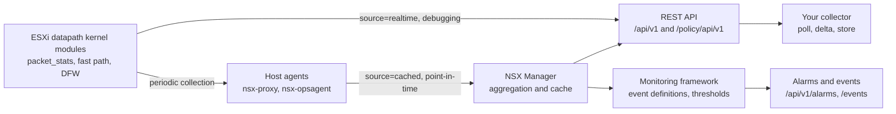
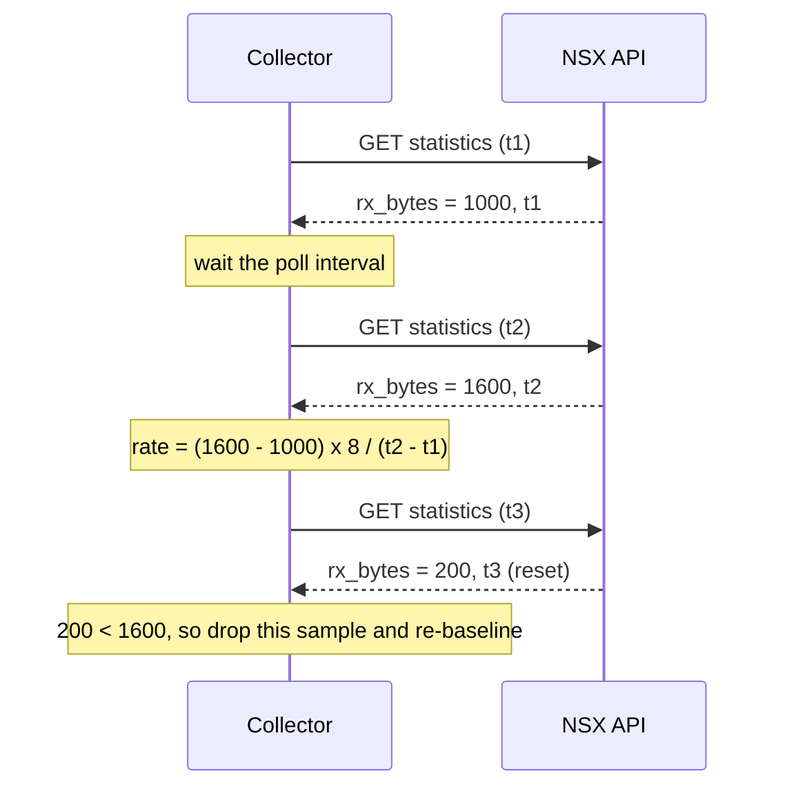
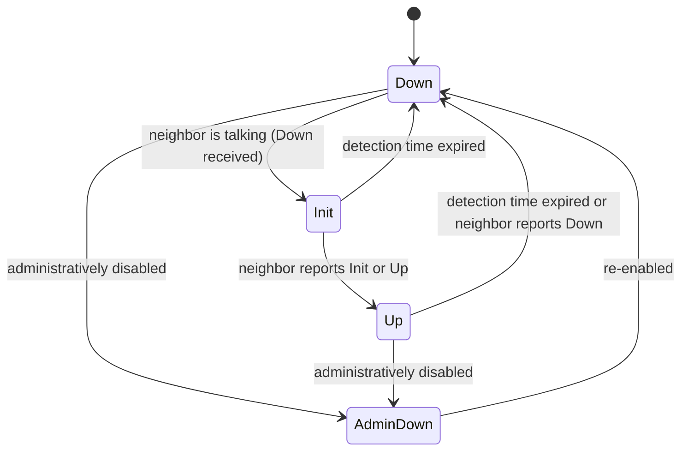
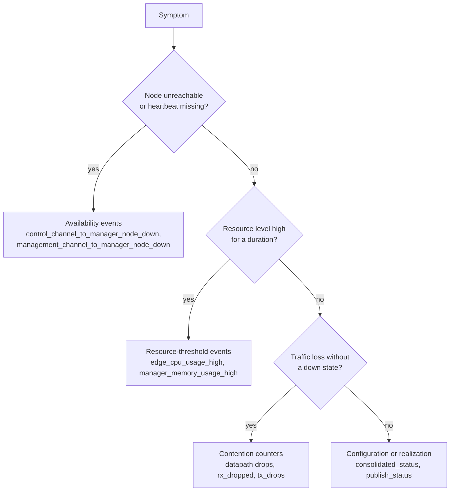

# NSX metrics: formulas, conventions and open questions

Level 400 reference for the metrics that NSX exposes through its REST API, with the formula to turn each one into a number you can alert on.

- Lab: `nsxman1.liljestig.com`, NSX **9.1.1.0**, single Local Manager, 3 ESXi host transport nodes, no Edge, no segments, no gateways. Crawl: 2026-10-19.
- Field dictionary: [`data/nsx-metric-fields.csv`](data/nsx-metric-fields.csv) (19,585 rows: endpoint × field, with category, formula hint and lab flag).
- Companion guides: [Contention](NSX-Contention-Metrics.md) · [Consumption](NSX-Consumption-Metrics.md) · [Capacity](NSX-Capacity-Metrics.md) · [Availability and events](NSX-Availability-Metrics-and-Events.md)
- Endpoint inventory: [`nsx-metric-endpoint-catalog.md`](nsx-metric-endpoint-catalog.md) · crawl method: [`NSX-Metrics-and-Properties.md`](NSX-Metrics-and-Properties.md)

**Evidence labels.** Every formula is tagged so you can see how far to trust it.

| Tag | Meaning |
|---|---|
| **[Lab]** | Checked by arithmetic on values returned by the lab on 2026-10-19 |
| **[Doc]** | Stated in Broadcom/VMware API schema or product text (sources in section 9) |
| **[Derived]** | My formula built from named fields. NSX does not state it. |
| **[Open]** | Not confirmed. Listed in the doubts log (section 8) for your review |

---

## 1. How the numbers are produced

Points that change how you read a value:

1. **Two sources.** `source=cached` (default) returns the last collected point-in-time value. `source=realtime` reads the datapath directly and is meant for debugging. The spec defines the parameter as `realtime | cached` ([Lab]: policy spec, route-controller state). Broadcom's text says point-in-time values are collected periodically and cached, with a default collection interval of 300 s, and that realtime values come straight from the host kernel modules ([Doc, search summary]). The lab README says the cached value refreshes "about every minute". **These two statements disagree, and I have not settled it. See D1.**
2. **Aggregation lag.** Per-rule DFW statistics are gathered on each host and aggregated by the manager. The aggregated values can be stale. Max-type rule aggregates may lag up to 15 minutes ([Doc]).
3. **Counters reset on restart.** Interface, Edge dataplane and flow-cache counters count from the node's uptime or dataplane start. They reset on reboot or dataplane restart ([Doc]).

---

## 2. Metric types and how to turn each into a number

| Type | What it looks like | Example field | Formula |
|---|---|---|---|
| **Cumulative counter** | Only goes up until a reset | `rx_bytes`, `rx_dropped`, `hit_count` | rate = (v₂ − v₁) ÷ (t₂ − t₁). If v₂ < v₁, a reset happened: drop that sample. |
| **NSX rate** | Already per second | `packet_stats.*_pps`, `pnic_rxmbps`, `fastpath_flow_miss_pps` | Use as is. The averaging window is set by NSX, not stated in the schema. |
| **Gauge** | Point-in-time level | `mem_used`, `load_average[]`, `file_systems[].used` | Use as is, or divide by a total for a percentage |
| **Utilisation percent** | NSX-computed percentage | `capacity_usage[].current_usage_percentage` | Use as is. Lab-verified formula in section 4.6. |
| **Enumerated state** | Fixed vocabulary | `tunnel_status.status`, `consolidated_status` | Alert on transitions. Count how many objects are in each state. |
| **State counts** | Number of objects per state | `tunnel_status.up_count`, `down_count`, `degraded_count` | Availability ratio = up ÷ (up + down + degraded + unknown) |
| **Event** | Threshold crossed for a duration | `edge_cpu_usage_high` | Do not recompute. Consume the alarm. Event semantics in section 4.8. |
| **Timestamp** | Epoch milliseconds | `packet_stats.last_update_timestamp`, `system_time` | Δt between samples, and staleness = now − timestamp |

**Conventions the lab confirms**

- **Epoch milliseconds.** `system_time` = 1792384339000 converts to 2026-10-19 04:32 UTC, the crawl date ([Lab]).
- **Uptime in milliseconds.** `uptime` = 1178250000 would be 37 years if it were seconds, so it is milliseconds ([Lab, plausibility]). The schema does not state the unit.
- **Memory in kilobytes.** `mem_total` is documented in kilobytes ([Doc, NodeStatusProperties]). 24,599,336 KB ≈ 23.5 GiB, which fits a medium manager.
- **Counts can be strings.** IP block `used_ips_count` and `available_ips_count` come back as JSON strings, not numbers ([Lab]). Cast before you compare.
- **Two severity vocabularies.** Alarms use `CRITICAL / HIGH / MEDIUM / LOW`. Health objects and pools use `GREEN / ORANGE / RED`. Capacity uses `INFO`. Lab data also contains `SUSPICIOUS` and `WARNING`. Do not map one onto another without a table.

---

## 3. Calculation pattern for counters

Use the NSX timestamp when one exists (`packet_stats.last_update_timestamp`). Otherwise use your own poll time, and accept the jitter.

---

## 4. Formulas by object type

### 4.1 NSX Manager node (`/api/v1/node/status`, `/cluster/nodes/{id}/status`)

| Metric | Formula | Lab value | Basis |
|---|---|---|---|
| Memory used % | `mem_used ÷ mem_total × 100` | 20,260,176 ÷ 24,599,336 = **82.4%** | **[Lab]** `mem_used = mem_total − mem_available` holds exactly (24,599,336 − 4,339,160 = 20,260,176). The schema says the same ([Doc]). |
| Memory available % | `mem_available ÷ mem_total × 100` | 17.6% | [Derived] |
| Load per core | `load_average[0] ÷ cpu_cores` | 1.27 ÷ 6 = **0.21** | [Derived]. `load_average` holds 1, 5 and 15-minute values ([Doc]). |
| Partition used % | `file_systems[].used ÷ file_systems[].total × 100` | per partition | [Derived]. The disk alarms use the same idea ([Lab] event definitions). |
| Interface throughput | `Δ rx_bytes × 8 ÷ Δt` | not computable from one sample | [Derived] |

The memory alarm compares usage to a **high threshold of 90%** and a **very high threshold of 95%**. The lab node at 82.4% is below the high threshold and has no memory alarm. That matches, but it does not prove, that the alarm uses the same formula. See D4.

### 4.2 Host transport node, ESXi (`/infra/sites/…/host-transport-nodes/{id}/status`, `…/statistics/monitor`, `…/statistics/debug`)

| Metric | Formula | Lab value | Basis |
|---|---|---|---|
| Host memory used % | `node_status.system_status.mem_used ÷ mem_total × 100` | 234,112,624 ÷ 536,552,284 = **43.6%** | [Derived], same convention as 4.1 |
| Host load per core | `load_average[0] ÷ cpu_cores` | 0.5 ÷ 56 = **0.009** | [Derived] |
| Datapath drop rate | `packet_stats.datapath_total_packet_drops_pps` | **5.46 pps** | [Lab]. The name says "pps", so it is an NSX rate. |
| Flow-cache hit ratio | `fastpath_flow_hit_pps ÷ (fastpath_flow_hit_pps + fastpath_flow_miss_pps) × 100` | 37,524.9 ÷ 37,745.8 = **99.41%** | [Derived]. The field names are clear, but the definition is not in any document I found ([Open], D8). |
| Slow-path-only rate | `fastpath_slowpath_only_pps` | **22.2 pps** | [Lab] |
| pNIC throughput | `pnic_rxmbps`, `pnic_txmbps` | 53.8 and 118.2 Mb/s | [Lab] |
| pNIC utilisation % | `(pnic_rxmbps + pnic_txmbps) ÷ link speed × 100` | needs link speed | **[Open]**. Link speed is not in the response that I found (D6). |
| vNIC throughput | `vnic_rxmbps`, `vnic_txmbps` | 10.5 and 11.1 Mb/s | [Lab] |
| Tunnel availability % | `bfd_up_count ÷ (bfd_up + bfd_down + bfd_init + bfd_admin_down) × 100` | all four counts are 0 | [Derived], but see D9. The status says UP while every BFD count is 0. |
| Agent health | `agent_status.up_count ÷ (up + down + degraded)` | 17 up, 0 down | [Derived] |
| Control connection | `control_connection_status.status` | UP | [Lab] |

**Packet-processing efficiency.** `packet_processing_efficiency_watch` is a group of rate fields. Its name suggests the NSX team uses it to watch fast-path health. I found no public definition ([Open], D8).

**Drop counters on the lab host.** `hostswitch_network_mismatch_packet_drops` = **4,053,653** and `vlan_tag_mismatch_tx_mcast` = **4,054,351**. Both are cumulative since the host or datapath started, so they are not rates. They are of the same order, which suggests one cause. Take two samples to get a rate before you chase a root cause ([Lab]).

**Status roll-up.** Broadcom's summary says the overall `status` combines the pNIC, management, control and tunnel statuses, with values `UP / DOWN / DEGRADED / UNKNOWN` ([Doc, search summary]). The exact combination rules are not in the pages I read ([Open], D9). Enumerations observed in the lab for these fields: `UP` for `tunnel_status`, `pnic_status`, `control_connection_status`, `mgmt_connection_status` and `mpa_connectivity_status` ([Lab]).

### 4.3 Transport node interfaces (`…/network/interfaces/{if}/stats`)

| Metric | Formula | Basis |
|---|---|---|
| RX bit rate | `(rx_bytes₂ − rx_bytes₁) × 8 ÷ Δt` | [Derived] on [Doc] cumulative counters |
| TX bit rate | `(tx_bytes₂ − tx_bytes₁) × 8 ÷ Δt` | [Derived] |
| RX error ratio | `Δrx_errors ÷ Δrx_packets` | [Derived] |
| RX drop ratio | `Δrx_dropped ÷ Δrx_packets` | [Derived]. `rx_dropped` = "total packets dropped since the uptime" ([Doc]). |
| TX carrier loss | `tx_carrier` | [Doc]: "total packets for carrier losses detected on transmit", host transport nodes only |

Lab sample for `vmnic0`: 0 RX errors, 0 RX drops, 0 TX drops, 0 TX errors. Counters total 299.6 GB received and 427.8 GB sent since boot ([Lab]).

### 4.4 DFW rules and policy statistics (`…/security-policies/{id}/rules/{rule}/statistics`)

| Field | Meaning | Basis |
|---|---|---|
| `packet_count`, `byte_count` | Total packets and bytes that matched the rule | [Doc] |
| `hit_count` | Stateful rule: connection states created when the rule matched. Stateless rule: packets. | [Doc] |
| `session_count` | Stateful rule: sessions created. Stateless rule: equals `packet_count`. | [Doc] |
| `popularity_index` | `session_count ÷ age of the rule` | [Doc]. The **unit of age is not stated** (D11). |
| New-session rate | `Δsession_count ÷ Δt` | [Derived] |
| Max and total aggregates | `max_session_count`, `max_popularity_index`, `total_session_count` | [Doc]: lag up to 15 min |

Broadcom's knowledge base reports that a zero `hit_count` through the API can disagree with logs. Check host logs before you delete a low-hit rule ([Doc, KB summary]). Lab rules show zero hits, so the lab cannot test this.

### 4.5 Edge transport node (no Edge in the lab, so documented only)

| Metric | Formula | Basis |
|---|---|---|
| Datapath CPU per core | Schema: "per CPU core for the last 100 ms" for packet rates, and CPU "sampled within the last 60 seconds" | [Doc, EdgeDataplaneCpuStats]. **The CPU % formula is not stated** (D5). |
| Flow-cache hit ratio | `hits ÷ (hits + misses) × 100` | [Derived]. NSX defines hits as packets forwarded from a matching cache entry. Misses are not defined beyond that. Bucket collisions count as misses in the mega cache ([Doc, FlowCacheStatistics]). |
| Flow-cache capacity | default 256K entries per cache, minimum 8 | [Doc, tuning guide] |

Counters reset on Edge reboot or dataplane restart ([Doc]).

### 4.6 Capacity dashboard, limits and IP blocks

| Metric | Formula | Lab value | Basis |
|---|---|---|---|
| Object usage % | `current_usage_count ÷ max_supported_count × 100` | 415 ÷ 850 = **48.82%** | **[Lab]**: the response's `current_usage_percentage` is 48.82 |
| Severity | **INFO** at 48.8%, **WARNING** at 100%. Global minimum 70%, maximum 100%. | 48.82 → INFO; 100 → WARNING | [Lab]. What happens between 70% and 100% is [Open] (D18). |
| IP block used % | `used_ips_count ÷ overall_ips_count × 100` (cast the strings to integers) | 0 ÷ 65,536 = **0%** | [Derived] on [Lab] |
| Transport node health % | `up_count ÷ (up + down + degraded + unknown) × 100` | not in lab summary | [Derived] |

### 4.7 Realization status

| Field | Values | Basis |
|---|---|---|
| `consolidated_status` | `ConfigState` enum. The values are **not retrieved** ([Open], D2). | [Doc] |
| `publish_status` | Broadcom 4.2 lists `UNAVAILABLE, UNREALIZED, REALIZED, ERROR` ([Doc]). The lab returned **`UNINITIALIZED`** ([Lab], D2). | |
| Realization lag | `time(REALIZED) − time(intent change)` | [Derived]. No change timestamps were verified. |

`REALIZED` and `SUCCESS` appear in the lab as `state` values ([Lab]).

### 4.8 Event thresholds (`/api/v1/events` definitions)

Each event definition carries `threshold`, `is_threshold_fixed`, `sensitivity`, `severity`, and a description. The description states the duration, for example "at or above the high threshold value of 90 for at least two minutes" ([Lab]). Two examples from the lab metadata:

| Event | Threshold | Fixed | Sensitivity | Severity |
|---|---|---|---|---|
| `manager_memory_usage_high` | 90 | no | 80 | MEDIUM |
| `manager_memory_usage_very_high` | 95 | no | 80 | CRITICAL |
| `manager_cpu_usage_high` | 90 | no | 80 | MEDIUM |
| `edge_cpu_usage_high` | 80 | no | 100 | MEDIUM |
| `edge_datapath_cpu_very_high` | 95 | no | 100 | CRITICAL |
| `network_latency_high` | 150 ms | yes | 100 | MEDIUM |
| `edge_nic_out_of_receive_buffer` | 2 % | yes | 100 | MEDIUM |

The full table is in the [resource-threshold events](NSX-Availability-Metrics-and-Events.md#resource-threshold-events) section. I could not find the meaning of `sensitivity` in the sources I read. It is shown exactly as NSX returns it (D3).

### 4.9 BFD sessions and tunnel state

The BFD diagnostic codes in the host `tunnel_status.bfd_diagnostic` object are the RFC 5880 codes ([Doc, RFC 5880 §4.1]):

| Code | Name | Counter in NSX |
|---|---|---|
| 0 | No Diagnostic | `no_diagnostic_count` |
| 1 | Control Detection Time Expired | `control_detection_time_expired_count` |
| 2 | Echo Function Failed | `echo_function_failed_count` |
| 3 | Neighbor Signaled Session Down | `neighbor_signaled_session_down_count` |
| 4 | Forwarding Plane Reset | `forwarding_plane_reset_count` |
| 5 | Path Down | `path_down_count` |
| 6 | Concatenated Path Down | `concatenated_path_down_count` |
| 7 | Administratively Down | `administratively_down_count` |
| 8 | Reverse Concatenated Path Down | `reverse_concatenated_path_down_count` |

RFC 5880 defines the session states and the detection time:

*Simplified from RFC 5880 §6.2 ([Doc]). The **detection time** is the period with no BFD packets after which the session is declared failed (§6.8.4).*

**Pairing a tunnel alert with its cause.** For a `tunnel_status.status` of DEGRADED, read `bfd_diagnostic` first. A non-zero `control_detection_time_expired_count` means packets stopped arriving. A non-zero `path_down_count` means the path failed beyond the local host. A non-zero `administratively_down_count` means someone turned the session off on purpose.

---

## 5. Worked examples from the lab

1. **Manager memory.** `mem_used` 20,260,176 KB ÷ `mem_total` 24,599,336 KB = 82.4%. Below the 90% high threshold, so no alarm. ✓ [Lab]
2. **Capacity.** Services: 415 of 850 = 48.82%. Below the 70% minimum threshold, so INFO. ✓ [Lab]
3. **Flow-cache health.** 37,524.9 pps hits and 220.9 pps misses give a 99.41% hit ratio. Healthy. ✓ [Derived]
4. **Interface rate.** Needs two samples. One sample of `vmnic0` gives only totals. Formula in 4.3. [Derived]
5. **Datapath drops.** `datapath_total_packet_drops_pps` = 5.46 pps right now. The cumulative network-mismatch counter is about 4.05 million. Only the rate tells you whether the problem is active. [Lab]

---

## 6. Recommended polling rules

| Data | Poll | Why |
|---|---|---|
| `…/statistics/monitor` (host) | Every 1 to 5 min, `source=cached` | Already NSX rates and levels |
| `…/statistics/debug` (host) | Only when investigating | Large and detailed. The crawler marks it as `property` (see the note below). |
| Interface counters | Every 1 to 5 min, compute deltas | Cumulative |
| `/alarms` and `/events` | Every 1 min, or subscribe | Event-driven availability |
| Inventory (`/infra/…` lists) | Daily | Expensive and changes slowly |

**Crawler defect.** `tools/nsx_crawl.py` decides metric or property from the **last path segment only** (`kind_of`, line 55–57). `statistics/monitor` and `statistics/debug` end in `monitor` and `debug`, so they are labelled `property` in `endpoints.csv`, and the catalog left them out. This guide found them through the spec. Fix: test for a `/statistics/` segment, not only the last segment. I have not changed the crawler.

---

## 7. Diagram: which alarm to use for which symptom

---

## 8. Open questions

The open questions (D1 to D18) are kept in one place: [NSX-Open-Questions.md](NSX-Open-Questions.md). Each item says what it affects, what is assumed until it is settled, and who can settle it.

## 9. Sources

- Broadcom developer portal, NSX-T Data Center REST API, schemas: `FpCounters` (4.2), `NodeInterfaceStatisticsProperties` (9.0.0), `NodeStatusProperties` (4.2), `RuleStatistics` (4.2), `EdgeDataplaneCpuStats` (9.0.0), `FlowCacheStatistics` (9.0.0), `ConsolidatedStatus` (9.0.0), `ConsolidatedRealizedStatus` (4.2), `TransportNodeStatus` and remote-status list pages.
- Broadcom NSX CLI guide: `HostShowTnHealthMetricsModulesList`.
- Broadcom knowledge base: 412847 (rule statistics), 409357 (retrieving rule statistics via API), 401552 (hit count discrepancies), 319083 (Edge flow cache), 327401 (micro flow-cache alarm), 440105 (Edge datapath CPU), 435065 and 409965 (degraded transport nodes), 375204 and 375215 (manager memory alarms).
- VMware NSX 4.2 administration guide, host transport node statistics (GUID-CDA0495E and GUID-90825C2B).
- IETF RFC 5880, Bidirectional Forwarding Detection (BFD), §4.1 and §6.2.
- Lab evidence: `output/nsxman1-run1/` (local only, git-ignored), 2026-10-19 crawl.

*Where a search summary was my only source, the text says so. I did not open every page in full.*
